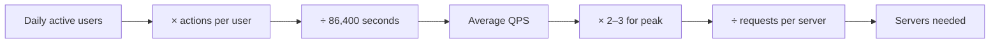

Back-of-the-envelope estimation means working out, in a couple of minutes and with round numbers, how big a system needs to be. The goal is not precision. The goal is to know the **order of magnitude**: is this 10 requests per second or 100,000? 50 GB or 5 PB? The answer decides whether you need one database or a sharded cluster.

## The numbers to keep in your head

> [!REAL] Why rough numbers are enough
> A contractor quoting for your house doesn't count bricks; they know "about 8 bricks per square foot" and multiply. Engineers do the same: knowing that one server handles ~5,000 simple requests per second tells you a 50,000 RPS system needs about 10–20 servers.

### Time
- 1 day ≈ 86,400 seconds. Round it to **100,000 (10⁵)**. This one shortcut makes most estimates trivial.
- 1 month ≈ 2.5 million seconds. 1 year ≈ 30 million seconds.

### Powers of two and ten

| Unit | Bytes | Rough meaning |
|---|---|---|
| 1 KB | 10³ | a short text message with metadata |
| 1 MB | 10⁶ | a compressed photo |
| 1 GB | 10⁹ | an hour of SD video |
| 1 TB | 10¹² | fits on one disk |
| 1 PB | 10¹⁵ | needs a fleet of machines |

### Typical sizes
- A tweet-like post with metadata: ~1 KB
- A user profile row: ~1 KB
- A compressed image: 200 KB – 2 MB
- One minute of 1080p video: ~50–100 MB raw upload, ~10 MB after encoding per rendition

### What one machine can do (rough, modern hardware)
- A web/app server: 1,000 – 10,000 simple requests per second
- A relational database: a few thousand to ~10,000 writes per second, more reads with good indexes
- Redis: ~100,000 operations per second per node
- A single commodity disk: ~200 MB/s sequential; an SSD several times more

These vary a lot, but they are good enough to decide how many machines you need.

## The method

1. **Start from users.** Daily active users (DAU) and what an average user does per day.
2. **Convert to per second.** Divide daily totals by 10⁵.
3. **Find the peak.** Multiply the average by 2–3× (more for spiky products like ticketing).
4. **Split reads and writes.** Most products are read-heavy; state the ratio.
5. **Estimate storage.** Writes per day × size × retention period, times the replication factor.
6. **Estimate bandwidth.** Requests per second × response size.
7. **Sanity-check.** Does the answer imply a sensible number of machines?

> [!REAL] Estimating chai sales at a railway station
> How much chai does Pune station sell a day? About 2 lakh passengers × 1 in 4 buys chai ≈ 50,000 cups. That's the same chain as DAU × actions per user ÷ 86,400 seconds = requests per second. Wrong by 2×? Fine. Wrong by 100×? Then the design is wrong.



## Worked example: a photo-sharing app

Assumptions, stated aloud:
- 100 million DAU
- Each user views 50 photos per day and uploads 0.1 photos per day (one every ten days)
- Average photo after compression: 500 KB
- Keep photos forever; plan for 5 years

**Traffic**
- Views: 100M × 50 = 5 billion per day → 5×10⁹ / 10⁵ = **50,000 reads/s** on average, **~150,000/s** at peak
- Uploads: 100M × 0.1 = 10 million per day → **100 writes/s** average, ~300/s peak
- Read:write ratio ≈ 500:1, so this is overwhelmingly read-heavy → caching and a CDN are essential

**Storage**
- 10M photos/day × 500 KB = 5 TB per day
- Per year: 5 TB × 365 ≈ 1.8 PB; five years ≈ **9 PB**, before replication
- With 3× replication, ~27 PB → object storage (S3-style), not a database

**Metadata**
- 10M rows/day × 1 KB = 10 GB/day → 3.6 TB/year. That outgrows a single comfortable database within a few years, so plan to shard metadata by user ID.

**Bandwidth**
- Egress: 50,000 reads/s × 500 KB = 25 GB/s average. No origin should serve that directly; a CDN absorbs most of it.

In two minutes you have learned that the design needs object storage, a CDN, heavy caching and eventually sharded metadata. That is exactly what estimation is for.

> [!TIP] Say your assumptions out loud
> The interviewer cares far more about your reasoning than your arithmetic. "Let's assume 100 million daily users, each viewing about 50 photos" invites them to correct you if they had different numbers in mind.

> [!REAL] Instagram for real
> Instagram has reported around 100 million photos and videos uploaded per day. At ~2 MB each that's ~200 TB of new media every day, which is why media goes to object storage plus a CDN and never into a relational database.

## Capacity planning in real life

Estimation in an interview is the first step of real capacity planning:

- **Headroom.** Run servers at 50–70% of capacity at peak, not 100%. Latency climbs sharply as utilisation approaches the limit, and you need spare room for a failed node's traffic.
- **N+1 or N+2.** If you need N machines for peak load, run at least N+1 so one can fail or be patched.
- **Growth.** Plan for the next 12–18 months, not today. Re-estimate as real numbers come in.
- **Measure, then model.** Load-test one server to find its real ceiling instead of trusting rules of thumb.

> [!REAL] IRCTC Tatkal at 10 a.m.
> IRCTC doesn't plan for the average day. It plans for 10:00 a.m., when Tatkal booking opens and traffic jumps many times above normal within seconds. Real capacity plans size for the peak plus headroom, not the daily average.

### Quick server-count formula

```text
servers = peak RPS / (RPS one server handles × target utilisation)

e.g. 150,000 / (5,000 × 0.6) = 50 app servers, + spares → ~55
```

## Mistakes to avoid

- **False precision.** "We need 47.3 servers" sounds like you missed the point. "About 50" is better.
- **Forgetting the peak.** Systems fall over at peak, not at average.
- **Forgetting replication and indexes.** Raw data × 3 for replicas, plus 20–50% for indexes and overhead.
- **Spending ten minutes on it.** Estimation supports the design; it is not the design.

## Key takeaways

- 1 day ≈ 10⁵ seconds; use it to turn daily numbers into per-second numbers.
- Always derive peak, read/write ratio, storage over time and bandwidth.
- Let the numbers drive the architecture: the photo example points straight to a CDN, object storage and sharding.
- State assumptions, round aggressively, move on.
