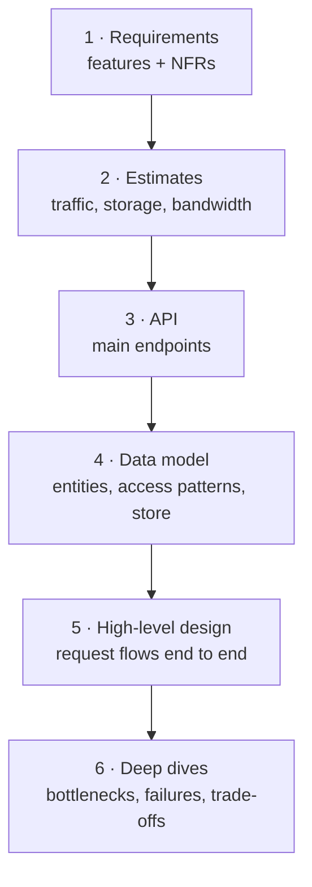
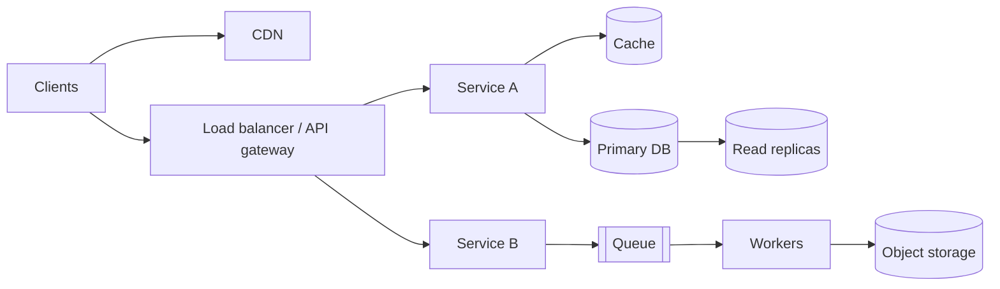

Interviewers can tell within ten minutes whether a candidate has a method. A method keeps you calm, makes sure you cover what is graded and leaves time for the deep dives where seniority shows. Here is one that works for almost any "design X" question.

## The six steps



### Step 1: Requirements (5–8 minutes)
Ask questions until the problem is concrete.
- **Functional:** the three to five core features. Say out loud what you are leaving out.
- **Non-functional:** scale, latency, availability, consistency, durability.

Write the agreed list in a corner of the board. You will refer back to it.

### Step 2: Estimates (3–5 minutes)
DAU → requests per second (average and peak) → read/write ratio → storage per year → bandwidth. Then **say what the numbers imply**: "50K reads a second at a 100:1 ratio means caching is central; 5 TB a day means object storage, not a database." See [Back-of-the-Envelope Estimation](#/l/01-fundamentals/back-of-the-envelope).

### Step 3: API (3–5 minutes)
Define the main endpoints. This forces you to pin down inputs and outputs.

```http
POST /v1/urls            { longUrl, customAlias?, expiresAt? } → { shortCode }
GET  /{shortCode}        → 301/302 redirect
GET  /v1/urls/{code}/stats → { clicks, byCountry, ... }
```

Mention pagination (cursor-based for feeds), idempotency keys for anything that creates or charges, and authentication.

### Step 4: Data model (3–5 minutes)
List the core entities and, more importantly, **how they are queried**. The access pattern picks the database:

- Need joins, transactions, flexible queries? Relational.
- Huge write volume, always queried by one key and a time range? Wide-column.
- Simple lookups by key at enormous scale? Key-value.
- Relationship traversal ("friends of friends")? Graph.

### Step 5: High-level design (10–15 minutes)
Draw the boxes and walk through each core use case as a request flowing through them.



Narrate as you draw: "A write goes through the gateway to the post service, which stores the row in the database and publishes an event to the queue; the fan-out workers consume it…"

Keep this first version simple. It should work for the stated scale, not for a hypothetical billion users.

### Step 6: Deep dives (15–20 minutes)
Now improve the design where it matters. Either the interviewer chooses, or you propose: "The two hardest parts are fan-out for celebrity accounts and keeping counters accurate. Shall I start with fan-out?"

Typical deep-dive themes:
- **Scaling the bottleneck:** sharding the hot table, caching the hot read path.
- **Hot spots:** celebrity users, viral content, flash sales.
- **Consistency:** what happens with concurrent updates? Do we need transactions, locks or idempotency?
- **Failure:** what if this service, this database or this whole region goes down?
- **Data growth:** retention, archiving, tiered storage.

For each one, present **options and a choice**: "We could fan out on write or on read. Fan-out on write makes reads cheap but is terrible for accounts with 50M followers, so I'll use a hybrid…"

### Wrap-up (2–3 minutes)
Summarise the design in a few sentences, name the remaining risks, and say what you would add next: monitoring, alerting, a multi-region setup, analytics.

## Habits that lift your score

- **Think aloud.** Silence is unscorable.
- **Check in.** "Does this level of detail work, or would you like me to go deeper here?"
- **Start simple, then evolve.** A working simple design you improve is better than a complex one you cannot explain.
- **Use numbers.** "A Redis node handles ~100K ops/s, so three shards give us headroom for the 150K peak."
- **Always give a reason and an alternative.** That is what "trade-off discussion" means.
- **Watch the clock.** If you are 25 minutes in and still on requirements, move.

> [!WARNING] The interviewer's hints are not interruptions
> When they ask "what happens if that cache goes down?", they are steering you towards something they want to grade. Follow the hint.

## A template you can sketch in the first minute

```text
REQUIREMENTS            ESTIMATES
- F1 ...                - DAU, RPS avg/peak
- F2 ...                - R:W ratio
- NFR: latency, avail.  - storage / year
---------------------------------------------
API                     DATA MODEL
---------------------------------------------
HIGH-LEVEL DIAGRAM
---------------------------------------------
DEEP DIVES / TRADE-OFFS / RISKS
```

## Key takeaways

- Requirements → estimates → API → data model → high-level design → deep dives.
- Let the numbers and access patterns justify every component.
- Keep the first diagram simple, then improve it where the interviewer points.
- Spend the most time on deep dives; that is where the hire/no-hire decision is made.
