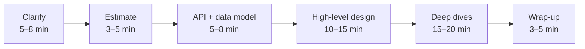

A system design interview is a 45–60 minute conversation in which you and the interviewer build a large system together on a whiteboard. There is no single correct answer. What is being graded is **how you think**: how you clarify a vague problem, how you break it down, which trade-offs you notice and how clearly you explain them.

## Why companies run this round

Coding rounds show that you can write a correct function. They say nothing about whether you can build something that serves ten million people, survives a data centre outage and still costs a sensible amount of money. The design round fills that gap. It approximates the conversation a senior engineer has before writing any code: *what are we building, how big will it get, and what could go wrong?*

That is why the round carries more weight as you get more senior. For a junior role the interviewer wants to see that you know the building blocks. For a senior role they want to see you **drive** the conversation, make decisions and defend them.

> [!REAL] Coding vs building
> Knowing how to lay one brick perfectly (a coding round) doesn't mean you can plan a building that stands in an earthquake. The system design round checks whether you can plan the building.

## What the interviewer is actually scoring

Most companies use a rubric that boils down to four or five signals:

| Signal | What it looks like when you do it well |
|---|---|
| **Problem exploration** | You ask about users, scale and the most important features before drawing anything. |
| **High-level design** | You produce a clean diagram of clients, services, data stores and the flow of a request. |
| **Technical depth** | When asked "how does that part work?", you can go a level deeper: indexes, partitions, consistency, failure handling. |
| **Trade-offs** | You name at least two options for important choices and explain why you picked one. |
| **Communication** | You think aloud, check in with the interviewer and keep the design readable. |

Notice what is *not* on the list: memorising how a specific company built their product. Knowing that a famous app uses a particular database earns very little. Explaining *why* a write-heavy, append-only workload suits a wide-column store earns a lot.

> [!INTERVIEW] The one-line summary
> The interviewer is asking: "Would I trust this person to lead the design of a new service on my team?"

> [!REAL] Like a driving test
> A driving examiner isn't checking that you reach the destination; they watch how you check mirrors, signal and handle surprises. Interviewers score your process (clarifying, trade-offs, communication) more than the final diagram.

## How the hour usually goes

1. **Clarify.** Turn "design Instagram" into a concrete list of features and numbers.
2. **Estimate.** Rough traffic, storage and bandwidth, enough to know whether this is a one-server problem or a thousand-server problem.
3. **API and data model.** The main endpoints and the core entities.
4. **High-level design.** Boxes and arrows that handle the main use cases end to end.
5. **Deep dives.** The interviewer picks the interesting parts, or you propose them: the feed, the hot partition, the payment that must never be charged twice.
6. **Wrap-up.** Bottlenecks, failure modes, what you would build next.

The full method is in [A Framework for Any Design Question](#/l/01-fundamentals/interview-framework).

## Common ways candidates fail

- **Jumping straight to the diagram.** Drawing Kafka and Redis in minute two, before anyone knows what the system does, signals pattern-matching instead of thinking.
- **Designing for infinite scale by default.** Sharding a database that will hold 50 GB is not impressive; it is over-engineering. Size the system first, then pick the design.
- **Name-dropping without reasons.** "We'll use Cassandra" is a weak answer. "Writes outnumber reads 10:1 and we only ever query by user and time, so a wide-column store partitioned by user fits" is a strong one.
- **Going silent.** The interviewer cannot grade thinking they cannot hear.
- **Defending a choice to the death.** When the interviewer pushes back, they are often testing whether you can weigh new information. "Good point, that changes things. If writes are that bursty, I'd put a queue in front…" is a great answer.
- **Running out of time on the easy parts.** Spending 25 minutes on the login flow leaves nothing for the interesting problems.

> [!REAL] Building a mall for a tea stall
> The classic failure is designing Kafka, 12 microservices and multi-region replication for a system with 1,000 users. That's building a shopping mall to sell chai. Match the design to the numbers.

## How to prepare

1. **Learn the building blocks** in the first chapters of this course: load balancers, caches, databases, queues, CDNs. For each, know what problem it solves and what it costs.
2. **Learn the trade-offs.** Chapter 9 is entirely about the pairs you will be asked to choose between.
3. **Practise end-to-end designs** out loud, against a timer. Reading a solution is not the same as producing one.
4. **Collect numbers.** Know roughly how fast a disk seek is, how many requests one server handles and how big a typical image is. Estimates make your design concrete.
5. **Do mock interviews.** Explaining a design to another person exposes gaps that reading never will.

> [!TIP]
> When you study any real product, ask three questions: what is its read/write ratio, what must be strongly consistent, and what can be stale? Those three answers drive most of the design.

## Key takeaways

- The round tests judgement and communication, not memorised architectures.
- Clarify and size the problem before you draw it.
- Every important choice needs a reason and an alternative you rejected.
- Leave time for deep dives; that is where seniority shows.
