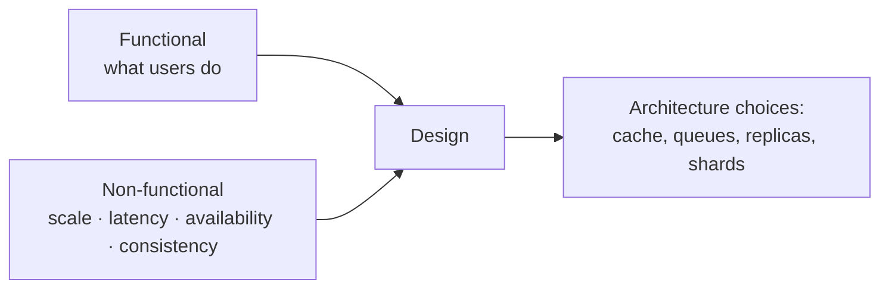

Every design starts by agreeing on what you are building. Requirements come in two kinds, and both shape the architecture, but the second kind usually shapes it more.

## Functional requirements: what the system does

Functional requirements are the features: the things a user can do. They are usually phrased as "users can…".

For a URL shortener:
- Users can submit a long URL and get a short one back.
- Visiting the short URL redirects to the long one.
- Users can optionally choose a custom alias.
- Links can have an expiry date.

For a chat app:
- Users can send one-to-one messages.
- Users can create groups of up to 500 people.
- Users see when a message was delivered and read.
- Users see whether a contact is online.

> [!REAL] Zomato in one line each
> "Users can search restaurants", "users can place an order", "users can track the rider live", "restaurants can mark food ready". Each is a verb the user does. Reviews, offers and Zomato Gold get parked for later.

### Keep the list short
An interview has 45 minutes. Pick the **three to five** features that define the product and explicitly park the rest:

> "I'll focus on sending messages, group chat and delivery receipts. I'll leave out voice calls, payments and stories unless you'd like me to cover them."

This shows judgement, and it gives you time to go deep.

## Non-functional requirements: how well it does it

Non-functional requirements (NFRs) are the qualities: speed, scale, availability, consistency, security, cost. They rarely appear in a product spec, yet they decide almost every architectural choice.

| Quality | Question to ask | Example answer |
|---|---|---|
| **Scale** | How many users, requests, how much data? | 500M DAU, 50K writes/s |
| **Latency** | How fast must the core action feel? | Redirect in under 50 ms p99 |
| **Availability** | Can it ever go down? | 99.99%; redirects must keep working |
| **Consistency** | Can users see stale data? | Feed can lag seconds; balance cannot |
| **Durability** | Can we ever lose data? | Never lose a message once acknowledged |
| **Security & privacy** | Who can see what? Any regulations? | End-to-end encryption; GDPR deletion |
| **Cost** | Is there a budget constraint? | Storage cost dominates; tier old data |
| **Read/write pattern** | Read-heavy or write-heavy? | 100:1 read-heavy |

> [!REAL] Same features, different promises
> A cricket score app and a stock trading app both "show a number that changes". The score app can be a few seconds late; the trading app must be accurate to the millisecond and never show a wrong price. The features are the same; the NFRs make them completely different systems.

## How NFRs change the design

The same feature list leads to very different systems depending on the NFRs.

**"Users can see their account balance"**
- If it must be exact and up to date: read from the primary database, strong consistency, no caching of the balance.
- If a few seconds of lag is fine: read from a replica or cache, much cheaper at scale.

**"Users can upload videos"**
- At 100 uploads a day: one server writing to object storage is fine.
- At 500 hours of video per minute: resumable chunked uploads, a distributed transcoding pipeline, a CDN.

**"Users can post comments"**
- 99.9% availability: one region with replicas.
- 99.99% availability across regional failures: multi-region, which forces you to deal with replication lag and conflicts.

> [!INTERVIEW] Name the tension
> Strong interviews spot where NFRs pull against each other. "We want low latency globally *and* strong consistency on bookings. Those conflict across regions, so I'll keep bookings strongly consistent in one home region per property and accept higher latency there, while search can be served from local, eventually consistent replicas."

> [!REAL] Two chat apps
> WhatsApp must deliver every message exactly in order and never lose one, so it stores messages until they're acknowledged. A Twitch live chat with 100,000 viewers can drop messages under load, because no one reads them all anyway. Same feature, opposite designs.

## Turning vague words into numbers

"Fast", "scalable" and "highly available" mean nothing until they have numbers.

- "Fast" → "p99 under 200 ms for the feed, under 50 ms for the redirect"
- "Scalable" → "10M DAU now, plan for 100M in two years"
- "Highly available" → "99.95% for writes, 99.99% for reads"
- "Durable" → "zero data loss for confirmed payments (RPO = 0)"

Two more terms worth knowing for availability discussions:
- **RTO (Recovery Time Objective):** how long you can be down after a disaster.
- **RPO (Recovery Point Objective):** how much recent data you can afford to lose.

> [!REAL] "Fast" for Google Search
> "Fast" for Google Search means results in a few hundred milliseconds. "Fast" for a bank statement PDF means within a minute. Always ask "how fast, at what percentile, for how many users?"

## A checklist to run through

1. Who are the users, and how many?
2. What are the three to five core features?
3. What is the read/write ratio?
4. What latency does the core action need?
5. What happens if we are down for an hour? If we lose a minute of data?
6. Which data must be strongly consistent, and which can be stale?
7. Any special constraints: regulation, regions, mobile clients on bad networks, budget?

## Key takeaways

- Functional = features; non-functional = qualities. NFRs drive the architecture.
- Scope the features down to what you can design well in the time.
- Attach numbers to every quality.
- Point out where requirements conflict and say how you will resolve it.
