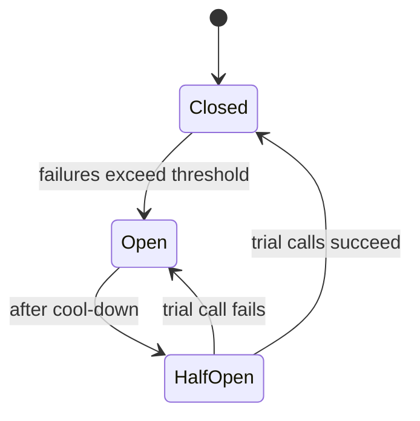

Everything fails eventually: disks, servers, network links, whole data centres, and most often, deployments. **High availability** is about keeping the service usable anyway. **Fault tolerance** is the set of techniques that make that possible.

## Availability in numbers

Availability = uptime ÷ total time. The industry talks in "nines":

| Target | Allowed downtime per year | Per month |
|---|---|---|
| 99.9% | 8.8 hours | 44 minutes |
| 99.95% | 4.4 hours | 22 minutes |
| 99.99% | 53 minutes | 4.4 minutes |
| 99.999% | 5 minutes | 26 seconds |

At four nines and above, a human cannot even notice and respond to a failure in time. Recovery has to be **automatic**.

### Availability of combined components

**In series** (a request needs A *and* B), availabilities multiply, so the total gets worse:

```text
API 99.9% × DB 99.9% × Cache 99.9% = 99.7%
```

**In parallel** (A *or* B can serve), the chance of both failing is tiny, so the total gets better:

```text
Two replicas at 99% each: 1 − (0.01 × 0.01) = 99.99%
```

This is the maths behind redundancy: every dependency on the request path lowers your availability; every redundant copy raises it.

## Techniques for fault tolerance

### 1. Redundancy everywhere
No single point of failure. At least two of every critical component, ideally spread across **availability zones** (separate data centres in one region with independent power and networking).

- **Active-active:** all copies serve traffic. Full use of capacity; failover is instant because traffic simply stops going to the failed node.
- **Active-passive:** a standby waits. Simpler for stateful systems such as a database primary, but the standby is idle and failover takes seconds to minutes.

### 2. Automatic failover
Detect the failure (health checks, heartbeats) and promote a replacement without a human. The hard parts:
- **False positives:** a slow node is not a dead node. Failing over too eagerly can cause flapping.
- **Split brain:** two nodes both believe they are the primary and both accept writes. Prevented with quorum-based leader election and fencing. See [Leader Election & Raft](#/l/08-distributed/leader-election).

### 3. Replication
Copies of data on several machines so losing one does not lose data or availability. Synchronous replication protects every write but adds latency; asynchronous is faster but can lose the last few writes on failover.

### 4. Isolation and bulkheads
Keep failures contained. Separate thread pools or connection pools per dependency, so a slow payment provider cannot use up every thread and take down the product catalogue too. Separate "cells" of users so one bad shard affects a slice of customers, not all of them.

### 5. Timeouts, retries and circuit breakers
- **Timeouts** on every network call. Without them, one slow dependency ties up resources indefinitely.
- **Retries with exponential backoff and jitter**, only for idempotent operations, with a cap. Unbounded retries turn a small outage into a retry storm.
- **Circuit breakers:** after repeated failures, stop calling the dependency for a while and fail fast (or serve a fallback), then probe to see whether it has recovered.



### 6. Graceful degradation
When something breaks, drop the nice-to-have and keep the core. If recommendations are down, show popular items. If the "people also bought" service times out, render the product page without it. Users rarely notice a missing widget; they always notice an error page.

### 7. Load shedding and rate limiting
When overloaded, reject some requests quickly (HTTP 429/503) rather than letting every request slow to a crawl. Prioritise: shed analytics before checkout.

### 8. Multi-region
To survive a whole region failing, run in at least two. Costly and complex (data replication across regions, conflict handling), so reserve it for services that truly need it.

## Disaster recovery terms

- **RTO (Recovery Time Objective):** how quickly service must be restored.
- **RPO (Recovery Point Objective):** how much data loss is acceptable, measured in time.

| Strategy | RTO | RPO | Cost |
|---|---|---|---|
| Backups only | Hours to days | Hours | Low |
| Pilot light (minimal standby) | Tens of minutes | Minutes | Medium |
| Warm standby (scaled-down copy) | Minutes | Seconds to minutes | Higher |
| Active-active multi-region | Seconds | ~0 | Highest |

## Don't forget the most common cause of outages

Most incidents are caused by **changes**: deployments, config pushes, migrations. Availability practices therefore include:
- Canary and progressive rollouts, with automatic rollback on error spikes.
- Feature flags to turn off a bad feature without redeploying.
- Testing failure on purpose (chaos engineering) so failover paths actually work when needed.

> [!INTERVIEW] A strong answer to "how do you make this highly available?"
> "No single points of failure: at least two instances of each stateless service across three AZs behind a redundant load balancer. The database has a synchronous standby in another AZ with automatic failover via a quorum. Every external call has a timeout, bounded retries and a circuit breaker. If recommendations fail we degrade to popular items. Deploys go out as canaries with automatic rollback."

## Key takeaways

- Each nine costs about ten times more; above three nines, recovery must be automatic.
- Components in series lower availability; redundant components in parallel raise it.
- Redundancy, failover, isolation, timeouts, circuit breakers and graceful degradation work together.
- Know RTO and RPO, and remember that deployments cause most outages.
