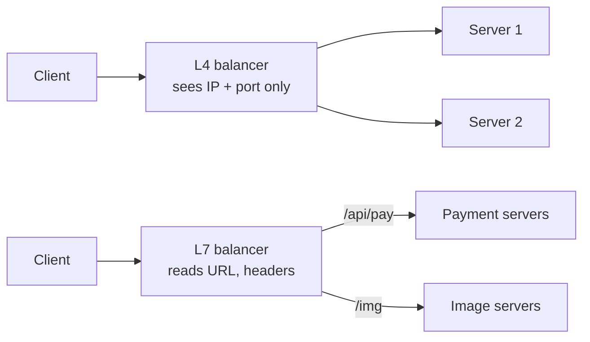

"Put a load balancer in front" is only half an answer. Load balancers differ in **which network layer** they work at, **where** they run and **how** they are deployed, and each kind fits different jobs.

## Layer 4 vs Layer 7

The layers come from the OSI model. Layer 4 is transport (TCP/UDP); layer 7 is application (HTTP, gRPC).

### Layer 4 (transport) load balancers
They see IP addresses and ports, and forward packets or connections without reading the content.

- **Very fast and cheap per request**, can handle millions of connections.
- Work with **any TCP/UDP protocol**: databases, game servers, MQTT, custom protocols.
- **Cannot** route by URL, header or cookie, because they never parse HTTP.
- Usually cannot terminate TLS (they pass encrypted bytes through).

> [!REAL] The postman
> The postman reads only the address on the envelope and delivers it. He never opens the letter. That's a layer-4 balancer: fast, but blind to the content.

### Layer 7 (application) load balancers
They terminate the connection, parse the HTTP request and then decide where to send it.

- **Content-based routing:** `/api/*` to the API fleet, `/images/*` to the media service, `Host: admin.example.com` to the admin service.
- **TLS termination**, compression, header rewriting, retries, rate limiting, authentication checks.
- Understand HTTP/2 and gRPC, so they can balance individual requests on one long-lived connection.
- More CPU per request than L4, so slightly slower and more expensive.

| | Layer 4 | Layer 7 |
|---|---|---|
| Sees | IP, port | Full HTTP request |
| Routing by path/header/cookie | No | Yes |
| TLS termination | Usually no | Yes |
| Protocols | Any TCP/UDP | HTTP(S), gRPC, WebSocket |
| Speed | Highest | High |
| Typical use | Edge traffic, non-HTTP services, in front of L7 tier | API routing, microservices, web apps |

> [!TIP] They are often stacked
> Large sites commonly put a fleet of L4 balancers at the edge (fast, simple, handles enormous connection counts) in front of a fleet of L7 proxies (smart routing). Each layer does what it is best at.

> [!REAL] The office mail room
> The mail room opens each envelope, reads "Attn: Accounts" and sends it to the right department. A layer-7 balancer reads the URL: `/api/payments` goes to payment servers, `/images` goes to the image servers.

## Where the load balancing happens

### DNS load balancing
DNS returns different IP addresses for the same name, either rotating them (round-robin DNS) or picking by the user's location (GeoDNS).
- Cheap, global, no extra hop.
- Crude: clients and resolvers cache answers for the TTL, so a dead server can keep receiving traffic until caches expire. No real health awareness unless the DNS provider adds it.

> [!REAL] Directory enquiry
> Calling directory enquiry for "Domino's" gets you a different branch number depending on where you call from. DNS hands different users different IPs, but phones cache the number, so changes take time to spread.

### Global server load balancing (GSLB)
Steers users to the best **region or data centre**, using health, latency and geography, typically through DNS or anycast. If a whole region fails, traffic moves to another. See [DNS Resolution, Caching & Routing](#/l/06-networking/dns-performance).

> [!REAL] Choosing the nearest airport
> A traveller from Chennai flies out of Chennai, not Delhi, unless Chennai airport is closed. GSLB sends Indian users to the Mumbai region and fails them over to Singapore if Mumbai goes down.

### Anycast
The same IP address is announced from many locations; internet routing delivers each user to the nearest one. Used by CDNs and DNS providers. Fast failover and natural DDoS absorption.

> [!REAL] One emergency number, many control rooms
> Dial 112 anywhere in India and the call goes to the nearest control room, though everyone dials the same number. Cloudflare's 1.1.1.1 works the same way: one IP, served from hundreds of cities.

### Client-side load balancing
The client itself (or a library inside it) knows the list of servers, often from a service registry, and picks one. Common inside microservice fleets (gRPC clients, service meshes).
- No extra network hop, no central bottleneck.
- Every client needs the logic and a fresh server list.

> [!REAL] Choosing your own checkout queue
> Instead of a staff member directing you, you look at the queues and pick one yourself. Inside microservices, the calling service picks a healthy instance from a list it keeps up to date.

### Service mesh sidecars
A proxy runs next to every service instance and handles load balancing, retries, timeouts and mTLS for it. Moves the logic out of application code into infrastructure.

> [!REAL] A personal assistant for every employee
> Each employee gets an assistant who handles their calls, retries, scheduling and ID checks, so the employee only does real work. Istio and Linkerd put such a proxy next to every service.

## Hardware vs software vs managed

- **Hardware appliances:** dedicated boxes with specialised chips. Very high throughput, expensive, less flexible. Mostly in traditional data centres.
- **Software:** proxies such as NGINX, HAProxy and Envoy on ordinary servers. Flexible, cheap, scriptable.
- **Managed cloud balancers:** the cloud provider runs them for you, redundant and autoscaled. The default choice in the cloud.

## Choosing in an interview

| Need | Pick |
|---|---|
| Route `/api` and `/static` differently, terminate TLS | Layer 7 |
| Balance a TCP database proxy or game server | Layer 4 |
| Send users to the nearest region, survive region loss | GSLB / GeoDNS / anycast |
| Service-to-service calls inside a cluster | Client-side LB or service mesh |
| Millions of connections at the edge | L4 in front of L7 |

> [!INTERVIEW] Say where each balancer sits
> "Users hit GeoDNS, which returns the nearest healthy region. In each region, a managed L7 balancer terminates TLS and routes by path to the API and upload services. Internally, services call each other through client-side load balancing from the service registry."

## Key takeaways

- L4 is fast and protocol-agnostic; L7 understands HTTP and can route intelligently.
- DNS, GSLB and anycast balance across regions; L4/L7 balance inside one.
- Inside a microservice fleet, client-side balancing or a service mesh avoids a central hop.
- Real systems layer several of these together.
