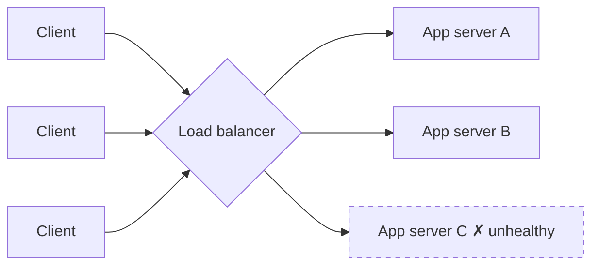

A load balancer sits in front of a group of servers and decides which one handles each request. It is what turns "many servers" into "one service" from the user's point of view.

## What a load balancer does

1. **Distributes traffic** so no server is overloaded while others sit idle.
2. **Health checks.** It probes each server (e.g. `GET /health` every 5 seconds) and stops sending traffic to ones that fail.
3. **Enables zero-downtime deploys.** Drain a server, update it, put it back.
4. **Hides the fleet.** Clients see one address; you add and remove servers freely.
5. **Often more:** TLS termination, compression, routing by URL, rate limiting.

## Load balancing algorithms

### Static algorithms (ignore current load)

**Round robin.** Send requests to servers in turn: A, B, C, A, B, C…
- Simple and fair when servers are identical and requests cost about the same.
- Poor when requests vary a lot in cost; one server can get several heavy ones in a row.

**Weighted round robin.** Each server gets a weight matching its capacity. A server with weight 3 gets three requests for every one sent to a weight-1 server.
- Useful for mixed hardware, or to send a small share of traffic to a new version (canary).

**IP hash / hash-based.** `server = hash(client IP) % N`. The same client always lands on the same server.
- Gives "stickiness" without cookies.
- Adding or removing a server reshuffles almost everyone. **Consistent hashing** fixes that. See [From Modulo to Consistent Hashing](#/l/03-databases/consistent-hashing).

**Random.** Pick a server at random. Surprisingly decent at scale, but uneven in the short term.

### Dynamic algorithms (look at current load)

**Least connections.** Send the request to the server with the fewest open connections.
- Great when requests have very different durations (long-polling, WebSockets, file uploads).

**Weighted least connections.** Least connections, adjusted for each server's capacity.

**Least response time.** Prefer the server with the lowest recent latency (and often fewest connections).
- Steers traffic away from servers that are slow because of GC pauses, noisy neighbours or a bad disk.

**Power of two choices.** Pick two servers at random and send the request to the less loaded one.
- Nearly as good as checking every server, at a fraction of the cost. Used widely in large-scale proxies because it avoids every balancer stampeding to the same "least loaded" server at once.

### Picking one

| Situation | Good choice |
|---|---|
| Identical servers, short similar requests | Round robin |
| Servers of different sizes | Weighted round robin / weighted least connections |
| Long-lived or very uneven requests | Least connections |
| Latency-sensitive, uneven server health | Least response time / power of two choices |
| Need the same client on the same server | Consistent hashing on a user or session key |

## Sticky sessions

Sticky sessions (session affinity) pin a user to one server, usually via a cookie the load balancer sets.

- **Why:** the server holds session state in memory.
- **Problem:** uneven load, and if that server dies the user's session is lost. Scaling down is awkward.
- **Better:** make servers stateless and keep sessions in Redis or in a signed token, so stickiness becomes unnecessary.

## Health checks in more detail

- **Liveness:** is the process running? (Restart it if not.)
- **Readiness:** can it serve traffic right now? (Warm caches loaded, database reachable.)
- Use thresholds: mark unhealthy after, say, 3 failed checks and healthy again after 2 successes, so a single blip does not flap the server in and out.
- Keep health endpoints cheap. A health check that queries the database can take the database down when thousands of instances run it.

> [!WARNING] Deep health checks can cause cascading failures
> If every server's health check depends on a shared database, a brief database hiccup marks *all* servers unhealthy at once and the load balancer has nowhere to send traffic. Many teams make the load-balancer check shallow and alert on dependencies separately.

## The load balancer must not be a single point of failure

A single load balancer is itself a SPOF. Common fixes:
- **Active-passive pair** sharing a floating IP; the standby takes over on failure.
- **Active-active** behind DNS or anycast, so several balancers share traffic.
- **Managed cloud load balancers**, which are redundant by design.

## Key takeaways

- Load balancers spread traffic, remove unhealthy servers and let you scale and deploy without downtime.
- Static algorithms (round robin, hashing) are simple; dynamic ones (least connections, least response time) adapt to real load.
- Avoid sticky sessions by keeping app servers stateless.
- Make the balancer itself redundant.
