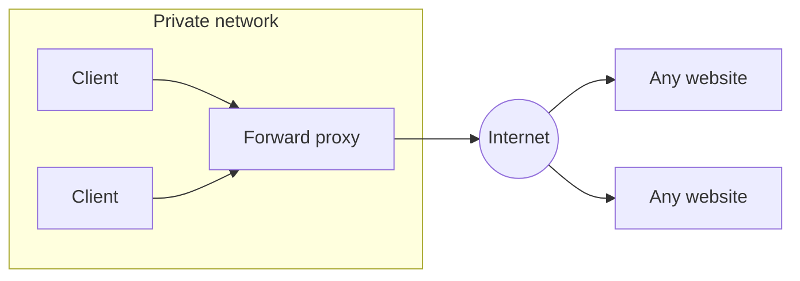
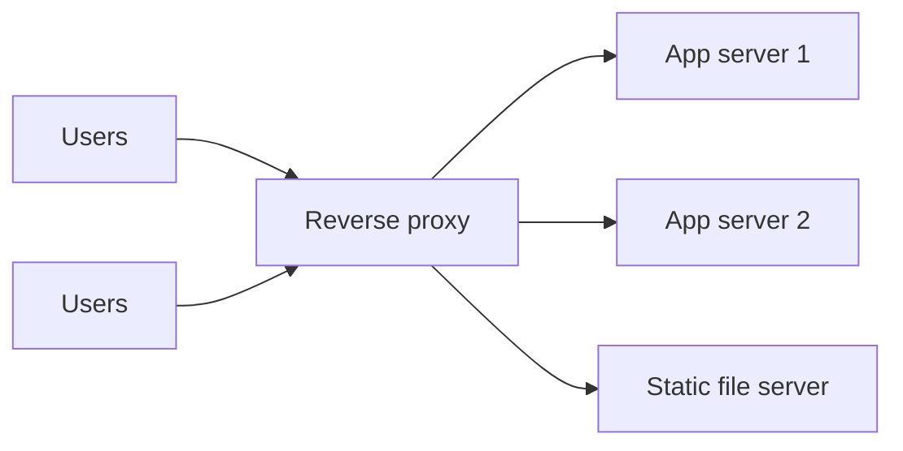

A proxy is a server that sits between a client and a destination and forwards traffic on someone's behalf. The only real difference between the two kinds is **whose side it is on**.

## Forward proxy: acts for the client

The client is configured to send its requests through the proxy, and the proxy talks to the outside world. The destination server sees the proxy, not the client.

**Used for**
- **Control and filtering:** a company or school blocks certain sites or scans for malware.
- **Privacy:** hide the client's IP address from the destination.
- **Caching shared downloads:** one office downloads a large update once, many machines use it.
- **Egress control in data centres:** all outbound traffic from servers leaves through a proxy, so it can be logged and restricted to approved destinations.
- **Getting around geographic restrictions.**

**Key point:** the *client* knows about the proxy; the server usually does not.

> [!REAL] The college Wi-Fi proxy
> Your college network sends all student traffic through a proxy that blocks some sites and logs usage. Websites see the college's IP, not yours. The proxy works on behalf of the clients.

## Reverse proxy: acts for the server

Clients think they are talking to the website. In fact they are talking to the reverse proxy, which forwards each request to one of the servers behind it.

**Used for**
- **Load balancing** across many backend servers. A load balancer is a kind of reverse proxy.
- **TLS termination:** decrypt HTTPS once at the edge so backends deal with plain HTTP (or re-encrypt for internal traffic).
- **Caching** responses and serving static files.
- **Compression** (gzip, Brotli).
- **Security:** hide the backend topology, absorb attacks, apply a web application firewall, rate limiting and authentication checks.
- **Routing:** send `/api` to one service and `/blog` to another; serve many sites from one IP.
- **Smooth deploys:** shift traffic between old and new versions.

**Key point:** the *server side* deploys it; the client usually has no idea it exists.

> [!REAL] A company's reception desk
> Visitors talk to the receptionist, never directly to employees. The receptionist knows who's in, sends you to the right person and turns away troublemakers. Nginx in front of your app servers is that receptionist.

## Side by side

| | Forward proxy | Reverse proxy |
|---|---|---|
| Acts on behalf of | Clients | Servers |
| Who configures it | Client / client's network | Website operator |
| Hides | The client from servers | The servers from clients |
| Typical jobs | Filtering, privacy, egress control | Load balancing, TLS, caching, security, routing |
| Examples | Corporate web proxy, VPN-like gateways | NGINX, HAProxy, Envoy, CDN edge, API gateway |

## How they relate to other components

- A **load balancer** is a reverse proxy focused on spreading traffic.
- An **API gateway** is a reverse proxy focused on APIs: authentication, rate limits, routing, request transformation. See [Load Balancer vs API Gateway](#/l/09-tradeoffs/lb-vs-api-gateway).
- A **CDN** is a globally distributed reverse proxy cache.
- A **service mesh sidecar** is a small reverse *and* forward proxy next to each service: it receives incoming calls and sends outgoing ones.

> [!NOTE] The client IP problem
> Behind a reverse proxy, your application sees the proxy's IP, not the user's. Proxies pass the original address in a header such as `X-Forwarded-For`. Only trust that header from your own proxies; anyone can set it on a direct request.

> [!INTERVIEW] Easy way to remember
> Forward proxy: *"I am going out to the internet on your behalf."* Reverse proxy: *"You came to this website; I'll decide which server answers you."*

## Key takeaways

- Forward proxies serve clients; reverse proxies serve servers.
- Reverse proxies provide load balancing, TLS termination, caching, security and routing.
- Load balancers, API gateways and CDNs are all specialised reverse proxies.
- Pass and trust client IP headers carefully.
