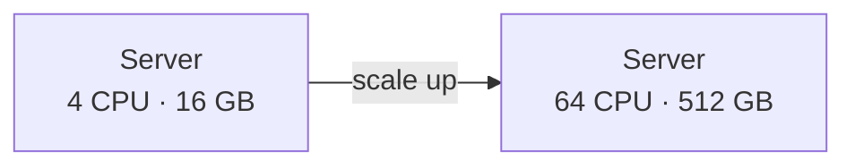
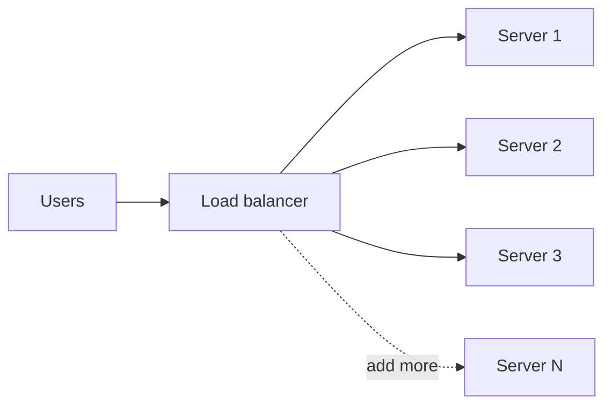

A system is scalable if it can handle more work by adding resources, without a redesign and without performance collapsing. There are two ways to add resources, and almost every large system ends up using both.

## Vertical scaling: a bigger machine

Vertical scaling (scaling **up**) means giving one server more CPU, RAM, faster disks or a faster network card.

**Why people like it**
- No code changes. The application does not know it moved.
- No distributed-systems problems: one machine, one copy of the data, transactions just work.
- Often the cheapest first step. Upgrading a database from 8 to 32 cores can buy a year of growth in an afternoon.

**Why it runs out**
- **Hard ceiling.** The biggest machine you can buy or rent is finite.
- **Cost grows faster than capacity.** High-end hardware costs disproportionately more.
- **Single point of failure.** One machine failing means total downtime.
- **Downtime to upgrade**, unless you have a failover setup.

## Horizontal scaling: more machines

Horizontal scaling (scaling **out**) means adding more servers and spreading the work across them.

**Why it wins at scale**
- **Near-unlimited capacity.** Need twice the throughput? Add twice the servers.
- **Fault tolerance.** One server dying removes a fraction of capacity, not all of it.
- **Commodity hardware** and cloud autoscaling, so you pay for what you use.

**What it costs**
- **The application must be designed for it.** Servers must be (mostly) stateless so any one can handle any request.
- **Distributed-systems complexity.** Data split across machines brings replication lag, partial failures, consistency questions and network partitions.
- **More operational work:** load balancers, service discovery, monitoring many nodes.

## Side by side

| | Vertical | Horizontal |
|---|---|---|
| How | Bigger machine | More machines |
| Limit | Hardware ceiling | Practically none |
| Complexity | Low | High |
| Failure impact | Total outage | Partial capacity loss |
| Code changes | None | Statelessness, partitioning |
| Data consistency | Easy | Needs thought |
| Typical use | Databases early on, caches, quick wins | Web/app tiers, large data stores |

## Making a service horizontally scalable

### 1. Make the app tier stateless
Any state that lives in a server's memory (sessions, uploaded files, in-memory caches that must be correct) ties a user to that server. Move it out:
- Sessions → a shared store (Redis) or self-contained tokens (JWT).
- Files → object storage (S3-style).
- Shared caches → a distributed cache.

Once the servers are stateless, the load balancer can send any request anywhere and autoscaling becomes trivial. See [Stateful vs Stateless](#/l/09-tradeoffs/stateful-vs-stateless).

### 2. Scale the data tier in stages
The database is almost always the hardest part. A typical progression:

1. **Vertical scaling** of the primary.
2. **Caching** the hottest reads.
3. **Read replicas** to spread read traffic.
4. **Functional partitioning**: separate databases for separate services (users, orders, payments).
5. **Sharding**: split one big table across many databases by a key.

Each step adds complexity, so take the next one only when the numbers say you need it.

### 3. Move slow work off the request path
Sending emails, resizing images, updating search indexes: put them on a queue and let workers do them. The web tier stays fast, and you can scale workers separately.

## Scalability is more than capacity

A system can have plenty of servers and still not scale because of:
- **A shared bottleneck:** one database, one lock, one counter row everyone updates.
- **Hot keys:** a celebrity account or a viral product sending all traffic to one shard.
- **Coordination overhead:** if every request needs agreement among many nodes, adding nodes makes it slower.
- **Fan-out:** a request that calls 50 services is only as fast as the slowest of them.

> [!INTERVIEW] What a good answer sounds like
> "I'd start by scaling the stateless API tier horizontally behind a load balancer, which is easy. The database is the real constraint. At 5K writes per second a single well-tuned primary with read replicas is fine; I'd only shard when writes or data size outgrow one machine, and I'd shard by user ID because almost every query is per user."

## Key takeaways

- Vertical scaling is simple but capped and a single point of failure.
- Horizontal scaling is nearly unlimited but needs stateless services and careful data design.
- Make the app tier stateless first; scale the database in stages.
- Look for shared bottlenecks and hot spots; more machines do not fix those.
