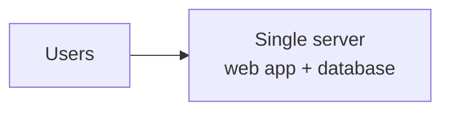
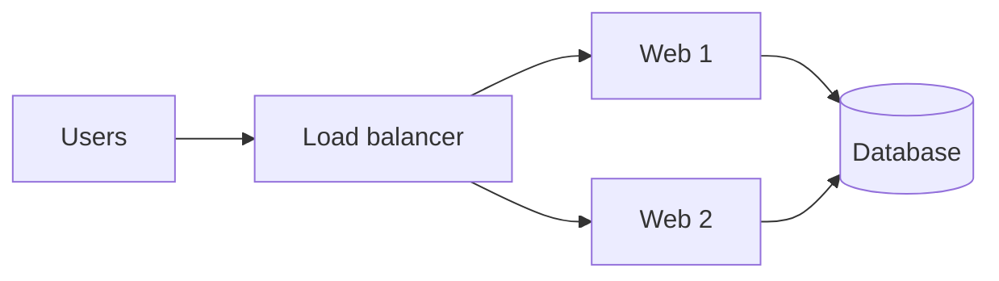
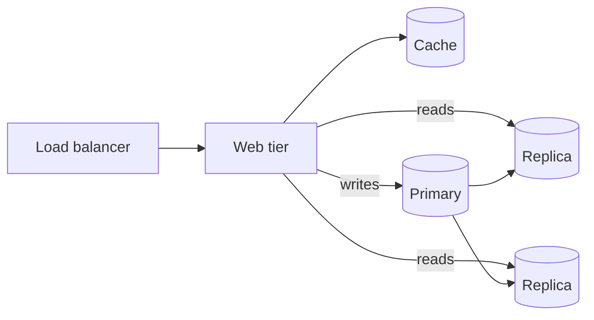
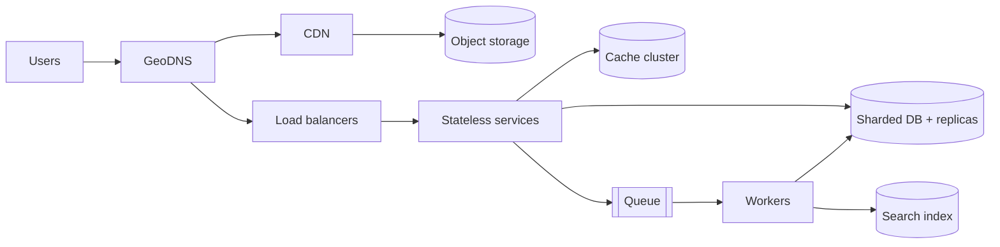

The best way to understand how large systems are built is to watch one grow. Here is the typical path a web application takes from its first user to tens of millions, and the reason for each step. In an interview, this story is a strong answer to "how would you scale this?".

## Stage 1: one server (≈ 0 – 1,000 users)

Web server, application and database all on one machine. It is cheap and simple, and it is the right choice when you have no users yet.

**Breaks when:** the app and the database fight over CPU and memory, and any crash takes everything down.

> [!REAL] A home kitchen
> A home baker takes orders on WhatsApp, bakes and delivers alone. Perfect for 20 orders a week. Most startups begin exactly here, and should.

## Stage 2: separate the database (≈ 1K – 10K)

Move the database to its own machine. Now the web tier and the data tier can be sized independently, and you can scale each vertically.

**Breaks when:** one web server cannot keep up, or it fails and the site goes down.

> [!REAL] Renting a separate store room
> The baker moves supplies into a separate store room so the kitchen has space. The app server and the database can now grow independently.

## Stage 3: load balancer + several web servers (≈ 10K – 100K)

Make the web tier **stateless** (sessions in Redis or tokens), then run several servers behind a load balancer. You get capacity and redundancy.

**Breaks when:** the single database becomes the bottleneck, mostly with reads.

> [!REAL] Hiring more bakers
> Several bakers work in parallel and an order desk hands each order to whoever is free.

## Stage 4: replicas and a cache (≈ 100K – 1M)

- **Read replicas:** writes go to the primary, reads are spread over replicas. Most apps are 10:1 or more read-heavy, so this buys a lot.
- **Cache (Redis/Memcached):** keep hot data in memory using cache-aside. A 90% hit rate removes 90% of those reads from the database.
- **Primary failover:** a standby replica can be promoted if the primary dies.

**Watch out for:** replication lag. A user who updates their profile and immediately reloads might read an old replica. Fix with read-your-own-writes (read from the primary for a few seconds after a write, or for that user's own data).

> [!REAL] A display counter
> The most popular cakes sit ready in a display counter (cache), so most customers are served without going to the kitchen at all.

## Stage 5: CDN and object storage (≈ 1M+)

- Static assets (JS, CSS, images, video) move to **object storage** and are served through a **CDN**. Your servers stop shipping bytes and focus on dynamic requests.
- Users far away get fast responses from a nearby edge.

> [!REAL] Franchise outlets
> Ready-made products are stocked at outlets across the city (CDN), so customers don't travel to the main bakery.

## Stage 6: asynchronous work with queues

Anything that does not need to finish before the response (emails, image processing, notifications, analytics, search indexing) becomes a message on a queue processed by workers.

- The web tier stays fast.
- Spikes are absorbed by the queue instead of overwhelming downstream systems.
- Workers scale independently.

> [!REAL] Pre-orders for weddings
> Big wedding orders go into a queue and are baked overnight, so walk-in customers aren't kept waiting.

## Stage 7: multiple data centres / regions (≈ 10M+)

- Run in several availability zones from early on; add a second **region** for disaster recovery and lower latency for distant users.
- GeoDNS or anycast send users to the nearest healthy region.
- The hard part is data: cross-region replication, deciding which data is global and which is regional, and handling conflicts.

> [!REAL] A second factory in another state
> If a flood hits one factory, the other keeps supplying the country.

## Stage 8: scale the data tier horizontally

When writes or data volume outgrow one primary:
- **Functional partitioning:** split databases by domain (users, orders, payments). Often goes hand in hand with splitting the monolith into services.
- **Sharding:** split a big table across many databases by a key such as user ID. See [Sharding](#/l/03-databases/sharding).
- **NoSQL where it fits:** wide-column or key-value stores for very high write volume with simple access patterns.

> [!REAL] Regional warehouses
> Stock records are split by region, so no single warehouse ledger has to track the whole country.

## Stage 9: services, observability and automation

- Split the monolith along team and domain boundaries when the codebase and teams get too big to move fast together, not before.
- **Observability:** metrics, logs and traces are mandatory at this size.
- **Automation:** autoscaling, infrastructure as code, CI/CD with canary deploys.

> [!REAL] Departments and dashboards
> The company now has separate teams (services) for orders, delivery and payments, each with its own dashboard and on-call rota.

## The whole picture

> [!INTERVIEW] Scale on evidence, not ambition
> Interviewers like hearing *why* each step happens: "Reads are 90% of database load, so before sharding I'd add a cache and read replicas, which is far simpler. I'd shard only once write volume or data size outgrows one primary." Sharding a database that fits on one machine is a red flag.

## Key takeaways

- Separate tiers, then make the web tier stateless and scale it out.
- Relieve the database with caching and read replicas before sharding.
- Push static content to a CDN and slow work to queues.
- Add regions, sharding and microservices only when the numbers require them.
