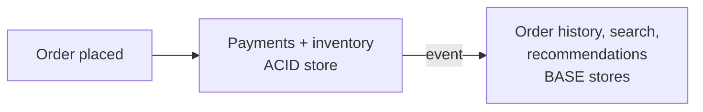

ACID and BASE are two philosophies for handling data. ACID puts **correctness first**: every transaction is all-or-nothing and immediately visible. BASE puts **availability and scale first**: the system always answers, and replicas agree eventually. Most large products use both, for different data.

## ACID in one paragraph

**Atomicity** (all or nothing), **Consistency** (rules always hold), **Isolation** (concurrent transactions don't interfere), **Durability** (committed means saved). The traditional promise of relational databases. Full detail in [Transactions, Isolation & ACID](#/l/03-databases/sql-and-acid).

## BASE

- **Basically Available:** the system keeps responding even when parts of it fail, possibly with stale or partial data.
- **Soft state:** the state of the system can change over time even without new input, as replicas catch up with each other.
- **Eventually consistent:** if no new writes arrive, all replicas converge to the same value.

BASE is the natural model for distributed, replicated, partition-tolerant stores such as Cassandra, DynamoDB (by default) and many caches.

## Side by side

| | ACID | BASE |
|---|---|---|
| Priority | Correctness | Availability and scale |
| After a write | Every reader sees it | Readers may briefly see old data |
| Under a network partition | May refuse requests | Keeps serving, reconciles later |
| Concurrency | Locks / MVCC / serializable checks | Conflict resolution, last-write-wins, CRDTs |
| Scaling writes | Harder (one primary, or distributed consensus) | Easier (any replica can accept writes) |
| Programming model | Simple: the database protects you | Harder: the app handles staleness and conflicts |
| Examples | PostgreSQL, MySQL, Oracle, Spanner | Cassandra, DynamoDB (eventual reads), Riak, DNS |

## Choosing per piece of data

The real skill is deciding which data needs which model.

**Needs ACID**
- Account balances, payments, ledgers
- Inventory counts when overselling is unacceptable
- Seat or room bookings
- Unique usernames
- Anything where a wrong answer costs money or trust

**Fine with BASE**
- Like and view counts
- Social feeds and timelines
- Product reviews, recommendations
- Analytics events, logs
- "Last seen" and presence indicators

A common architecture keeps the source of truth in an ACID store and feeds eventually consistent read models (search index, cache, analytics) from its change events.

## It is a spectrum, not a switch

- Many NoSQL stores offer **tunable consistency**: Cassandra's `QUORUM` reads and writes, DynamoDB's strongly consistent reads, conditional writes and transactions.
- Many SQL databases run with **asynchronous replicas**, so reading from a replica is eventually consistent even though the primary is ACID.
- Between strong and eventual sit useful models such as **read-your-own-writes**, **monotonic reads** and **causal consistency**. These are often what users actually need.

> [!INTERVIEW] Make the split explicit
> "The wallet balance and ledger are ACID in PostgreSQL. A transfer is a single transaction with a double-entry insert. The activity feed showing 'Asha paid Ravi' is built from events into Cassandra and can lag by a second or two, which users won't notice."

## Key takeaways

- ACID: correctness and immediate visibility; BASE: availability, scale and eventual agreement.
- Pick per data type, based on the cost of a stale or conflicting answer.
- A common pattern is an ACID source of truth feeding BASE read models.
- Modern stores let you tune consistency per operation.
