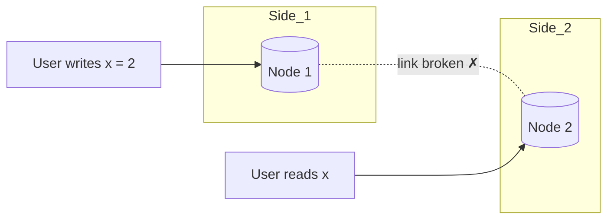

The CAP theorem is the most quoted, and most misquoted, idea in distributed systems. PACELC extends it to cover what happens when nothing is broken, which is most of the time.

## CAP

In a distributed data store, during a **network partition** you can guarantee at most one of:

- **C, Consistency (linearizability):** every read sees the most recent write, as if there were a single copy of the data.
- **A, Availability:** every request to a non-failed node gets a non-error response, without waiting for other nodes.

**P, Partition tolerance:** the system continues operating despite messages between nodes being lost or delayed.

### Why "pick two" is misleading
Networks *do* partition: a switch fails, a cable is cut, a cloud zone loses connectivity. You cannot opt out of P. So the real statement is:

> **When a partition happens, choose: stay consistent (refuse some requests) or stay available (serve possibly stale data).**

User 2 asks node 2 for `x`. Node 2 cannot reach node 1 to learn about the new write. Its two options:
- **Answer anyway** with the old value → available, not consistent (**AP**).
- **Refuse or wait** until the partition heals → consistent, not available (**CP**).

### CP systems
Prefer correctness: they reject writes (or reads) on the minority side of a partition.
- Examples: ZooKeeper, etcd, Consul, HBase, Spanner, MongoDB with majority writes and reads.
- Use for: configuration, leader election, locks, financial records, inventory.

### AP systems
Prefer responsiveness: every side keeps serving and they reconcile afterwards.
- Examples: Cassandra, DynamoDB (default reads), Riak, CouchDB, DNS.
- Use for: shopping carts, social content, sensor data, caches.

### Clarifications interviewers like
- CAP's "consistency" is **linearizability**, not the "C" in ACID.
- CAP's "availability" means *every* non-failed node responds. A system can be "highly available" in the everyday sense and still be CP under CAP's strict definition.
- A single-node database is not a distributed system, so CAP does not really apply to it.
- Real systems are often configurable per operation, not just "CP" or "AP".

## PACELC

CAP only talks about partitions. But even when the network is healthy, replicated systems face a trade-off on **every** request: wait for replicas to agree (consistent but slower), or answer from a local copy (fast but maybe stale).

> **If Partition (P): choose Availability (A) or Consistency (C).
> Else (E): choose Latency (L) or Consistency (C).**

| System | During partition | Normal operation | Label |
|---|---|---|---|
| Cassandra, DynamoDB (default) | Availability | Latency | PA/EL |
| Riak | Availability | Latency | PA/EL |
| MongoDB (default config) | Consistency | Latency | PC/EL |
| Spanner, CockroachDB, HBase | Consistency | Consistency | PC/EC |
| PNUTS (Yahoo) | Availability | Consistency | PA/EC |

PACELC is the more useful lens in interviews, because it explains a cost you pay all the time, not only during rare failures. Strong consistency across replicas means waiting for a round trip to a quorum on every write, and that is very noticeable across regions.

## Applying it

> [!INTERVIEW] Decide per feature
> "Booking a seat must be CP: during a partition I'd rather show 'try again' than sell the same seat twice. The seat map display can be AP and slightly stale. In normal operation, bookings go to the seat's home region for consistency (EC), while browsing reads local replicas for latency (EL)."

Questions to ask yourself:
1. What is the cost of a stale read here? Of a lost or conflicting write?
2. What is the cost of returning an error or waiting?
3. Is the data read across regions? (Latency vs consistency becomes acute.)

## Key takeaways

- Partitions are unavoidable, so CAP is really "consistency or availability during a partition".
- CAP's C is linearizability, not ACID's C.
- PACELC adds the everyday trade-off: latency vs consistency when there is no partition.
- Choose per feature, not per company or per database.
