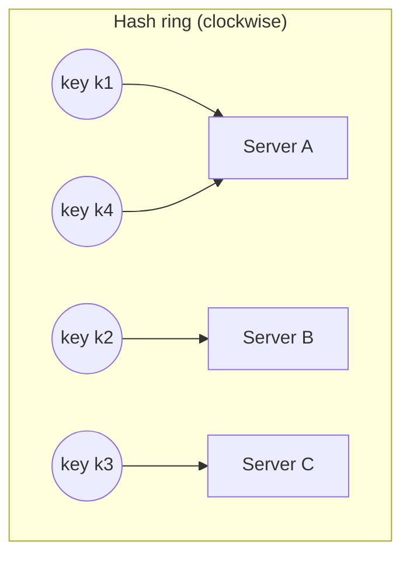

When you spread keys across N servers, the obvious formula is `server = hash(key) mod N`. It works perfectly, until N changes. Consistent hashing is the technique that lets you add or remove servers while moving only a small fraction of the keys.

## The problem with modulo

Four cache servers, keys placed with `hash(key) mod 4`. Add a fifth server: now it is `mod 5`.

```text
hash   mod 4   mod 5
 10      2       0   ← moved
 11      3       1   ← moved
 12      0       2   ← moved
 13      1       3   ← moved
 14      2       4   ← moved
 15      3       0   ← moved
 16      0       1   ← moved
 20      0       0     stayed
```

Going from N to N+1 servers moves roughly **N/(N+1)** of all keys: about 80% here, about 99% at 100 servers. For a cache, that means almost everything misses at once and the database is flooded. For a database, it means moving almost all the data.

> [!REAL] Renumbering every seat
> If a cinema renumbers *every* seat when one extra row is added, everyone has to move. With `hash % N`, changing N from 4 to 5 moves almost every key, so your cache is suddenly empty.

## The hash ring

Consistent hashing places **both servers and keys** on the same circular hash space, say 0 to 2³²−1.

1. Hash each server's ID to a position on the ring.
2. Hash each key to a position on the ring.
3. A key belongs to the **first server clockwise** from it.



> [!REAL] Delivery zones on a circular road
> Imagine houses on a ring road, each served by the next depot clockwise. Add a new depot and only the houses between it and the previous depot change depot; everyone else is untouched.

### Adding a server
A new server D lands between C and A on the ring. Only the keys between C and D, which used to go to A, now go to D. **Everything else stays put.** On average just 1/N of the keys move.

### Removing a server
If B fails, only B's keys move, to the next server clockwise. No other server is affected.

## Virtual nodes

With only a few servers, their random positions on the ring leave very uneven arcs: one server might own 50% of the ring. And when a server fails, its whole load lands on a single neighbour.

**Virtual nodes** fix both. Each physical server is placed on the ring many times (e.g. 100–200 positions: `A#1`, `A#2`, …).

- Load evens out, because each server owns many small arcs spread around the ring.
- When a server fails, its arcs are scattered, so its load spreads across **all** remaining servers.
- Heterogeneous hardware: give a bigger server more virtual nodes.

> [!REAL] Each depot runs several counters around the ring
> Instead of one spot on the ring, each server takes 100–200 spots scattered around it. Load evens out, and a bigger server can simply take more spots.

## Lookup in code

```java
import java.util.*;

public class ConsistentHash {
    private final TreeMap<Long, String> ring = new TreeMap<>();
    private final int vnodes;

    public ConsistentHash(int vnodes) { this.vnodes = vnodes; }

    public void addServer(String server) {
        for (int i = 0; i < vnodes; i++) ring.put(hash(server + "#" + i), server);
    }

    public void removeServer(String server) {
        for (int i = 0; i < vnodes; i++) ring.remove(hash(server + "#" + i));
    }

    public String serverFor(String key) {
        if (ring.isEmpty()) throw new IllegalStateException("no servers");
        Map.Entry<Long, String> e = ring.ceilingEntry(hash(key)); // first node clockwise
        return (e != null ? e : ring.firstEntry()).getValue();     // wrap around
    }

    private long hash(String s) {
        // A real implementation uses a well-distributed hash such as MurmurHash or xxHash.
        long h = 1125899906842597L;
        for (char c : s.toCharArray()) h = 31 * h + c;
        return h & 0xffffffffL;
    }
}
```

Lookup is O(log V) where V is the number of virtual nodes, thanks to the sorted map.

## Replication on the ring

To store each key on R servers, walk clockwise from the key and take the first R **distinct physical** servers (skipping extra virtual nodes of a server already chosen). This is how Dynamo-style stores such as Cassandra place replicas.

## Where it is used

- **Distributed caches:** client libraries for Memcached and Redis clusters.
- **Distributed databases:** Cassandra, ScyllaDB, DynamoDB, Riak partition data on a ring.
- **Load balancers:** sticky routing of a user or session to a backend, with little disruption when backends change.
- **CDNs:** choosing which edge server in a location caches which object.

> [!REAL] Real systems
> Amazon's Dynamo, Apache Cassandra and Discord's message routing all use consistent hashing. CDNs use it to decide which edge server caches which file.

## Alternatives worth knowing

- **Rendezvous (highest random weight) hashing:** for each key, score every server with `hash(key, server)` and pick the highest. Also moves only 1/N of keys, needs no ring, but costs O(N) per lookup.
- **Jump consistent hash:** tiny, fast and perfectly balanced for numbered buckets, but servers can only be added or removed at the end.
- **Fixed slots:** Redis Cluster uses 16,384 hash slots assigned to nodes; moving slots moves data. The same idea as many logical shards.

> [!INTERVIEW] The one-sentence answer
> "Plain modulo hashing remaps almost every key when the server count changes; consistent hashing puts servers and keys on a ring so each key goes to the next server clockwise, and adding or removing a server only moves about 1/N of the keys. Virtual nodes keep the load even."

## Key takeaways

- `hash mod N` reshuffles nearly all keys when N changes.
- On a hash ring, a key belongs to the next server clockwise; changes move only ~1/N of keys.
- Virtual nodes balance load and spread a failed server's keys across all others.
- Used by distributed caches, Dynamo-style databases, load balancers and CDNs.
