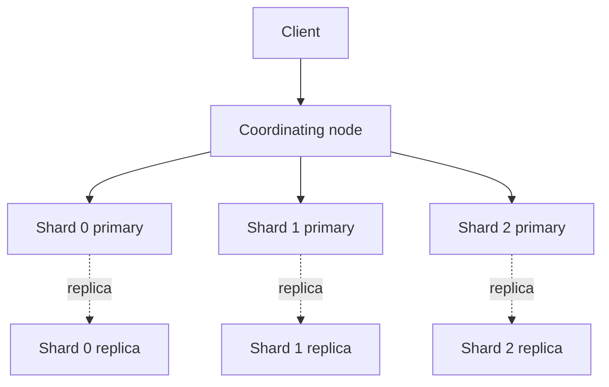
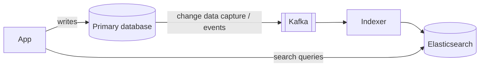

A relational database can find a row by ID instantly, but ask it "which of 50 million products mention *waterproof hiking boots*, ranked by relevance, with typos forgiven?" and it struggles. Search engines such as Elasticsearch and OpenSearch are built for exactly that question.

## The core idea: the inverted index

A normal index maps a document to its words. An **inverted** index maps each word to the documents that contain it.

```text
Documents
  1: "Waterproof hiking boots"
  2: "Lightweight running shoes"
  3: "Hiking backpack, waterproof"

Inverted index
  backpack     → [3]
  boots        → [1]
  hiking       → [1, 3]
  lightweight  → [2]
  running      → [2]
  shoes        → [2]
  waterproof   → [1, 3]
```

A search for `waterproof hiking` intersects `[1, 3]` and `[1, 3]` → documents 1 and 3, without scanning anything else. Each list also stores positions (for phrase queries) and frequencies (for scoring).

> [!REAL] The index at the back of a cookbook
> The cookbook's index lists "paneer → pages 12, 48, 97". You don't scan every recipe for the word "paneer". Elasticsearch builds that list for every word in every document.

## Analysis: turning text into terms

Before indexing, text passes through an **analyzer**:
1. **Character filters:** strip HTML, normalise characters.
2. **Tokenizer:** split into words.
3. **Token filters:** lowercase, remove stop words ("the", "a"), **stem** words to their root ("running" → "run"), add synonyms ("tv" → "television").

The same analysis runs on the search query, so "Running Shoes" matches "run shoe". Choosing analyzers per language and field is a big part of search quality.

> [!REAL] Searching "running shoes"
> A user types "Running Shoes". The analyzer lowercases it and reduces "running" to "run", so it matches a product titled "Shoes for runners". Flipkart and Amazon search depend on this step.

## Relevance scoring

Results are ranked, usually with **BM25**, a refinement of TF-IDF:
- **Term frequency:** a document that mentions "waterproof" several times is likely more about it (with diminishing returns).
- **Inverse document frequency:** rare words matter more than common ones. Matching "gore-tex" is more telling than matching "boots".
- **Field length:** a match in a short title counts more than in a long description.

Teams then add business signals: boosts for in-stock items, popularity, recency, personalisation.

> [!REAL] Which result comes first
> A product with "iPhone" in its title should rank above one that mentions "iPhone" once in a long description. Scoring formulas like BM25 do exactly that.

## Architecture



- **Index:** a logical collection of documents (like a table).
- **Shards:** each index is split into shards; each shard is a complete Lucene index. Shards spread across nodes for scale.
- **Replicas:** copies of each shard on other nodes, for availability and read throughput.
- **Query flow (scatter-gather):** the coordinating node sends the query to one copy of every shard; each returns its top results with scores; the coordinator merges them, then fetches the full documents for the final page.

### Near-real-time, not real-time
New documents go to an in-memory buffer and become searchable when a **refresh** writes them into a new immutable **segment** (by default about once a second). Segments are merged in the background, much like LSM compaction. Durability comes from a transaction log. So a document you just indexed may not appear in search for up to a second.

> [!REAL] The new product that shows up a second later
> A seller lists a product and it appears in search about a second later, not instantly. That small delay is the refresh interval, and it's normal.

## Using it in a system

Elasticsearch is almost never the **source of truth**. The usual pattern:



- Writes go to the main database.
- Changes flow through a queue or CDC pipeline to an indexer that updates Elasticsearch.
- Search reads from Elasticsearch, then often fetches authoritative details (price, stock) from the database or cache.
- If the index is lost or corrupted, rebuild it from the database.

> [!REAL] Search beside the database
> Swiggy keeps the source of truth for restaurants in its main database and copies it into a search engine for "biryani near me". If the search index is lost, it can be rebuilt from the database.

## What it is good at

- Full-text search with relevance, typo tolerance (fuzzy queries), synonyms, highlighting.
- Faceted filtering: brand, price ranges, ratings, with counts per facet (**aggregations**).
- Autocomplete (edge n-grams or completion suggesters).
- Log and metrics analytics (the ELK stack), geospatial queries.

## What it is not good at

- Transactions and strict consistency.
- Being the only copy of important data.
- Frequent updates to the same document (each update rewrites the document into a new segment).
- Deep pagination (page 10,000 is expensive; use `search_after` cursors).

> [!INTERVIEW] Describe the pipeline, not just the box
> "Product writes go to PostgreSQL. A CDC stream publishes changes to Kafka, and an indexer keeps Elasticsearch updated within a second or two. Search, filters and facets are served from Elasticsearch; the product page reads price and stock from the database so they are always correct."

## Key takeaways

- An inverted index maps terms to documents, making text search fast.
- Analyzers (tokenise, lowercase, stem, synonyms) decide what matches.
- BM25 ranks results; business signals tune them.
- Shards and replicas scale it; it is near-real-time and should be fed from a source-of-truth database.
