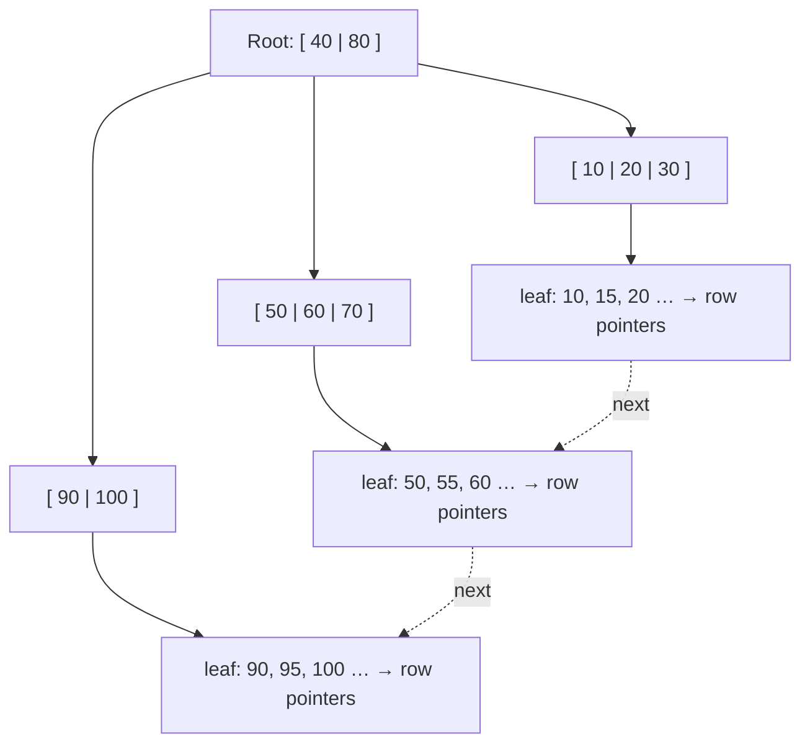

An index is a separate data structure that lets the database find rows without reading the whole table, just like the index at the back of a book. The right index can turn a 10-second query into a 1-millisecond one. The wrong ones slow down every write.

## Without and with an index

`SELECT * FROM users WHERE email = 'a@x.com'` on 100 million rows:
- **No index:** a full table scan, reading every row. Seconds to minutes.
- **Index on `email`:** walk a tree of a few levels to the exact row. Under a millisecond.

> [!REAL] The index at the back of a textbook
> Finding "photosynthesis" without the index means reading all 400 pages. With it, you jump straight to page 212. A database index does the same for `WHERE email = ?`.

## The B-tree (B+ tree) index

The default index in almost every relational database.



- A balanced tree with a very high fan-out (hundreds of keys per node), so even billions of rows need only 3–5 levels.
- Keys are **sorted**, and leaf nodes are linked, which makes **range queries** (`BETWEEN`, `>`, `ORDER BY`) efficient.
- Lookups, inserts and deletes are O(log n).

Good for: equality, ranges, sorting, prefix matches (`LIKE 'abc%'`). Not useful for: `LIKE '%abc'` or functions applied to the column (unless you index the expression).

> [!REAL] The phone directory
> The old telephone directory had guide words at the top of each page ("Sharma – Shetty"). You open the middle, narrow down, and find the page in a few flips. A B-tree is that, in a few disk reads for millions of rows.

## Other index types

| Type | How it works | Good for |
|---|---|---|
| **Hash** | Hash table of key → row | Exact equality only; no ranges |
| **Inverted index** | word → list of documents containing it | Full-text search (Elasticsearch, PostgreSQL GIN) |
| **Bitmap** | one bit per row per value | Low-cardinality columns in analytics (status, gender) |
| **Geospatial (R-tree, geohash, S2)** | Indexes regions of space | "Drivers within 2 km" |
| **LSM-tree based** | Sorted files merged in the background | Write-heavy stores (Cassandra, RocksDB) |

## Clustered vs non-clustered

- **Clustered (primary) index:** the table's rows are physically stored in the index order. One per table. In MySQL InnoDB, the primary key is the clustered index, so lookups by primary key are fastest, and a random UUID primary key scatters inserts across the tree (slower writes; prefer time-ordered IDs).
- **Secondary (non-clustered) index:** a separate structure holding the indexed column plus a pointer to the row (or the primary key). A lookup may need a second step to fetch the row.

## Composite indexes and the leftmost-prefix rule

An index on `(user_id, created_at)` is sorted by `user_id`, then by `created_at` within each user.

It helps:
- `WHERE user_id = 42`
- `WHERE user_id = 42 AND created_at > '2026-01-01'`
- `WHERE user_id = 42 ORDER BY created_at DESC LIMIT 20` (no sort needed)

It does **not** help `WHERE created_at > '2026-01-01'` alone, because the index is not sorted by `created_at` globally.

**Column order rule of thumb:** equality columns first, then range or sort columns.

> [!REAL] A directory sorted by surname, then first name
> You can quickly find all "Sharma", or "Sharma, Rahul". You can't quickly find every "Rahul" because the directory isn't sorted by first name. That's the leftmost-prefix rule.

## Covering indexes

If the index contains every column the query needs, the database answers from the index alone without touching the table ("index-only scan").

```sql
CREATE INDEX idx_orders_user ON orders (user_id, created_at) INCLUDE (status, total);
SELECT created_at, status, total FROM orders WHERE user_id = 42 ORDER BY created_at DESC LIMIT 20;
```

> [!REAL] The answer is in the index itself
> If you only want to know which page "photosynthesis" is on, the index alone answers you; you never open the chapter. A covering index answers the query without touching the table.

## The cost of indexes

Indexes are not free:
- **Every write updates every index** on the table. Ten indexes means each insert does roughly eleven writes.
- **Storage:** indexes can be as big as the table.
- **Memory:** hot indexes need to fit in RAM to be fast.

So index for the queries you actually run, and drop unused indexes. Write-heavy tables should carry only the indexes they need.

> [!REAL] Updating every index in the library
> Every new book must be added to the title catalogue, the author catalogue and the subject catalogue. More indexes mean faster searching but slower adding.

## How to find what to index

1. Look at slow query logs and the most frequent queries.
2. Run `EXPLAIN` / `EXPLAIN ANALYZE` to see whether a query scans or uses an index.
3. Index columns used in `WHERE`, `JOIN ... ON` and `ORDER BY` for those queries.
4. Prefer **selective** columns (many distinct values). An index on a boolean column rarely helps.

> [!WARNING] Common traps
> - Wrapping the column in a function: `WHERE LOWER(email) = ?` ignores an index on `email` (index the expression instead).
> - Implicit type casts: comparing a string column with a number can skip the index.
> - Leading wildcards: `LIKE '%term'` cannot use a B-tree; use full-text search.
> - `OR` across different columns can prevent index use; sometimes `UNION` of two indexed queries is faster.

> [!INTERVIEW] Tie indexes to access patterns
> "The feed query is 'latest 20 posts by this user', so I'll add a composite index on `(author_id, created_at DESC)`. That serves the filter and the sort directly. Posts are written far less than they are read, so the extra write cost is fine."

## Key takeaways

- B-trees give O(log n) lookups and efficient range scans; they are the default.
- Composite indexes follow the leftmost-prefix rule: equality columns first, then range/sort.
- Covering indexes avoid touching the table at all.
- Every index slows writes; index the queries you actually run.
