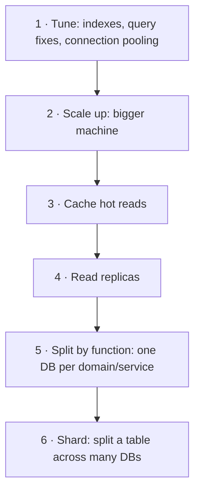

Almost every system design question is, underneath, a data question: where does the data live, how is it read and written, and what happens when there is too much of it? This lesson maps out the territory the rest of the chapter covers.

## What a database gives you

A database is more than "a place to put data". A good one provides:
- **Durability:** acknowledged writes survive crashes.
- **Querying:** find data by more than its primary key.
- **Concurrency control:** many users can read and write at once without corrupting data.
- **Integrity:** rules (types, constraints, foreign keys) that keep data valid.
- **Transactions:** groups of changes that succeed or fail together.

Different databases trade some of these away to gain speed, scale or flexibility. Knowing which trade a database makes is the core skill.

> [!REAL] Why not just a text file?
> A kirana shop can track dues in a notebook. Once ten clerks write in it at the same time, someone overwrites someone else, pages get lost and finding "all dues from Sharma ji" takes an hour. A database solves exactly those problems: safe concurrent writes, durability and fast lookups.

## The two big families

| | Relational (SQL) | Non-relational (NoSQL) |
|---|---|---|
| Data model | Tables with fixed schemas, related by keys | Documents, key-value pairs, wide columns or graphs |
| Query | SQL, joins, ad-hoc queries | Mostly by key; limited or model-specific queries |
| Transactions | Strong, multi-row ACID | Often single-item; some offer more |
| Scaling | Vertical first, then replicas, sharding is manual work | Usually built to scale out from day one |
| Best when | Data is relational, integrity matters, queries vary | Huge scale, simple known access patterns, flexible schema |

Neither is "better". Details in [Relational Databases](#/l/03-databases/relational), [NoSQL: The Four Families](#/l/03-databases/nosql) and [SQL vs NoSQL](#/l/09-tradeoffs/sql-vs-nosql).

> [!REAL] Excel sheet vs folder of files
> A relational database is like a set of strict Excel sheets linked by IDs (customers, orders, payments). A document database is like a folder holding one file per customer with everything about them inside. Banks love the first; product catalogues with varying attributes often prefer the second.

## How databases scale: the ladder

When a database struggles, climb this ladder one rung at a time. Each rung costs more complexity than the last.

1. **Tune.** A missing index can make a query 1,000× slower. Fix queries, add indexes, use connection pooling. Free and often decisive.
2. **Scale up.** More CPU, RAM and faster disks.
3. **Cache.** Keep hot reads in memory. See the [Caching chapter](#/c/04-caching).
4. **Replicate.** Copies of the database serve reads; the primary handles writes. See [Replication](#/l/03-databases/replication).
5. **Partition by function.** Users, orders and payments in separate databases.
6. **Shard.** Split one large table horizontally by a key. See [Sharding](#/l/03-databases/sharding).

> [!TIP] Reads and writes scale differently
> Reads are easy to scale: copy the data (replicas, caches). Writes are hard: every write must land on the owner of that data, so the only way to scale writes is to split ownership (sharding).

> [!REAL] How a growing shop handles its ledger
> First a faster clerk (bigger machine), then photocopies for people who only read (replicas), then a cheat-sheet of popular answers on the counter (cache), and only at the end separate ledgers per region (sharding).

## Questions that pick the right database

Ask these about the data, then choose:

1. **What are the access patterns?** By key only? Range scans by time? Full-text search? Graph traversals? Ad-hoc analytics?
2. **What is the read/write ratio and volume?**
3. **How much data, and how fast does it grow?**
4. **What consistency is needed?** Money and inventory need strong guarantees; likes and view counts do not.
5. **Does the schema change often or vary per record?**
6. **Do we need transactions across multiple records?**

Real systems use several stores at once (**polyglot persistence**):

| Data | Likely store |
|---|---|
| Users, orders, payments | Relational |
| Sessions, rate-limit counters, leaderboards | Key-value (in-memory) |
| Chat messages, activity events, time-series | Wide-column / time-series |
| Product catalogue with varied attributes | Document |
| Social graph, recommendations | Graph |
| Full-text search | Search engine (inverted index) |
| Images, video, backups | Object storage |
| Analytics over billions of rows | Columnar warehouse |

## Concepts covered in this chapter

- **Transactions and isolation:** what ACID really promises and the anomalies weaker isolation allows.
- **Indexes:** B-trees, composite indexes and their write cost.
- **Replication:** leader-follower, multi-leader, leaderless, and lag.
- **Sharding and consistent hashing:** splitting data so the system keeps scaling.
- **CAP and PACELC:** the theory behind consistency vs availability choices.
- **Storage engines:** B-trees vs LSM trees, and why it matters.
- **Search engines:** how Elasticsearch finds documents.

## Key takeaways

- Choose a database by access patterns, consistency needs and scale, not by fashion.
- Scale databases in steps: tune, scale up, cache, replicate, split, shard.
- Reads scale by copying; writes scale only by splitting.
- Most real systems use several kinds of storage.
