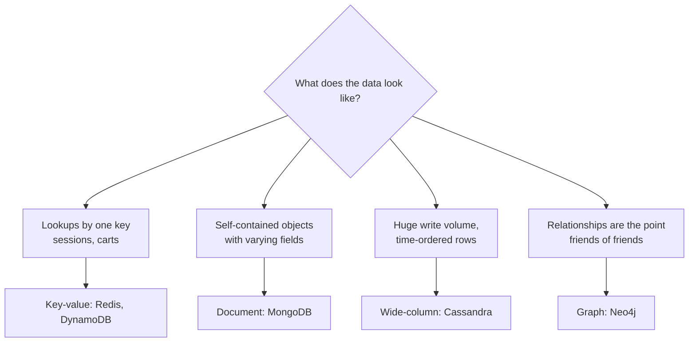

"NoSQL" is a loose label for databases that do not use the relational table model. They usually give up joins, rich transactions or a fixed schema in exchange for horizontal scalability, flexibility or speed on a specific access pattern. There are four main families, and each fits a different shape of data.

## 1. Key-value stores

**Model:** a giant distributed hash map. You `GET`, `PUT` and `DELETE` a value by its key. The value is opaque to the database.

**Examples:** Redis, Memcached, DynamoDB (also document-like), etcd.

**Strengths:** the simplest model, extremely fast (in-memory ones reach sub-millisecond latency), trivial to partition by key.

**Weaknesses:** no queries by anything except the key, no relationships.

**Use for:** caches, sessions, rate-limit counters, feature flags, shopping carts, leaderboards (Redis sorted sets), distributed locks.

```text
session:9f2a   → {"userId": 42, "expires": 1767225600}
ratelimit:u42  → 17
```

> [!REAL] The cloakroom token
> Hand over your bag, get token #47. Later, show #47 and get the bag. No searching by colour. Redis and DynamoDB are cloakrooms: very fast when you know the key.

## 2. Document stores

**Model:** each record is a self-contained JSON-like document with nested fields and arrays. Documents in one collection can have different fields.

**Examples:** MongoDB, Couchbase, Firestore.

```json
{
  "_id": "p_123",
  "name": "Running shoe",
  "price": 4999,
  "attributes": { "size": [7, 8, 9], "colour": "blue", "drop_mm": 8 },
  "reviews": [{ "user": "u42", "stars": 5 }]
}
```

**Strengths:** maps naturally to objects in code; flexible schema; can index and query fields inside documents; reading a whole entity is one fetch.

**Weaknesses:** joins are weak or absent; data shared between documents must be duplicated or referenced manually; multi-document transactions exist in some products but are costlier.

**Use for:** product catalogues with varied attributes, content management, user profiles, anything read and written as a whole object.

> [!REAL] One file per customer
> A Flipkart product has very different attributes: a phone has RAM and camera, a shirt has size and fabric. A document store like MongoDB keeps each product as one flexible JSON document.

## 3. Wide-column stores

**Model:** rows identified by a **partition key**, with many columns sorted by a **clustering key** inside each partition. Think "a sorted map of sorted maps", spread across a cluster.

**Examples:** Apache Cassandra, ScyllaDB, HBase, Google Bigtable.

```text
partition key: chat_id = 991
  clustering key (message time) → columns
  2026-11-02T10:00:01  → sender=u1, text="hi"
  2026-11-02T10:00:07  → sender=u2, text="hello"
  ...
```

**Strengths:** massive write throughput (LSM-tree storage, see [How Databases Store Data on Disk](#/l/03-databases/storage-engines)); linear horizontal scaling; efficient range reads within a partition; tunable consistency; multi-datacentre replication built in.

**Weaknesses:** you must design tables around queries in advance ("query-first modelling"), often duplicating data into one table per query; no joins; ad-hoc queries are hard.

**Use for:** chat messages, activity feeds, IoT and time-series data, event logs, anything write-heavy that is always read by a known key and time range.

> [!REAL] A huge register with millions of columns
> Cassandra lets each row have its own set of columns, and it is built for enormous write volumes. Discord stored billions of chat messages this way (it later moved to ScyllaDB, a Cassandra-compatible database).

## 4. Graph databases

**Model:** **nodes** (entities) and **edges** (relationships), both with properties. Traversing relationships is the primary operation.

**Examples:** Neo4j, Amazon Neptune, JanusGraph.

```text
(Asha)-[:FOLLOWS]->(Ravi)-[:FOLLOWS]->(Meera)
(Asha)-[:LIKES]->(Post 17)
```

**Strengths:** multi-hop queries ("friends of friends who like X") are fast because each node stores direct references to its neighbours, rather than needing a join per hop.

**Weaknesses:** harder to shard, since a good partition of a graph is difficult; smaller ecosystem; overkill if you only ever need one hop.

**Use for:** social graphs, recommendations, fraud rings, knowledge graphs, network topology.

> [!REAL] "People you may know"
> LinkedIn's "2nd-degree connection" is a friends-of-friends walk. In a graph database that's following edges; in SQL it's a stack of painful self-joins.

## Related specialised stores

- **Search engines** (Elasticsearch, OpenSearch): inverted indexes for full-text search and filtering. See [How Elasticsearch Works](#/l/03-databases/elasticsearch).
- **Time-series databases** (InfluxDB, TimescaleDB, Prometheus): optimised for timestamped metrics, downsampling and retention.
- **Columnar warehouses** (BigQuery, Snowflake, ClickHouse, Redshift): store each column separately for fast analytics over billions of rows.
- **Object storage** (S3, GCS): cheap, durable storage for large blobs such as images and video.

## Comparison

| Family | Query by | Scales writes | Schema | Transactions | Typical use |
|---|---|---|---|---|---|
| Key-value | Key only | Excellent | None | Single key | Cache, sessions, counters |
| Document | Key + indexed fields | Good | Flexible | Single doc (multi-doc in some) | Catalogues, profiles, CMS |
| Wide-column | Partition key + range | Excellent | Per table, query-first | Single partition, lightweight | Messages, feeds, time-series |
| Graph | Traversals | Hard | Flexible | Varies | Social, recommendations, fraud |

> [!INTERVIEW] Justify NoSQL by the access pattern
> "Chat messages are written constantly, never updated, and always read as 'latest N messages in this conversation'. That is a perfect fit for a wide-column store with `conversation_id` as the partition key and message time as the clustering key: writes spread evenly and the read is one sequential slice."

> [!WARNING] NoSQL is not automatically faster
> A key-value store is fast for lookups by key. Ask it "which users signed up last week in Pune?" and it becomes slow or impossible. The speed comes from narrowing what you can ask.



## Key takeaways

- Key-value: lookups by key, blazing fast. Document: flexible nested records. Wide-column: huge write volume, query-first design. Graph: relationships.
- Each family wins by constraining the access pattern.
- Model data around the queries you will run.
- Real systems combine several stores.
