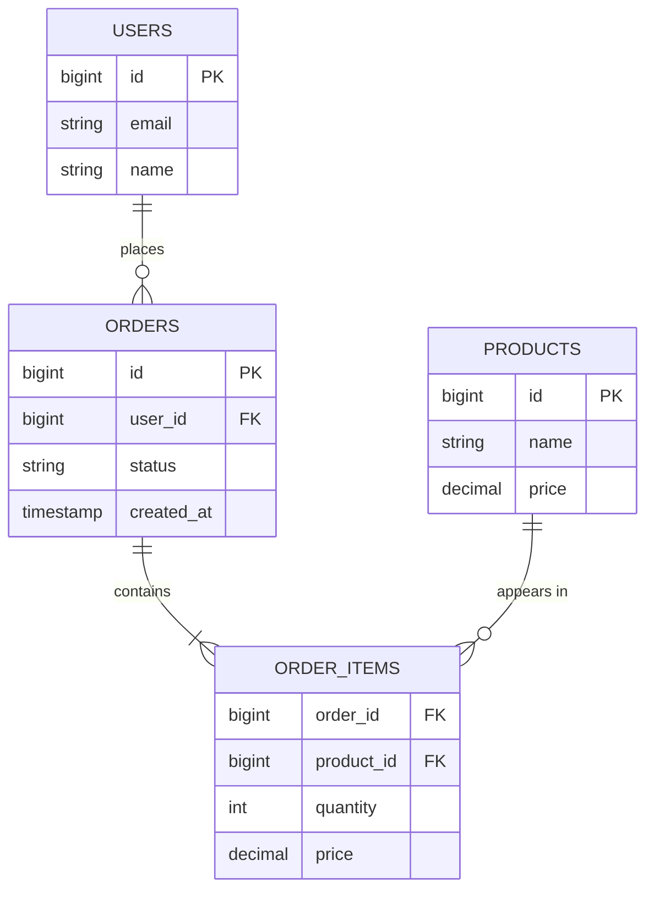

Relational databases (PostgreSQL, MySQL, Oracle, SQL Server) store data in **tables** of rows and columns, link tables through **keys**, and let you ask almost any question with SQL. Decades after they appeared, they are still the right default for most business data.

## The model



- **Table:** a set of rows with the same columns.
- **Schema:** the declared columns, types and rules. Data that breaks the rules is rejected.
- **Primary key (PK):** uniquely identifies a row.
- **Foreign key (FK):** a column that refers to a row in another table. The database can enforce that it points at something real.
- **Constraints:** `NOT NULL`, `UNIQUE`, `CHECK (quantity > 0)` and so on. The database guards integrity so every application does not have to.

## Normalisation

Normalisation means storing each fact **once** and referencing it elsewhere.

**Not normalised:** each order row repeats the customer's name and email. If the email changes, you must update every order, and a missed row leaves the data contradicting itself.

**Normalised:** orders store `user_id`; the email lives only in `users`.

The usual normal forms in plain words:
- **1NF:** each cell holds a single value; no repeating groups like `phone1, phone2, phone3`.
- **2NF:** every non-key column depends on the *whole* primary key, not part of it.
- **3NF:** non-key columns depend only on the key, not on other non-key columns (store `zip_code`, not `zip_code` *and* `city` derived from it, unless you accept the duplication).

### Denormalisation
Sometimes you deliberately duplicate data to avoid expensive joins on hot read paths: a `comment_count` column on posts, or the author's name copied onto each post for a feed. You trade write complexity and the risk of inconsistency for read speed. It is a legitimate optimisation, but make it a conscious choice.

## Joins

Joins combine rows from several tables in one query:

```sql
SELECT u.name, o.id, o.created_at
FROM users u
JOIN orders o ON o.user_id = u.id
WHERE u.id = 42
ORDER BY o.created_at DESC
LIMIT 20;
```

Joins are what make the relational model so flexible: you can ask new questions without changing how the data is stored. They are cheap on indexed columns within one database, and **painful across shards**, which is a big reason sharding relational data is hard.

## Strengths

- **Strong consistency and ACID transactions** across many rows and tables. See [Transactions, Isolation & ACID](#/l/03-databases/sql-and-acid).
- **Integrity enforced by the database** (constraints, foreign keys).
- **Ad-hoc queries.** New reports and features rarely need a schema redesign.
- **Mature tooling:** backups, replication, monitoring, ORMs, decades of operational knowledge.
- **Very capable on one machine.** A tuned PostgreSQL on good hardware handles tens of thousands of transactions per second and terabytes of data.

## Weaknesses

- **Horizontal write scaling is not built in.** Sharding is possible but you (or an extension or a distributed SQL product) must handle routing, cross-shard queries and transactions.
- **Rigid schema.** Changing the schema on a huge table needs care (online migration tools, backfills).
- **Object–relational mismatch.** Nested objects in code must be flattened into tables.

## When to choose relational

- Data has clear relationships and integrity matters: users, orders, payments, inventory, bookings.
- You need multi-row transactions.
- Query patterns are varied or not fully known yet.
- Data fits on one primary for the foreseeable future, or can be split by a natural key later.

> [!INTERVIEW] A good default
> "I'll start with PostgreSQL for orders and payments because we need transactions across the order, its items and the inventory reservation, and the data is clearly relational. At our estimated 2K writes per second a single primary with replicas is comfortable. If we outgrow it, we shard by customer ID since nearly all queries are per customer."

### Distributed SQL
Products such as Google Spanner, CockroachDB and YugabyteDB keep SQL and ACID transactions but shard and replicate automatically, using consensus. They cost more latency per write and more money, but remove a lot of manual sharding work. Worth mentioning when an interviewer wants both relational guarantees and global scale.

## Key takeaways

- Tables, keys and constraints let the database guarantee integrity.
- Normalise by default; denormalise deliberately for hot reads.
- Joins make relational databases flexible but are hard across shards.
- Relational is the right default for transactional business data.
