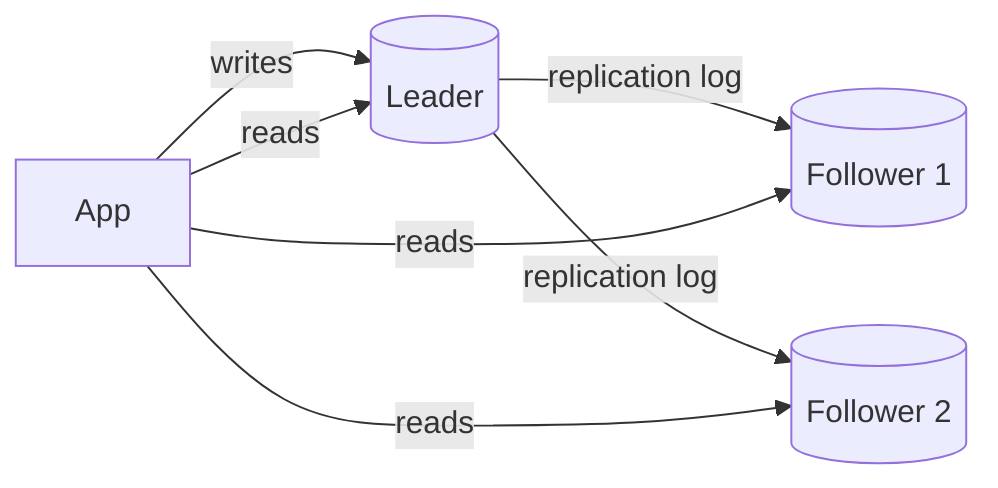

Replication means keeping copies of the same data on several machines. It serves three purposes: **availability** (survive a machine dying), **read scaling** (spread reads across copies) and **latency** (put a copy near the users). The design questions are who accepts writes and how changes travel to the other copies.

## Leader-follower (primary-replica)



- **One leader** accepts all writes and records them in a replication log (e.g. the WAL or binlog).
- **Followers** apply the log in the same order and serve reads.
- The most common setup: PostgreSQL, MySQL, MongoDB replica sets, Redis.

### Synchronous vs asynchronous

| | Synchronous | Asynchronous |
|---|---|---|
| Leader waits for follower before acknowledging? | Yes | No |
| Data loss if leader dies | None (for synced followers) | Recent writes can be lost |
| Write latency | Higher | Lower |
| If a follower is slow or down | Writes stall | Writes continue |

A common middle ground is **semi-synchronous**: wait for *one* follower (ideally in another availability zone), replicate to the rest asynchronously. You lose nothing on a single failure and are not held hostage by the slowest replica.

### Failover
When the leader dies, a follower must be promoted:
1. **Detect** the failure (missed heartbeats, timeouts).
2. **Choose** the most up-to-date follower, ideally through a consensus process.
3. **Reconfigure** clients and other followers to use the new leader.

What can go wrong:
- With async replication, the new leader may be missing the last writes. Those writes are lost or conflict when the old leader returns.
- **Split brain:** the old leader was only slow, not dead, and keeps accepting writes. Prevent with quorum-based election and **fencing** (the old leader is blocked from writing, e.g. by an epoch number that storage rejects).
- Timeouts too short cause needless failovers; too long mean longer outages.

## Replication lag and the anomalies it causes

With async followers, a follower might be milliseconds or, under load, seconds behind. That produces visible bugs:

**Read-your-own-writes violation.** A user edits their profile, the page reloads from a lagging follower, and the edit seems to vanish.
- *Fix:* read the user's own data from the leader, or from the leader for N seconds after they write, or track the write's log position and only read from followers that have caught up.

**Monotonic reads violation.** Two refreshes hit two different followers; a comment appears, then disappears.
- *Fix:* pin each user to one follower (e.g. hash user ID to a replica).

**Consistent prefix violation.** You see an answer before the question it replies to, because they came from different partitions.
- *Fix:* write causally related data to the same partition, or track causal dependencies.

## Multi-leader replication

Several leaders accept writes, typically **one per region**, and replicate to each other asynchronously.

- **Pros:** local writes in every region (low latency); a region can keep working if the link to others is down.
- **Cons:** **write conflicts.** Two regions can change the same record at the same time.

Conflict resolution strategies:
- **Last-write-wins (LWW)** by timestamp. Simple, but silently drops one of the writes, and clocks drift.
- **Merge** the values (union of sets, sum of counters). CRDTs (conflict-free replicated data types) make this automatic for certain data types.
- **Application-level resolution:** keep both versions and let code or the user decide.
- **Avoid conflicts:** route all writes for a given record to its "home" region.

Also used by offline-first apps: each device is effectively a leader that syncs later.

## Leaderless replication

Any replica accepts reads and writes. The client (or a coordinator) sends each write to several replicas and reads from several. Used by Cassandra, ScyllaDB, Riak and DynamoDB-style systems.

### Quorums
With **N** replicas, a write must be acknowledged by **W** of them and a read must query **R** of them.

If **W + R > N**, every read overlaps at least one replica that has the latest write.

```text
N = 3, W = 2, R = 2  → 2 + 2 > 3  ✓ reads see the latest acknowledged write
N = 3, W = 1, R = 1  → fast, but reads may be stale
```

Tune per query: `W = N` makes writes slow but reads cheap; `W = 1` makes writes fast and durable on only one node.

### Keeping replicas in sync
- **Read repair:** when a read sees a stale replica, the coordinator writes the newer value back to it.
- **Anti-entropy:** background processes compare replicas (using Merkle trees, so only differing ranges are exchanged) and fix differences.
- **Hinted handoff:** if a replica is down, another node stores the write temporarily and passes it on when the replica returns.

## Choosing

| Setup | Best for | Main risk |
|---|---|---|
| Leader-follower | Most apps; read-heavy workloads | Lag anomalies, failover data loss |
| Multi-leader | Multi-region writes, offline clients | Conflicts |
| Leaderless | Very high availability and write volume | Stale reads, conflict handling, tuning quorums |

> [!INTERVIEW] Replication is not a backup
> A mistaken `DELETE` replicates to every copy within milliseconds. You still need point-in-time backups.

## Key takeaways

- Replication gives availability, read scale and locality; it does not scale writes.
- Leader-follower is the default; choose sync, async or semi-sync deliberately.
- Lag causes read-your-writes and monotonic-read anomalies; know the fixes.
- Multi-leader and leaderless setups trade conflicts and staleness for availability; W + R > N is the quorum rule.
