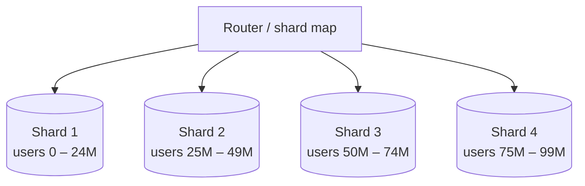

Sharding (horizontal partitioning) splits one large dataset across many databases, called **shards**, so that each holds only part of the rows. It is the main way to scale **writes** and total data size beyond one machine. It is also one of the most expensive decisions you can make, so it should come last on the scaling ladder.

## Partitioning vocabulary

- **Vertical partitioning:** split a table by *columns* (put rarely used, large columns such as `bio` or `avatar_blob` in a separate table).
- **Functional partitioning:** split by *domain* (users DB, orders DB, payments DB).
- **Horizontal partitioning / sharding:** split a table by *rows*; every shard has the same schema and a different subset of rows.

## Choosing the shard key

The **shard key** decides which shard a row lives on. It is the most important decision, because changing it later means moving all the data.

A good shard key:
1. **Spreads data and traffic evenly** (high cardinality, no dominant values).
2. **Matches the main access pattern**, so most queries hit one shard.
3. **Keeps related data together**, so transactions and joins stay within one shard.

| System | Good key | Why |
|---|---|---|
| Social app posts | `user_id` | Most queries are "this user's posts" |
| Chat messages | `conversation_id` | Messages are read per conversation |
| E-commerce orders | `customer_id` | Order history, per-customer transactions |
| Multi-tenant SaaS | `tenant_id` | Tenants are isolated; queries are per tenant |
| Metrics | `metric_id` + time bucket | Avoids all current writes hitting one shard |

Bad keys: `country` (India dwarfs others), `created_date` (all new writes hit one shard), a boolean or status column.

## Sharding strategies

### Range-based
Each shard owns a contiguous key range (A–F, G–M…, or IDs 1–1M, 1M–2M…).
- **Pros:** range queries are efficient; easy to understand.
- **Cons:** **hot spots**. Time-ordered or sequential keys send all new writes to the last shard.

### Hash-based
`shard = hash(key) mod N`.
- **Pros:** spreads keys evenly.
- **Cons:** range queries must hit every shard; **changing N moves almost every key**. Consistent hashing fixes the resharding problem. See [From Modulo to Consistent Hashing](#/l/03-databases/consistent-hashing).

### Directory-based (lookup table)
A lookup service maps each key (or key range) to a shard.
- **Pros:** total flexibility; move individual tenants or users between shards.
- **Cons:** the directory is an extra hop and a critical dependency; it must be cached and highly available.

### Geographic
Shard by region (EU users in an EU shard). Good for latency and data-residency laws; uneven if regions differ in size.

## The hard problems sharding creates

### 1. Cross-shard queries
"Top 10 products across all sellers" must ask every shard and merge (**scatter-gather**). It is slow and gets slower with more shards. Fixes: denormalise into a separate table sharded by the other key, maintain precomputed aggregates, or send analytics to a warehouse.

### 2. Cross-shard transactions
A transfer between users on different shards cannot use one local ACID transaction. Options: two-phase commit, sagas with compensation, or choose a shard key that keeps transactional data together.

### 3. Hot shards (celebrity problem)
Even with hashing, one key can be enormously popular: a celebrity's posts, a viral product, a huge tenant. Fixes:
- Split the hot key further by adding a suffix (`product_42#0` … `product_42#9`) and aggregate on read.
- Cache hot keys aggressively.
- Move a huge tenant to a dedicated shard (directory-based sharding makes this easy).

### 4. Resharding
When shards fill up, data must move while the system keeps running:
- Use **many logical shards** mapped onto fewer physical machines (e.g. 1,024 logical shards on 16 servers). Growing means moving whole logical shards to new servers, never re-hashing keys.
- Use consistent hashing so adding a node moves only a fraction of keys.
- Migrate online: copy data, replay changes (double-write or change data capture), verify, then switch reads and writes.

### 5. Unique IDs
Auto-increment no longer works across shards. Use UUIDs, or time-ordered IDs such as Snowflake-style 64-bit IDs (timestamp + machine ID + sequence), which also keep B-tree inserts efficient.

### 6. Operational overhead
Backups, schema migrations, monitoring and failover for every shard.

## Routing requests

- **Application-level:** the app computes the shard from the key.
- **Proxy / middleware:** a routing layer (e.g. Vitess for MySQL, Citus for PostgreSQL) hides shards from the app.
- **Built-in:** many NoSQL and distributed SQL databases shard automatically.

> [!INTERVIEW] Earn the right to shard
> "100M users × 2 KB is 200 GB, which fits on one primary, and 3K writes per second is fine too. So I'd start unsharded with replicas. Once writes approach the primary's limit, I'd shard by `user_id` because every main query is per user, using 1,024 logical shards so we can add machines without rehashing."

## Key takeaways

- Sharding scales writes and storage by splitting rows across databases.
- The shard key must spread load evenly and match the main access pattern.
- Range sharding gives range queries but hot spots; hashing spreads load but scatters ranges; directories add flexibility.
- Expect cross-shard queries, cross-shard transactions, hot keys and resharding; plan for them up front.
