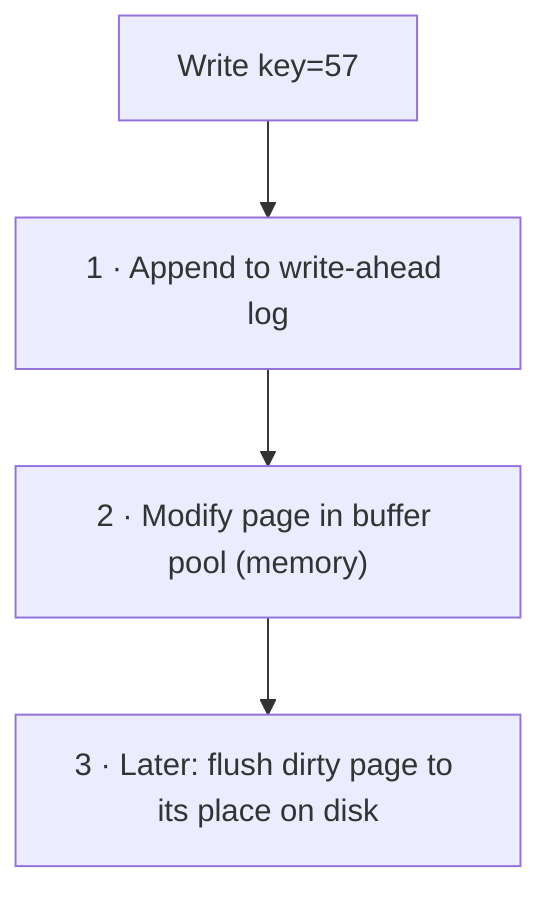
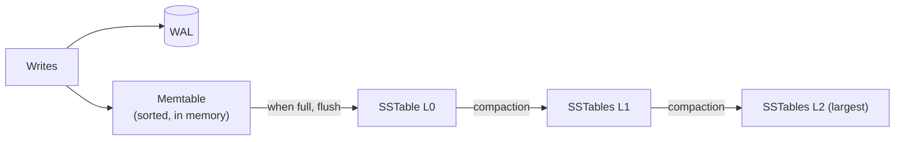

Underneath every database is a storage engine that decides how bytes are laid out on disk. Two designs dominate: **B-trees**, which update data in place, and **LSM trees**, which only ever append. The choice explains why some databases excel at reads and others at writes.

## Why disk layout matters

Recall the latency numbers: random disk access is far slower than sequential access, and memory is far faster than either. Storage engines are clever ways to minimise random I/O for the workload they target.

## The simplest possible engine: an append-only log

Append every write to the end of a file: `key,value`. Writes are sequential and therefore fast. But reading a key means scanning the whole file. Add an in-memory hash map from key to file offset and reads become one seek. That is essentially how Bitcask works. Its limit: all keys must fit in memory and range queries are impossible.

The two main engines both build on this idea in different directions.

## B-trees: update in place

The data lives in fixed-size **pages** (typically 4–16 KB) arranged as a balanced tree. To write, find the right leaf page and modify it in place.

- **Write-ahead log (WAL):** every change is appended to the log first, so a crash mid-update can be recovered.
- **Buffer pool:** hot pages live in memory; dirty pages are flushed in the background.
- **Page splits:** when a page fills, it splits in two and the parent gets a new pointer.

**Strengths:** reads are predictable (a few page reads per lookup); excellent range scans; each key lives in exactly one place, which makes transactions and locking straightforward.

**Weaknesses:** random writes to pages all over the disk; **write amplification** (changing one small row rewrites a whole page, plus the WAL); pages fragment over time.

**Used by:** PostgreSQL, MySQL InnoDB, Oracle, SQL Server, most relational databases.

## LSM trees: append, then merge

A log-structured merge tree never modifies data in place.

1. Writes go to the WAL (for durability) and to the **memtable**, a sorted structure in memory.
2. When the memtable fills, it is flushed to disk as an immutable, sorted file: an **SSTable** (sorted string table). This is one big sequential write.
3. Over time, many SSTables accumulate. **Compaction** merges them in the background, keeping the newest value for each key and dropping deleted ones (deletes are written as **tombstones**).

**Reading** a key: check the memtable, then SSTables from newest to oldest. To avoid opening every file:
- **Bloom filters** per SSTable answer "definitely not here" for most files. See [Bloom Filter vs Hash Table](#/l/09-tradeoffs/bloom-vs-hashtable).
- **Sparse indexes** inside each SSTable jump to the right block.

**Strengths:** very high write throughput (all disk writes are sequential); good compression; less write amplification for many workloads.

**Weaknesses:** reads may check several files (**read amplification**); compaction uses CPU and I/O in the background and can cause latency spikes; deleted data lingers until compaction.

**Used by:** Cassandra, ScyllaDB, HBase, RocksDB, LevelDB, Bigtable, and as an option in MySQL (MyRocks).

## Comparison

| | B-tree | LSM tree |
|---|---|---|
| Write pattern | Random, in place | Sequential, append-only |
| Write throughput | Good | Excellent |
| Read latency | Predictable, low | Usually low, can vary |
| Range scans | Excellent | Good |
| Space | Some fragmentation | Better compression; old versions until compaction |
| Background work | Page flushing | Compaction |
| Best for | Read-heavy, transactional | Write-heavy, time-series, logs, messages |

## Row stores vs column stores

Another layout choice, independent of the above:

- **Row-oriented:** all columns of a row stored together. Ideal for OLTP: fetch or update one order with all its fields.
- **Column-oriented:** each column stored separately. Ideal for OLAP: `SUM(amount) WHERE region = 'South'` over a billion rows reads only two columns, and similar values compress extremely well.

| | Row store | Column store |
|---|---|---|
| Workload | Transactions (OLTP) | Analytics (OLAP) |
| Reads | Whole rows | A few columns across many rows |
| Examples | PostgreSQL, MySQL | ClickHouse, BigQuery, Snowflake, Redshift, Parquet files |

## Key takeaways

- B-trees update pages in place: predictable reads, good for transactional workloads.
- LSM trees append to sorted files and compact later: excellent writes, a bit more read work.
- The WAL makes both durable; Bloom filters make LSM reads cheap.
- Row stores serve transactions; column stores serve analytics.
