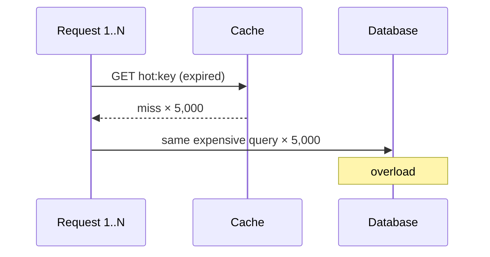

Caches fail in a few recurring, well-known ways. Each one can turn a cache from a performance aid into the cause of an outage. Interviewers love these because they show whether you have run a cache under real load.

## 1. Cache stampede (thundering herd / dog-piling)

**What happens:** a very popular key expires (or is deleted). In the next few milliseconds, thousands of requests miss at once and **all** of them query the database to rebuild the same value. The database collapses under identical queries.



**Fixes**
- **Request coalescing / single flight:** only one request rebuilds the key; others wait for its result. Within one process, a per-key future; across servers, a short-lived lock in the cache:

```text
SET lock:hot:key <token> NX PX 5000    → winner rebuilds and SETs the value
others: wait briefly and re-read the cache, or serve the stale value
```

- **Stale-while-revalidate:** serve the old value while one background job refreshes it. See [Combining Eviction and Invalidation](#/l/04-caching/eviction-and-invalidation).
- **Probabilistic early expiration:** each request has a small, rising chance of refreshing the key *before* it expires, so refreshes spread out instead of happening all at once.
- **Pre-warming / refresh-ahead:** a scheduled job refreshes known hot keys before they expire.

> [!REAL] Everyone rushes the counter at once
> The sweet shop's display runs out of jalebi and 50 customers all ask the kitchen at once. Instead, one person goes to the kitchen and the others wait for that batch. In caching, a lock or "single flight" makes one request rebuild a hot key.

## 2. Cache avalanche

**What happens:** many keys expire **at the same moment** (they were all loaded together with the same TTL, e.g. after a deploy or a cache restart), or the cache cluster itself goes down. The whole read load lands on the database.

**Fixes**
- **TTL jitter:** randomise expiry (`TTL = base + random(0, 10%)`).
- **High availability for the cache:** replicas and automatic failover (Redis Sentinel or Cluster).
- **Protect the database:** rate limiting, circuit breakers and load shedding so a cache outage degrades the service instead of killing the database.
- **Warm up gradually** after a cold start: pre-load hot keys or ramp traffic slowly.
- **Multi-level caching:** a small local cache absorbs some load if the distributed cache disappears.

> [!REAL] All the milk expires on the same day
> If every carton in the shop has the same expiry date, the shelf goes empty at once. Add random jitter to TTLs so keys don't all expire together.

## 3. Cache penetration

**What happens:** requests ask for keys that **do not exist** in the database at all (a bug, a scraper, or an attack with random IDs). Every request misses the cache *and* the database, so the cache gives no protection.

**Fixes**
- **Negative caching:** cache "not found" for a short TTL (`user:999999 → NULL, 60 s`).
- **Bloom filter in front:** keep a Bloom filter of all valid IDs; if it says "definitely not present", reject immediately without touching cache or database. See [Bloom Filter vs Hash Table](#/l/09-tradeoffs/bloom-vs-hashtable).
- **Input validation:** reject malformed IDs early; rate-limit abusive clients.

> [!REAL] Asking for a product that doesn't exist
> Bots request random product IDs that don't exist, so every request misses the cache and hits the database. Cache the "not found" result, or use a Bloom filter to reject unknown IDs early.

## 4. Hot keys

**What happens:** one key receives an enormous share of traffic: a celebrity's profile, a flash-sale product, a viral post. In a distributed cache that key lives on **one node**, which saturates its CPU or network while the others idle.

**Fixes**
- **Local (in-process) cache** for the hottest keys with a short TTL, so most reads never leave the app server.
- **Key replication / splitting:** store copies under `product:42#1` … `product:42#10` on different nodes and read a random copy. Writes must update all copies (or rely on short TTLs).
- **Read replicas** of the cache shard holding the hot key.
- **Detect hot keys** automatically (Redis `--hotkeys`, client-side sampling) so you can react during an event.

> [!REAL] The IPL final score
> During an IPL final, one key ("live score") gets millions of reads per second, more than one Redis node can serve. Copy it to several keys or keep it in each server's local memory for a second.

## 5. Big keys

**What happens:** a single value is huge (a list with millions of members, a multi-megabyte JSON). Reading it blocks a single-threaded server like Redis, saturates the network, and deleting it can freeze the node.

**Fixes:** split into smaller keys (paginate lists, use hashes with fields), compress values, delete with non-blocking commands (`UNLINK`), and set size limits in code review.

> [!REAL] One suitcase too heavy to lift
> A single 50 MB value (say, a celebrity's full follower list) blocks the cache node while it's being read. Split it into pages.

## 6. Inconsistency between cache and database

**What happens:** races between concurrent reads and writes leave stale values in the cache (see the stale re-fill race in [Cache Invalidation Strategies](#/l/04-caching/invalidation)), or an invalidation message is lost.

**Fixes:** update the database then delete the key; always set TTLs; leases or versions on fills; event-driven invalidation with retries; never use the cache as the source of truth for critical values.

## 7. Cold start

**What happens:** a new cache node, a restart or a new region starts empty; hit ratio is 0% and the database takes the full load.

**Fixes:** warm the cache from logs of popular keys or a snapshot, shift traffic gradually, keep persistence (Redis RDB/AOF) for faster restarts.

> [!REAL] A new shop with empty shelves
> A freshly restarted cache has nothing in it, so the database takes the full load. Warm it up with popular items before sending real traffic, the way a shop restocks before opening.

## Summary table

| Problem | Cause | Main fixes |
|---|---|---|
| Stampede | One hot key expires | Single flight, stale-while-revalidate, early refresh |
| Avalanche | Many keys expire / cache down | TTL jitter, HA cache, DB protection, warm-up |
| Penetration | Requests for non-existent keys | Negative caching, Bloom filter, validation |
| Hot key | One key gets huge traffic | Local cache, key splitting, replicas |
| Big key | Oversized values | Split, compress, `UNLINK` |
| Inconsistency | Races, lost invalidations | Delete after write, TTL, leases, events |
| Cold start | Empty cache | Pre-warm, gradual traffic, persistence |

> [!INTERVIEW] Flash-sale example
> "At 12:00 the sale product page gets 200K requests per second, all for one key. I'd pre-warm it before the sale, serve it from a 1-second in-process cache on every app server so Redis sees only a few thousand requests, and use single-flight so only one request per server refreshes it. Stock is not cached; it's decremented atomically in Redis and reconciled to the database."

## Key takeaways

- Stampede: one key, many misses → single flight or stale-while-revalidate.
- Avalanche: many keys or the whole cache → jitter, HA and database protection.
- Penetration: missing keys → negative caching and Bloom filters.
- Hot and big keys need special handling because one node owns each key.
