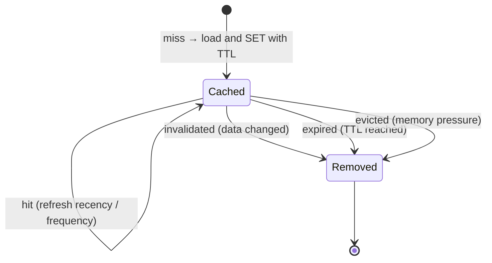

Eviction and invalidation both remove items from a cache, so they are often confused. They answer different questions and work together.

| | Eviction | Invalidation |
|---|---|---|
| Question it answers | "Memory is full: what can go?" | "This data changed: what is now wrong?" |
| Triggered by | Memory pressure | Data changes or time |
| Goal | Maximise hit ratio | Bound staleness / correctness |
| Removes | Valid but less useful items | Possibly incorrect items |
| Mechanisms | LRU, LFU, TinyLFU, random | TTL, delete-on-write, events, versioned keys |

A cache with perfect eviction but no invalidation is fast and wrong. A cache with perfect invalidation but poor eviction is correct and slow.

## How they interact

### TTL is the bridge
A TTL is an invalidation mechanism (bounds staleness) that also frees memory (helps eviction). In Redis, the `volatile-*` eviction policies only consider keys that have a TTL, which lets you mark which keys are disposable.

### Lifecycle of a cached item



Three exits, three reasons. When debugging a low hit ratio, find out which exit is dominant:
- Mostly **evictions** → cache too small or caching low-value data.
- Mostly **expirations** → TTLs may be shorter than needed.
- Mostly **invalidations** → data changes often; maybe it is a poor caching candidate, or invalidation is too broad.

## Design patterns that combine them

### 1. Long TTL + precise invalidation
Product details: TTL of hours, deleted on every update. Freshness comes from invalidation; memory is managed by LRU; the long TTL just cleans up anything missed.

### 2. Short TTL, no invalidation
Trending lists, recommendation results, aggregated stats: recompute every few minutes and let the TTL replace them. No invalidation plumbing needed because slight staleness is fine.

### 3. Tiered TTLs by importance
Different TTLs for different classes of data in the same cache, combined with `volatile-lru`, so disposable data is evicted first and must-keep data (rate-limit state, locks) has no TTL and is never evicted.

### 4. Soft TTL + hard TTL (stale-while-revalidate)
Store a "soft" expiry inside the value and a longer "hard" TTL on the key.
- Before the soft expiry: serve as normal.
- Between soft and hard: serve the stale value immediately **and** refresh it in the background (only one request does the refresh).
- After the hard expiry: it is gone; treat as a miss.

Users never wait for a reload, and the database sees one refresh per key instead of a stampede. HTTP has the same idea built in: `Cache-Control: max-age=60, stale-while-revalidate=300`.

### 5. Negative caching with short TTLs
Cache "not found" results for a short time (e.g. 30–60 seconds) to stop repeated lookups for missing keys from hitting the database. Invalidate (or keep the TTL short) so a newly created item becomes visible quickly. See [Stampedes, Penetration & Hot Keys](#/l/04-caching/challenges).

## Sizing: when eviction should be rare

Ideally, the **working set** (data accessed in a typical window) fits in the cache, so eviction only removes truly cold data. Estimate it:

```text
hot items × average size × overhead factor (~1.5 for keys, metadata, fragmentation)
e.g. 2M hot products × 4 KB × 1.5 ≈ 12 GB → a 3-node Redis cluster with 8 GB each leaves headroom
```

If the working set cannot fit, rely on a smarter eviction policy (LFU / TinyLFU) to keep the most valuable subset.

> [!INTERVIEW] Keep the two words apart
> "Eviction is about capacity: we use allkeys-lfu because the popular catalogue items are stable. Invalidation is about correctness: product updates delete the key via a change event, and a 1-hour TTL catches anything we miss."

## Key takeaways

- Eviction manages memory; invalidation manages correctness.
- TTL does both and should be on every cache key.
- Diagnose hit-ratio problems by which exit dominates: eviction, expiry or invalidation.
- Soft/hard TTLs (stale-while-revalidate) give fresh-enough data without stampedes.
