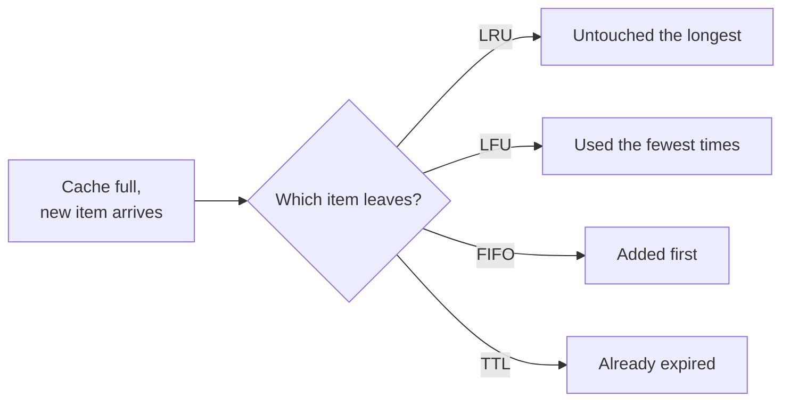

A cache has limited memory. When it is full and a new item arrives, something must go. The **eviction policy** decides what. A good policy keeps the items most likely to be requested again, which keeps the hit ratio high.

## The main policies



### LRU: Least Recently Used
Evict the item that has not been accessed for the longest time. Based on the observation that recently used data is likely to be used again soon (temporal locality).

- **Implementation:** a hash map for O(1) lookup plus a doubly linked list ordered by recency. On every access, move the item to the front; evict from the back. Both operations are O(1).
- **Strengths:** simple, works well for most workloads; the default almost everywhere.
- **Weakness:** a one-time **scan** (a batch job reading millions of keys once) pushes out the genuinely hot items.

```java
// Minimal LRU in Java using LinkedHashMap's access order.
class LruCache<K, V> extends java.util.LinkedHashMap<K, V> {
    private final int capacity;
    LruCache(int capacity) { super(16, 0.75f, true); this.capacity = capacity; }
    @Override protected boolean removeEldestEntry(java.util.Map.Entry<K, V> e) { return size() > capacity; }
}
```

> [!REAL] Clearing your phone's recent apps
> When memory is full, Android closes the app you used longest ago. LRU evicts the item that hasn't been touched for the longest time.

### LFU: Least Frequently Used
Evict the item accessed the fewest times.

- **Strengths:** keeps long-term popular items even if they were not touched in the last few seconds; resists one-off scans.
- **Weaknesses:** items that were popular long ago keep high counts and linger (**cache pollution**), unless counts decay over time; new items start with low counts and may be evicted before they prove themselves; more bookkeeping.

> [!REAL] Keeping your favourite songs offline
> Spotify offline storage full? Drop the songs you've played least often, even if you played one yesterday. LFU keeps popular items, even if not recent.

### FIFO: First In, First Out
Evict the oldest inserted item, regardless of use.
- Very cheap, but ignores popularity. Occasionally fine for data that naturally expires in order.

> [!REAL] The queue at the bus stop
> The first person in line boards first, no matter how important. FIFO evicts the oldest entry, even if it's still hugely popular, which is why it's rarely the best choice for caches.

### Random
Evict a random item.
- Surprisingly competitive, almost no overhead. Useful when tracking order is too expensive.

### TTL-based expiry
Not strictly an eviction policy, but works alongside one: each item expires after a fixed time. Controls staleness rather than memory pressure.

> [!REAL] Milk with an expiry date
> Milk is thrown out on its expiry date even if the fridge has space. A 5-minute TTL on a stock price throws out an entry that might be stale, whether or not memory is tight.

### MRU: Most Recently Used
Evict the most recently used item. Rarely useful, except for cyclic scans where the item just read is the one least likely to be read again soon.

## Modern, smarter policies

- **LRU-K / 2Q:** an item must be accessed more than once before it enters the main cache, which protects against scans.
- **ARC (Adaptive Replacement Cache):** balances recency and frequency automatically.
- **W-TinyLFU:** a small LRU "window" for new items plus a frequency-based main area, with a compact frequency sketch deciding admission. Excellent hit ratios; used by Java's Caffeine library.
- **Approximated LRU/LFU in Redis:** Redis samples a few keys and evicts the best candidate among them, instead of maintaining an exact global order. Cheap and close to exact.

## Redis eviction settings

When `maxmemory` is reached, Redis applies `maxmemory-policy`:

| Policy | Evicts |
|---|---|
| `noeviction` | Nothing; new writes fail (good for data you must not lose) |
| `allkeys-lru` | Least recently used among all keys (common for pure caches) |
| `allkeys-lfu` | Least frequently used among all keys |
| `volatile-lru` / `volatile-lfu` | Same, but only keys that have a TTL |
| `allkeys-random` / `volatile-random` | Random keys |
| `volatile-ttl` | Keys with the shortest remaining TTL |

## Choosing a policy

| Workload | Good policy |
|---|---|
| General web caching, recency matters | LRU |
| Stable set of popular items (catalogues, top videos) | LFU or W-TinyLFU |
| Mixed with periodic large scans | 2Q, ARC, W-TinyLFU |
| Cache mixed with must-keep data in one Redis | `volatile-*` and TTLs only on cache keys |
| Very low overhead required | Random or sampled LRU |

> [!TIP] Eviction is a symptom
> High eviction rates with a low hit ratio usually mean the cache is too small for the working set, or you are caching things nobody re-reads. Measure before tuning the algorithm. See [Measuring and Tuning a Cache](#/l/04-caching/metrics).

> [!INTERVIEW] Be ready to implement LRU
> "Design an LRU cache with O(1) get and put" is a classic coding question: a hash map from key to a node in a doubly linked list, move to head on access, remove from tail when over capacity.

## Key takeaways

- Eviction decides what to drop when memory is full; it directly drives hit ratio.
- LRU is the default; LFU keeps long-term favourites; FIFO and random are cheap.
- Modern policies (2Q, ARC, W-TinyLFU) combine recency and frequency and resist scans.
- TTL controls staleness; eviction controls memory.
