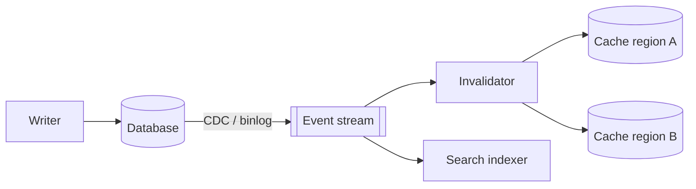

Cache invalidation means removing or updating cached data when the source changes, so users do not see stale values for longer than you can tolerate. It is famously one of the hard problems in computer science because it combines timing, distributed state and race conditions.

## The core tension

Every cached copy can disagree with the truth. You choose a point on a spectrum:

- **Short TTLs / aggressive invalidation:** fresh data, more load on the database.
- **Long TTLs / lazy invalidation:** less load, more staleness.

First decide **how stale is acceptable** for each piece of data, then pick the mechanism.

## Strategies

### 1. Time-based expiry (TTL)
Each entry expires after a fixed time.

```text
SET product:42 {...} EX 300   → gone after 5 minutes
```

- **Pros:** simplest; self-healing (any bug that leaves a bad value is fixed by the next expiry).
- **Cons:** data can be stale for up to the TTL; many keys expiring together can cause a load spike.
- **Tip:** add **jitter** (e.g. 300 ± 30 s) so keys created together do not expire together.
- **Always set a TTL**, even when you also invalidate explicitly. It is the safety net.

### 2. Explicit invalidation on write (delete-on-write)
When the data changes, the writer deletes (or updates) the cached key.

```java
db.updatePrice(productId, newPrice);
cache.delete("product:" + productId);
```

- **Pros:** staleness window is tiny.
- **Cons:** every writer must know every cache key derived from the data; keys holding aggregates or lists (`category:7:top-products`) are easy to miss; partial failures (DB updated, delete failed) leave stale data until TTL.

### 3. Event-driven invalidation
The database's change stream (change data capture) or an application event (`ProductUpdated`) is published to a queue; a consumer invalidates every affected key.



- **Pros:** decouples writers from cache knowledge; one change can invalidate many derived keys, in many regions; retries are natural.
- **Cons:** eventual: a short delay between the write and the invalidation; more moving parts.

### 4. Versioned keys
Include a version in the key, and bump the version on change instead of deleting:

```text
product:42:v7  → after update, readers look up product:42:v8
```

Old versions are never read again and simply age out. Also used for whole namespaces: store `catalog_version = 18`, build keys like `catalog:18:product:42`, and bump to 19 to invalidate the entire catalogue in one step. Static assets use the same idea: `app.3f9a.js` gets a new filename on every build, so it can be cached forever.

### 5. Write-through
Update the cache as part of the write. Keeps written keys fresh, but derived keys still need invalidating. See [Read & Write Caching Strategies](#/l/04-caching/read-write-strategies).

### 6. Validation (conditional requests)
For HTTP caching: the client keeps the response and its `ETag`. Next time it sends `If-None-Match`; the server answers `304 Not Modified` if unchanged. Every request still reaches the server, but unchanged data costs almost nothing to send.

## Race conditions to know about

### The stale re-fill race (cache-aside)
1. Reader A misses and reads the old value from the DB.
2. Writer B updates the DB and deletes the key.
3. Reader A, delayed, writes the **old** value into the cache.

Now the cache holds stale data until TTL. Mitigations:
- Keep TTLs as a backstop.
- **Delayed double delete:** delete again a few hundred milliseconds after the write.
- **Lease / version tokens:** the cache hands out a token on miss and rejects a fill whose token was invalidated by a later delete (the approach Facebook described for memcache).
- Set-if-not-exists with versions: only fill if the version is newer than what is cached.

### Multi-region and multi-layer caches
Local in-process caches on 200 servers plus Redis plus a CDN means one change must reach many copies. Use short TTLs for local caches, pub/sub or event fan-out for invalidation messages, and CDN purge APIs (or versioned URLs) at the edge.

## Choosing a strategy

| Data | Staleness tolerance | Approach |
|---|---|---|
| Static assets | Forever (versioned) | Versioned filenames, long max-age |
| Product description | Minutes | Cache-aside + TTL + delete-on-write |
| Price shown on listing | Seconds | Event-driven invalidation + short TTL; verify at checkout |
| Inventory at checkout | None | Read from database, don't cache |
| User's own profile after edit | None for that user | Delete-on-write + read-your-writes from DB |
| Trending list | Minutes | Recompute periodically; TTL only |

> [!INTERVIEW] A complete answer
> "Cache-aside with a jittered 10-minute TTL. On writes we update PostgreSQL and delete the key; we also publish a change event so derived keys such as category listings are invalidated and other regions are purged. TTL is the safety net if an invalidation is lost. Checkout never reads price from cache."

## Key takeaways

- Decide acceptable staleness per data type before choosing a mechanism.
- TTL is the safety net; always set one, with jitter.
- Delete-on-write gives freshness; event-driven invalidation scales it to derived keys and regions.
- Versioned keys turn invalidation into "read a new key".
- Know the stale re-fill race and how leases or delayed deletes fix it.
