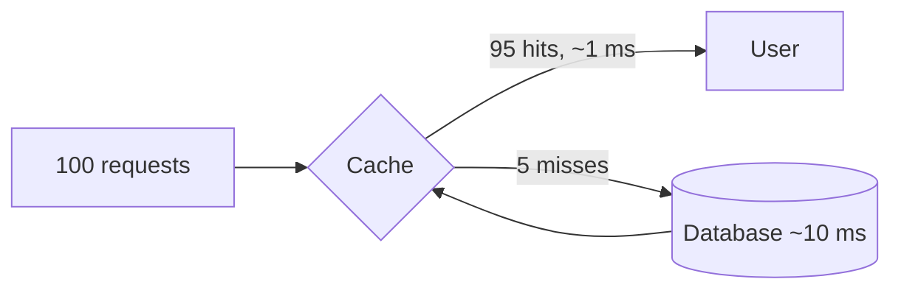

A cache you do not measure is a cache you cannot trust. These are the numbers to watch, what they tell you, and the tuning levers that move them.

## The core metrics



### Hit ratio
`hits ÷ (hits + misses)`. The headline number.

- Typical targets: **90–99%** for a read-heavy cache of hot objects.
- Watch the trend more than the absolute value. A sudden drop usually means a deploy changed key formats, a TTL changed, or traffic shifted.
- Look at hit ratio **per key prefix** (`product:*`, `user:*`). A global 95% can hide one prefix at 20% that is wasting memory.

> [!REAL] How often the fridge has what you want
> If 95 out of 100 times you find milk in the fridge, your hit ratio is 95%. The other 5 times you walk to the shop (the database).

### Why a small hit-ratio change matters
The database sees only the misses:

```text
hit ratio 90% → DB gets 10% of reads
hit ratio 99% → DB gets  1% of reads   (10× less load from a 9-point change)
```

> [!REAL] 95% vs 99%
> At 95%, 5 of every 100 requests hit the database; at 99%, only 1. Going from 95% to 99% cuts database load by 5×, even though it "looks" like a 4% improvement.

### Latency
- **Cache latency:** p50 and p99 of GET/SET. Redis is normally sub-millisecond; spikes point to big keys, slow commands (`KEYS *`), network saturation or CPU limits.
- **Miss penalty:** time to load from the source on a miss. Effective latency is roughly:

```text
average latency ≈ hit ratio × cache latency + miss ratio × (cache latency + load latency)
e.g. 0.95 × 1 ms + 0.05 × (1 + 40) ms ≈ 3 ms
```

### Eviction rate
Items removed because memory is full. High evictions with a low hit ratio means the working set does not fit or you are caching low-value data.

> [!REAL] Throwing out food you just bought
> A high eviction rate is like a fridge so small you throw out yesterday's vegetables to fit today's. The cache is too small for what you actually use.

### Expiration and invalidation rates
Which removal path dominates tells you where to tune. See [Combining Eviction and Invalidation](#/l/04-caching/eviction-and-invalidation).

### Memory
- Used memory vs `maxmemory`.
- **Fragmentation ratio** (Redis `mem_fragmentation_ratio`): well above 1.5 means wasted memory; below 1 means swapping, which is very bad.
- Key count and average value size; watch for big keys.

### Load and connections
- Operations per second per node: spot hot nodes caused by hot keys.
- CPU per node (Redis executes commands on one main thread).
- Network bandwidth: large values can saturate a NIC before the CPU.
- Connected clients, rejected connections, connection churn.

### Database offload
The point of the cache: compare database read QPS with and without the cache, and alert if database load rises while traffic is flat (a sign of a falling hit ratio).

## Tuning levers

### 1. Cache the right things
- Drop prefixes with very low hit ratios; they cost memory and give nothing back.
- Cache **computed results** (the rendered product card, the aggregated count) instead of raw rows if that is what readers need, so a hit saves more work.

### 2. Size the cache to the working set
Estimate hot items × size × ~1.5 overhead. Add memory until the hit-ratio curve flattens; beyond that point, more memory buys little.

> [!REAL] Pack what you'll actually wear
> For a week's trip you pack a week's clothes, not your whole wardrobe. Size the cache for the data that's actively used today, not the whole database.

### 3. Tune TTLs
- Too short: needless misses and reloads.
- Too long: staleness and memory held by cold data.
- Set TTLs per data type based on how often it changes and how stale it may be. Add jitter.

### 4. Pick a better eviction policy
Switch LRU → LFU or TinyLFU when a stable set of popular items is being pushed out by one-off reads.

### 5. Reduce the size of values
- Serialise efficiently (Protocol Buffers, MessagePack or compressed JSON instead of verbose JSON or Java serialisation).
- Compress large values (LZ4 or Snappy are fast).
- Store only fields readers need.

### 6. Cut round trips
- **Batch** reads with `MGET` or pipelining instead of N sequential GETs.
- Add a small **in-process cache** for the hottest keys.
- Keep clients and cache in the same zone.

### 7. Scale the cluster
- **Shard** across more nodes to spread memory and load (Redis Cluster, consistent hashing on the client).
- **Replicas** for read scaling and failover.
- Use connection pooling; avoid opening a connection per request.

### 8. Avoid slow operations
No `KEYS *` in production (use `SCAN`), avoid O(N) commands on huge collections, delete big keys with `UNLINK`.

## A simple dashboard

| Panel | Alert when |
|---|---|
| Hit ratio (global and per prefix) | Drops > 5 points in 10 minutes |
| GET/SET p99 latency | > 5 ms sustained |
| Evictions per second | Rising while hit ratio falls |
| Memory used / max | > 85% |
| Ops/s per node | One node far above the others (hot key) |
| DB read QPS | Rises without a matching rise in traffic |

> [!INTERVIEW] Talk in numbers
> "We'd target a 95% hit ratio on product reads. At 50K reads per second that leaves 2.5K per second for the database, which a primary plus two replicas handles easily. If the hit ratio dropped to 80%, the database would see 10K per second, so we alert on hit ratio and keep the database sized to survive a partial cache failure."

## Key takeaways

- Hit ratio is the headline; small changes in it cause large changes in database load.
- Watch latency, evictions, memory, fragmentation and per-node load to spot hot keys.
- Tune by caching the right data, sizing to the working set, setting sensible TTLs, shrinking values and batching.
- Size the backend for the cache failing, not just for the cache working.
