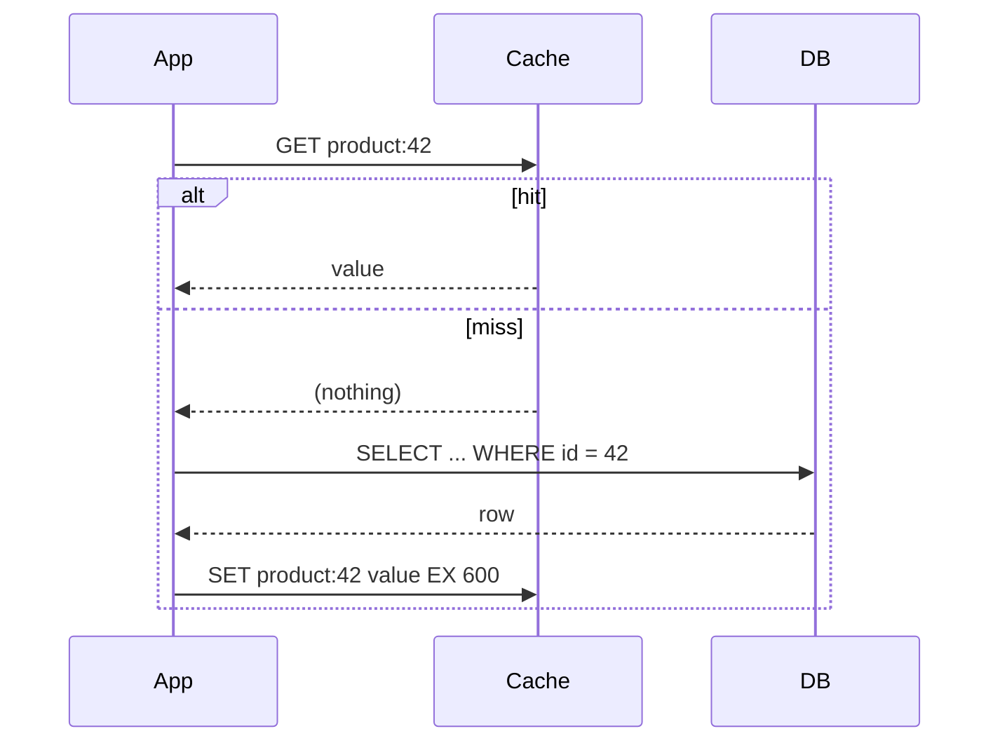
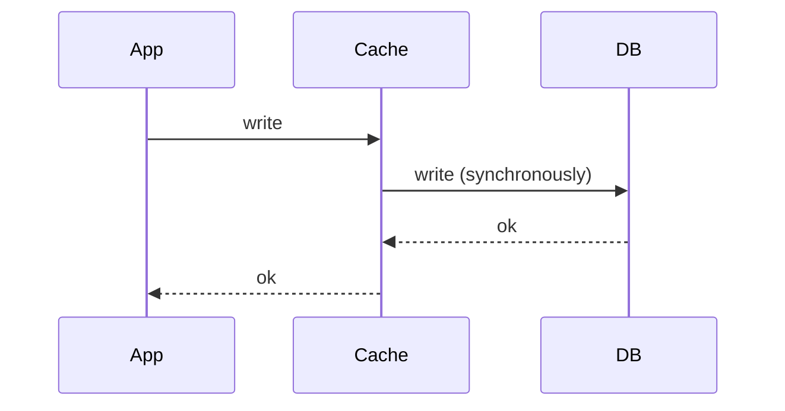

A caching strategy answers two questions: **on a read, who loads the cache?** and **on a write, how do the cache and database stay in step?** There are five standard patterns. Most systems use cache-aside for reads, with one of the write patterns chosen per data type.

## Read strategies

### Cache-aside (lazy loading)
The application talks to both the cache and the database.



```java
Product get(long id) {
    Product p = cache.get("product:" + id);
    if (p != null) return p;                 // hit
    p = db.findProduct(id);                  // miss → load
    if (p != null) cache.set("product:" + id, p, Duration.ofMinutes(10));
    return p;
}
```

- **Pros:** only data that is actually requested gets cached; a cache failure degrades to slower reads, not errors; simple and flexible.
- **Cons:** the first request for each key is slow (a miss costs three steps); data can be stale until TTL or invalidation; the app carries the caching logic.
- **The default choice** for most read-heavy services.

### Read-through
The application only talks to the cache. On a miss, **the cache itself** loads from the database (via a configured loader) and stores the result.

- **Pros:** cleaner application code; loading logic in one place; easy to add request coalescing so only one load happens per key.
- **Cons:** needs a cache library or product that supports loaders; same first-request penalty as cache-aside.

Cache-aside and read-through behave the same from the data's point of view. The difference is *who* fetches on a miss.

## Write strategies

### Write-through
Every write goes to the cache **and** the database synchronously, before the write is acknowledged.



- **Pros:** the cache is always up to date for written keys; reads after writes are fresh.
- **Cons:** every write pays both latencies; data written but never read still fills the cache (pair it with a TTL).
- **Use for:** data read soon after it is written, where freshness matters, e.g. user settings.

### Write-behind (write-back)
Writes go to the cache and are acknowledged immediately; the cache flushes them to the database **asynchronously**, often batched.

- **Pros:** very fast writes; batching and coalescing reduce database load (100 updates to one counter become one write).
- **Cons:** **risk of data loss** if the cache fails before flushing; the database lags behind; harder to reason about ordering.
- **Use for:** high-volume, loss-tolerant data: view counters, likes, analytics, game scores with periodic persistence.

### Write-around
Writes go straight to the database, skipping the cache. The cache gets the data only when it is read (via cache-aside), and the old cached entry is usually **deleted** on write.

- **Pros:** the cache is not flooded with data that is written but rarely read.
- **Cons:** the first read after a write is a miss.
- **Use for:** write-heavy data that is rarely re-read soon, such as logs, or large uploads.

## Comparison

| Strategy | Read latency | Write latency | Freshness | Data-loss risk | Typical use |
|---|---|---|---|---|---|
| Cache-aside | Miss penalty once | DB only (+ delete key) | TTL / invalidation | None | Default for reads |
| Read-through | Miss penalty once | — | TTL / invalidation | None | Library-managed caches |
| Write-through | Fast | Higher (cache + DB) | High | None | Read-after-write data |
| Write-behind | Fast | Lowest | Cache fresh, DB lags | **Yes** | Counters, metrics |
| Write-around | Miss after write | DB only | Fresh on next load | None | Write-heavy, rarely read |

## The most common production combination

**Cache-aside for reads + update the database, then delete the cache key on writes.**

```java
void updateProduct(Product p) {
    db.update(p);                      // 1. source of truth first
    cache.delete("product:" + p.id()); // 2. next read reloads fresh data
}
```

Why **delete** rather than **set** the new value? If two writers race, "set" can leave the older value in cache permanently. Deleting forces a reload from the database. A small race still exists (a slow reader can put an old value back right after the delete), which is why TTLs stay as a safety net and some teams delete twice with a short delay. See [Cache Invalidation Strategies](#/l/04-caching/invalidation).

> [!WARNING] Order matters
> Deleting the cache *before* updating the database opens a wider race: another request can miss, read the old row, and re-cache it before your update lands. Update the database first, then invalidate.

> [!INTERVIEW] Mix strategies by data type
> "Product details: cache-aside with delete-on-write and a 10-minute TTL. View counts: increment in Redis and flush to the database every 30 seconds (write-behind), since losing a few views is acceptable. Payments: no cache at all on the write path."

## Key takeaways

- Cache-aside: the app loads on a miss. Read-through: the cache loads on a miss.
- Write-through keeps the cache fresh at the cost of write latency.
- Write-behind is fastest but can lose data; use it only for loss-tolerant data.
- Write-around avoids polluting the cache with rarely read writes.
- Default: cache-aside + update DB then delete key + TTL.
