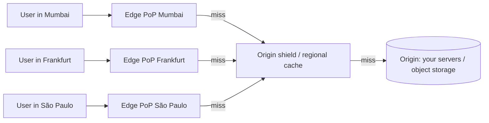
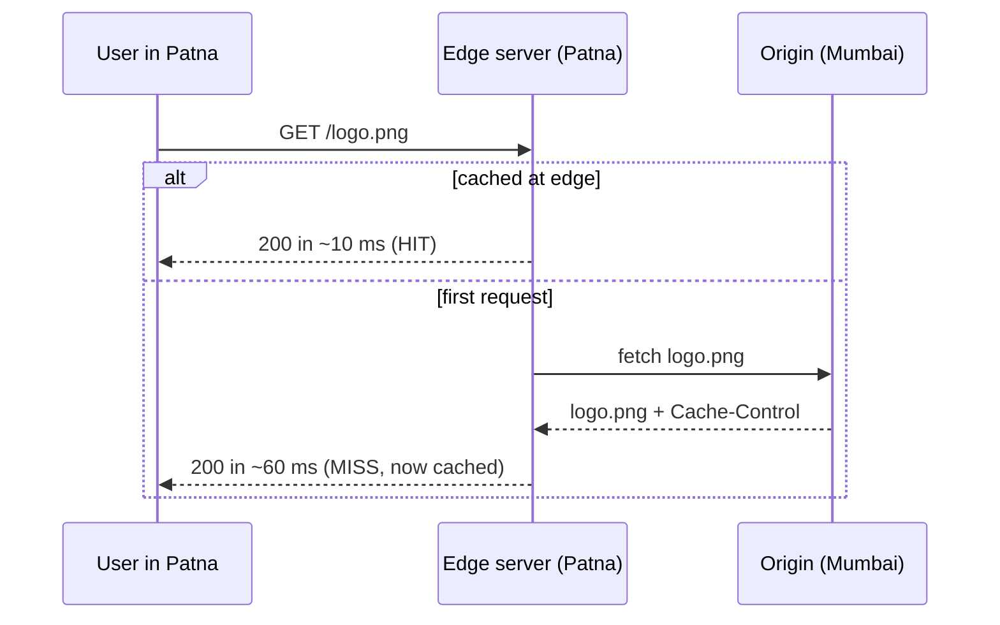

A Content Delivery Network (CDN) is a globally distributed set of servers that cache content close to users. A user in Chennai downloads your images from a server in Chennai instead of from your origin in Virginia. That cuts latency, offloads your servers and absorbs traffic spikes and attacks.

## The problem a CDN solves

Without a CDN, every request crosses the world to your origin:
- **Latency:** a round trip from India to the US east coast is ~200–250 ms, and loading a page takes many round trips (DNS, TCP, TLS, then dozens of assets).
- **Origin load:** every image and video byte is served by your own servers.
- **Bandwidth cost:** origin egress is expensive at scale.
- **Fragility:** a traffic spike or attack hits your origin directly.

> [!REAL] Mumbai to a user in Guwahati
> If Hotstar served every video from one data centre in Mumbai, a viewer in Guwahati would wait for every chunk to cross the country, and during an India–Pakistan match the Mumbai data centre's links would melt. Edge servers in many cities serve the same chunks locally.

## How it works

1. **Routing to the nearest edge.** The CDN's DNS returns the IP of a nearby **point of presence (PoP)**, or a single **anycast** IP is announced from every PoP and internet routing delivers the user to the closest one.
2. **Edge cache lookup.** If the edge has the object and it is fresh (a **hit**), it responds immediately.
3. **Miss.** The edge fetches from a mid-tier/regional cache (the **origin shield**), and only if that misses too, from the **origin**. The response is cached on the way back.
4. **Next user** in that region gets a hit.

> [!REAL] The neighbourhood ration shop
> The government warehouse doesn't hand grain directly to every family. It stocks ration shops in each locality, and families collect from the nearest one. Only when the shop runs out does it go back to the warehouse (the origin).

### Key vocabulary
- **PoP (point of presence):** a CDN data centre in a city, containing many edge servers.
- **Edge server:** the cache that users connect to.
- **Origin:** your source of truth: web servers or an object-storage bucket.
- **Origin shield / tiered caching:** an intermediate cache layer so that 200 edges missing at once become one request to the origin.
- **Cache key:** what identifies a cached object, usually the URL plus selected headers or query parameters.
- **TTL:** how long an object stays fresh at the edge, set by `Cache-Control` headers or CDN rules.
- **Purge / invalidation:** removing objects from edge caches before their TTL ends.

## Push vs pull CDNs

| | Pull (origin-pull) | Push |
|---|---|---|
| How content gets to the edge | Edge fetches from origin on first request | You upload content to the CDN ahead of time |
| Setup | Point the CDN at your origin | Manage uploads and storage on the CDN |
| First request | Slower (miss) | Already cached |
| Best for | Websites, APIs, most traffic | Large, predictable files: software releases, video libraries |

Most CDN use today is pull-based, often with the origin being an object-storage bucket.

> [!REAL] Stocking the shop vs ordering on demand
> Push: before Diwali, the company sends sweets boxes to every outlet in advance. Pull: an outlet orders a product from the warehouse only when the first customer asks for it, then keeps it on the shelf.

## What a CDN can serve

- **Static assets:** JS, CSS, fonts, images. The classic use.
- **Media:** video segments (HLS/DASH chunks), audio, downloads. Streaming platforms are built on CDNs.
- **Whole pages:** static sites, or dynamic pages cached for a few seconds ("micro-caching") during spikes.
- **API responses:** public, cacheable GETs (product catalogues, configuration) with short TTLs.
- **Dynamic content acceleration:** even uncacheable requests benefit, because the edge keeps warm, optimised connections to the origin over the CDN's private backbone, and the user's TLS handshake ends nearby.

## Benefits in one table

| Benefit | Why |
|---|---|
| Lower latency | Content and TLS termination are near the user |
| Origin offload | 90%+ of static bytes served from edge |
| Lower bandwidth cost | CDN egress is cheaper; origin egress drops |
| Spike absorption | Edges absorb sudden traffic (launches, viral content) |
| Availability | Can serve cached content even if the origin is down (stale-if-error) |
| Security | DDoS absorption, WAF, bot management, TLS at the edge |

## Limits

- **Personalised or rapidly changing data** is hard to cache.
- **Staleness:** cached content may lag behind the origin until TTL or purge.
- **Cost model:** priced by bandwidth and requests; high cache hit ratios matter for cost.
- **Debugging** gets harder with many caches in the path; use response headers such as `Age` and `X-Cache: HIT/MISS`.

> [!INTERVIEW] When to bring up a CDN
> Any time a design serves static files, images, video or globally distributed users. "All media is stored in object storage and served through a CDN; the origin only handles API calls. With a 95% edge hit ratio, origin egress drops twentyfold."

> [!REAL] What a CDN can't do
> A CDN can cache the IPL highlights video for everyone, but it can't cache *your* order history or bank balance. Personal, per-user data still goes to the origin.

## Key takeaways

- A CDN caches content in PoPs near users; DNS or anycast routes users to the nearest one.
- Misses go edge → origin shield → origin, then are cached.
- Pull CDNs are the default; push suits large, predictable content.
- Benefits: latency, origin offload, cost, spike absorption, availability and security.
