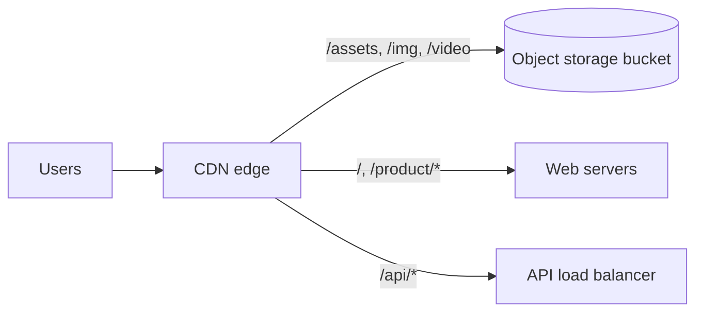

Here is how you would put a CDN in front of a real application, step by step, using an online store with a web app, an API, product images and a few promotional videos as the example.

## Step 1: Classify the traffic

| Content | Example | Cacheable? | TTL / rule |
|---|---|---|---|
| Versioned static assets | `/assets/app.3f9a1c.js` | Yes, forever | `max-age=31536000, immutable` |
| HTML shell | `/`, `/product/42` | Briefly | `s-maxage=60, stale-while-revalidate=300` |
| Product images | `/img/p42/main.webp` | Yes | Long TTL, versioned on change |
| Public API | `GET /api/products?cat=shoes` | Yes, short | `s-maxage=30` |
| Personal API | `GET /api/cart`, `/api/me` | No | `private, no-store` |
| Writes | `POST /api/orders` | Never | Pass through to origin |
| Video | `/video/promo/720p/seg_0042.ts` | Yes | Long TTL; segments never change |

Classifying first prevents the classic mistakes: caching user data, or caching nothing at all.

## Step 2: Set up origins

- Static files and media live in **object storage**, with the bucket private and readable only by the CDN.
- HTML and API traffic go to load balancers in your region(s).
- Path-based routing rules send each prefix to the right origin.

## Step 3: Make the build CDN-friendly

- The build pipeline fingerprints filenames and uploads assets to the bucket **before** deploying the new HTML, so the HTML never references files that don't exist yet.
- Keep old assets for a while after deploy; users with an old HTML page still need them.
- HTML references assets by their hashed names.

## Step 4: Configure cache keys and headers

- Strip marketing parameters (`utm_*`, `gclid`, `fbclid`) from cache keys.
- `Vary: Accept-Encoding` only; serve WebP/AVIF through image optimisation rather than varying on `User-Agent`.
- Make the origin send correct `Cache-Control` per route (the origin is the best place to know what is cacheable). Use CDN rules as a guard rail.

## Step 5: Handle updates

| Change | How it reaches users |
|---|---|
| New JS/CSS deploy | New filenames; nothing to purge |
| Product image replaced | Upload under a new versioned path (`main.v2.webp`) and update the reference; or purge the single URL |
| Price change on product page | HTML TTL of 60 s + `stale-while-revalidate`; for instant updates, purge by **cache tag** (`product-42`) |
| Emergency takedown | Purge the URL or tag immediately |

**Cache tags (surrogate keys):** the origin labels responses (`Surrogate-Key: product-42 category-shoes`). One API call then purges every cached page that mentions product 42, without knowing their URLs.

## Step 6: Secure it

- WAF with managed rules on all routes; rate limits on `/api/login`, `/api/search`.
- Origin accepts only CDN traffic.
- Signed URLs for any paid or private media.
- TLS everywhere; HSTS.

## Step 7: Video specifics

- Transcode videos into multiple bitrates and split into 2–6 second **segments** with a manifest (HLS/DASH).
- Segments are immutable → long TTLs and very high hit ratios.
- Manifests for live streams change constantly → TTL of a second or two, with request collapsing.
- The player switches bitrate based on bandwidth (adaptive bitrate).

## Step 8: Observe and iterate

- Dashboard: hit ratio (requests and bytes), origin requests per second, edge TTFB by region, 4xx/5xx by PoP.
- Inspect `X-Cache`/`Age` headers on sample requests after every config change.
- Run real-user monitoring to see actual latency by country.

## Expected results for the example store

| Metric | Before CDN | After |
|---|---|---|
| Origin requests | 100% | ~10–20% (mostly API and writes) |
| Static asset latency (India users, US origin) | 300–800 ms | 20–60 ms |
| Origin egress | All bytes | A few percent |
| Flash-sale spike | Hits origin | Mostly absorbed at edge |

> [!INTERVIEW] Explain it as a request journey
> "A shopper in Pune loads the product page. DNS resolves to the nearest PoP. The HTML is cached at the edge for 60 seconds, assets are cached forever under hashed names, images come from the bucket via the edge in WebP. The add-to-cart call is `no-store` and goes to the API origin. When the merchant changes the price, we purge the `product-42` tag, so pages update within seconds."

## Key takeaways

- Classify every route as forever-cacheable, briefly cacheable or never cacheable.
- Use object storage as the origin for static and media content; route by path.
- Fingerprint assets so deploys need no purges; use cache tags for targeted purges.
- Secure the origin, sign private URLs, and measure hit ratio and edge latency continuously.
