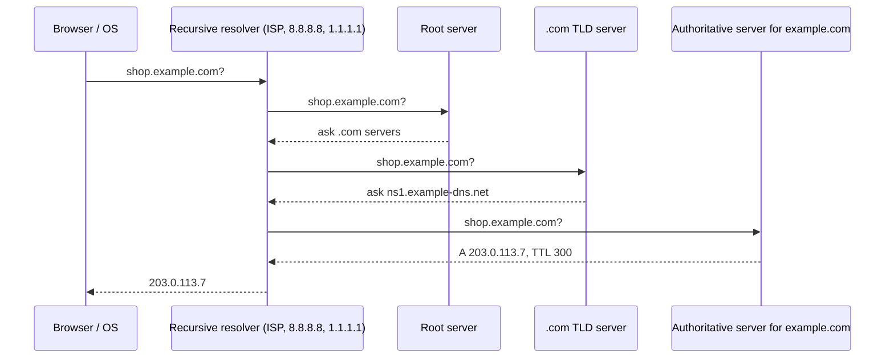

DNS (the Domain Name System) translates names like `shop.example.com` into IP addresses. It looks simple, but it is a global, hierarchical, heavily cached distributed database, and it doubles as a traffic-routing tool for large systems.

## How a lookup works

1. The **browser and OS** check their own caches.
2. The **recursive resolver** (your ISP's, or a public one) does the legwork. It also caches.
3. **Root servers** point to the servers for the top-level domain (`.com`, `.in`).
4. **TLD servers** point to the domain's **authoritative** name servers.
5. The **authoritative server** returns the actual record.

In practice the resolver almost always has the root and TLD answers cached, so a typical uncached lookup takes one or two round trips, and cached lookups take essentially none.

> [!REAL] Asking for directions
> You ask the neighbourhood shopkeeper (resolver). He doesn't know, so he asks the main road's traffic police (root), who points to the area's police station (.com), who points to the building's guard (the authoritative server), who finally gives the flat number (IP).

## Record types worth knowing

| Record | Maps | Example |
|---|---|---|
| **A / AAAA** | Name → IPv4 / IPv6 address | `shop.example.com → 203.0.113.7` |
| **CNAME** | Name → another name (alias) | `www → shop.example.com` |
| **NS** | Domain → its authoritative name servers | `example.com → ns1.example-dns.net` |
| **MX** | Domain → mail servers | |
| **TXT** | Arbitrary text: domain verification, SPF/DKIM | |
| **SRV** | Service → host and port | Service discovery |
| **CAA** | Which certificate authorities may issue certs | |
| **ALIAS / ANAME** | CNAME-like behaviour at the zone apex (provider feature) | `example.com → lb.cloud.net` |

## TTL: the main performance and agility lever

Every record carries a **TTL** (time to live) telling caches how long they may keep it.

| TTL | Effect |
|---|---|
| Long (hours/days) | Fewer lookups, faster for users, less load on DNS, **slow to change** |
| Short (30–60 s) | Changes and failovers take effect quickly, more lookups |

Practical habits:
- Keep stable records (MX, NS) long.
- Keep records you may need to fail over (your load balancer's address) short, e.g. 60 seconds.
- **Before a planned migration, lower the TTL a day or two in advance**, so the old long TTL has expired everywhere when you switch.
- Some resolvers and clients ignore low TTLs and cache longer. Never rely on DNS alone for instant failover.

> [!REAL] How long people remember your new number
> If you change your phone number, friends who saved the old one keep calling it until they update. A long DNS TTL is like friends who rarely check for changes: fewer lookups, but slow to learn about a move.

## DNS as a traffic router

Authoritative DNS can return **different answers to different users**. That turns DNS into the first layer of global load balancing.

### Round-robin DNS
Return several IPs, rotating their order. Spreads load crudely; no awareness of health or location.

### Weighted routing
Return IP A 90% of the time and IP B 10%. Useful for gradual migrations and canaries between regions.

> [!REAL] Sending 10% to the new branch
> A bank opens a new branch and sends 10% of customers there to test it before sending more. Weighted DNS does the same for a new data centre.

### Geolocation / latency-based routing (GeoDNS)
Answer based on where the query comes from: users in India get the Mumbai region, users in Europe get Frankfurt. Latency-based routing uses measured latency rather than geography.

- The authoritative server usually sees the **resolver's** IP, not the user's. A user on a distant public resolver might be routed badly. **EDNS Client Subnet (ECS)** passes a truncated client subnet to fix this.

> [!REAL] The nearest Domino's
> Calling the Domino's number connects you to the nearest outlet. GeoDNS gives Indian users the Mumbai IP and European users the Frankfurt IP for the same domain.

### Health-checked failover
The DNS provider health-checks your endpoints and stops returning the IP of a failed region. Failover speed is bounded by TTLs and resolver behaviour (often a minute or a few minutes).

> [!REAL] Diverted flights
> When fog closes Delhi airport, flights are diverted to Jaipur. When health checks fail in one region, DNS starts answering with the other region's IP.

### Anycast for DNS itself
Major DNS providers announce the same name-server IPs from many locations, so queries reach the nearest server and survive the loss of any single site.

## Performance tips

- **Use a fast, anycast DNS provider** for your authoritative zone.
- **Minimise distinct hostnames** on a page; each new one may cost a lookup.
- **`dns-prefetch` / `preconnect`** hints let browsers resolve and connect to third-party hosts early.
- **Avoid long CNAME chains**; each hop can mean another lookup.
- **Cache in your services**: application runtimes (the JVM, for one) and container platforms cache DNS. Make sure internal clients respect TTLs so service-endpoint changes are picked up, but don't resolve on every request.

## DNS for service discovery

Inside a data centre or Kubernetes cluster, DNS names like `orders.default.svc.cluster.local` resolve to a service's current instances or a virtual IP. SRV records add ports. It is simple and universal, but TTL caching makes changes propagate slowly, which is why many systems also use registries (Consul, etcd) or client-side load balancing.

> [!INTERVIEW] Multi-region routing answer
> "Users resolve `api.example.com` through a managed DNS service with latency-based routing and health checks, TTL 60 s. Indian users land in Mumbai; if Mumbai fails its health checks, DNS stops returning it and users move to Singapore within a minute or two. Inside each region a load balancer spreads requests across instances."

## Key takeaways

- Lookups go browser/OS cache → recursive resolver → root → TLD → authoritative, with caching at every step.
- TTL trades speed and DNS load against how quickly changes take effect; lower it before migrations.
- DNS can route by weight, geography, latency and health, forming the first tier of global load balancing.
- DNS failover is only as fast as caches allow; combine it with anycast or in-region redundancy.
