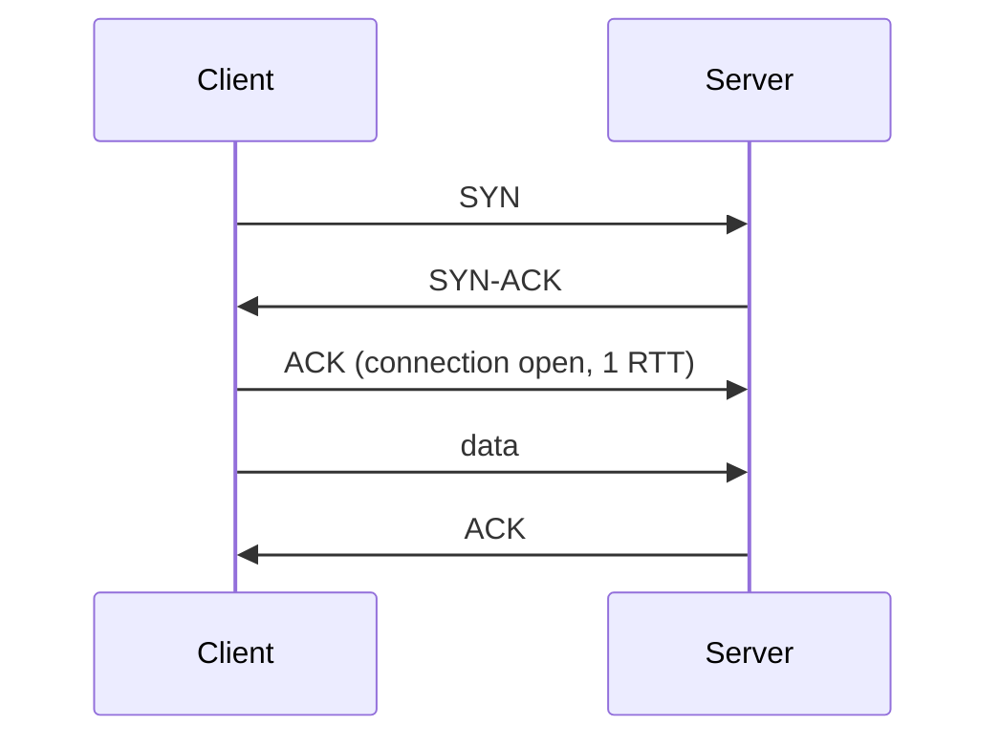
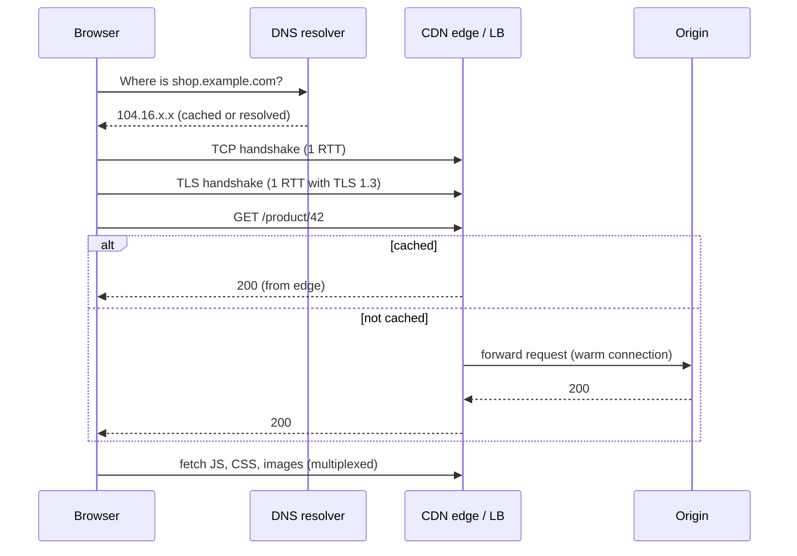

When a user opens a web page, a lot happens before your code runs: name lookups, connection setup, encryption, routing across many networks. Knowing this path lets you reason about latency, choose protocols, and explain where things can fail.

## The layers, practically

The OSI model has seven layers; in practice four matter for system design.

| Layer | Job | Examples |
|---|---|---|
| **Application (L7)** | Meaning of the messages | HTTP, gRPC, WebSocket, DNS, SMTP |
| **Transport (L4)** | Process-to-process delivery, reliability, ports | TCP, UDP, QUIC |
| **Network (L3)** | Addressing and routing between networks | IP (v4/v6), ICMP, BGP |
| **Link / physical (L1–L2)** | Moving bits on one link | Ethernet, Wi-Fi, fibre |

Load balancers are described as L4 or L7 by which of these layers they understand. See [Types of Load Balancers](#/l/02-scalability/load-balancer-types).

## IP: addresses and routing

- Every device on a network has an **IP address**. IPv4 (`203.0.113.7`) has ~4 billion addresses, so most devices sit behind **NAT** with private addresses (`10.x`, `192.168.x`). IPv6 has effectively unlimited addresses.
- Packets travel hop by hop through routers. Between the large networks of the internet (autonomous systems), **BGP** decides the paths.
- IP itself is **best effort**: packets can be lost, duplicated or arrive out of order.

## TCP: reliable streams

TCP builds a reliable, ordered byte stream on top of unreliable IP.

- **Three-way handshake:** one round trip before any data flows.
- **Reliability:** sequence numbers, acknowledgements and retransmission of lost segments.
- **Ordering:** data is delivered in order. One lost packet holds up everything behind it (**head-of-line blocking**).
- **Flow control:** the receiver advertises how much it can accept.
- **Congestion control:** senders start slowly (slow start) and back off when packets are lost, so the network is not overwhelmed. This is why new connections are slower than warm ones.

## UDP: fast and simple

UDP sends independent datagrams with no handshake, no retransmission and no ordering.

- **Pros:** minimal latency and overhead; no head-of-line blocking.
- **Cons:** the application must handle loss and ordering if it cares.
- **Used for:** DNS queries, live video and voice calls (a late packet is useless anyway), online games, and QUIC.

| | TCP | UDP |
|---|---|---|
| Connection | Handshake | None |
| Reliability | Guaranteed delivery | Best effort |
| Ordering | In order | None |
| Speed / overhead | Higher overhead | Minimal |
| Typical use | Web, APIs, databases, file transfer | DNS, real-time media, games, QUIC |

## TLS: encryption

TLS encrypts the connection and proves the server's identity using certificates.
- **TLS 1.2:** two round trips for the handshake.
- **TLS 1.3:** one round trip, and **0-RTT** resumption for returning clients.
- Terminating TLS close to the user (at a CDN or regional load balancer) saves the long round trips.

## HTTP versions

| Version | Key idea | Limitation |
|---|---|---|
| HTTP/1.1 | Text protocol, keep-alive connections | One request at a time per connection; browsers open ~6 connections per host |
| HTTP/2 | Binary framing, **multiplexes** many requests over one TCP connection, header compression | TCP head-of-line blocking: one lost packet stalls all streams |
| HTTP/3 | Runs over **QUIC** (on UDP); independent streams, faster handshakes, connection migration across networks | Newer; some networks block UDP |

QUIC combines transport and TLS 1.3 setup into one round trip (0-RTT on resumption) and keeps a connection alive when a phone switches from Wi-Fi to mobile data.

## What happens when you type a URL

1. **DNS lookup** turns the name into an IP (browser, OS and resolver caches first). See [DNS Resolution, Caching & Routing](#/l/06-networking/dns-performance).
2. **TCP handshake** (or QUIC).
3. **TLS handshake.**
4. **HTTP request**, often answered by a CDN edge or passed through load balancers to the application.
5. The browser parses HTML and fetches dozens of sub-resources, then renders.

Each of those round trips costs real time when the server is far away, which is why CDNs, connection reuse, HTTP/2–3 and TLS 1.3 matter so much.

## Other protocols you will mention

- **WebSocket:** upgrades an HTTP connection to a persistent, two-way channel. Chat, live updates, collaborative editing.
- **Server-Sent Events (SSE):** one-way server-to-client stream over HTTP. Notifications, live scores, streaming LLM output.
- **gRPC:** RPC over HTTP/2 with Protocol Buffers; efficient service-to-service calls with streaming.
- **WebRTC:** peer-to-peer audio/video/data in browsers, using UDP, with STUN/TURN servers for NAT traversal.

See [Protocols & Communication Patterns](#/l/07-api-design/protocols) for when to use each.

> [!INTERVIEW] Connect protocols to requirements
> "Messages need reliable, ordered delivery, so chat uses WebSockets over TCP. Voice calls use WebRTC over UDP because a retransmitted audio packet arrives too late to be useful; we'd rather drop it and conceal the gap."

## Key takeaways

- IP routes packets best-effort; TCP adds reliability and order; UDP trades them for speed.
- Each new connection costs round trips: TCP, then TLS. Reuse connections and terminate TLS near users.
- HTTP/2 multiplexes over one connection; HTTP/3 over QUIC removes TCP head-of-line blocking.
- Know the URL-to-page journey and where latency comes from.
