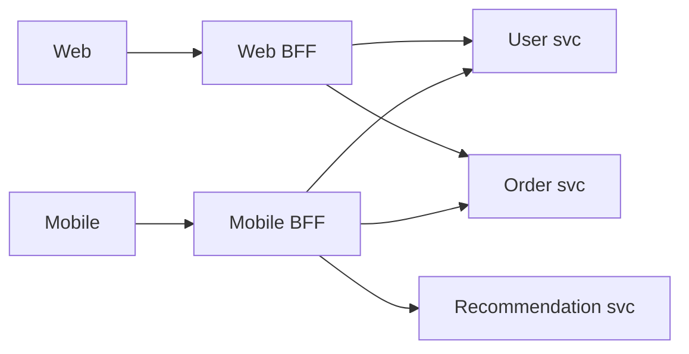

A good API is easy to use correctly, hard to use incorrectly and able to evolve without breaking clients. This lesson covers the design rules and the architectural patterns that come up in interviews.

## Resource-oriented REST design

Model the API around **nouns** (resources) and use HTTP methods as the verbs.

```http
GET    /v1/users/42                 read one
GET    /v1/users/42/orders?limit=20 list a sub-collection
POST   /v1/orders                   create
PATCH  /v1/orders/981               partial update
PUT    /v1/orders/981               full replace
DELETE /v1/orders/981               delete
POST   /v1/orders/981/cancel        action that isn't simple CRUD
```

| Method | Safe (no side effects) | Idempotent |
|---|---|---|
| GET, HEAD | Yes | Yes |
| PUT | No | Yes |
| DELETE | No | Yes |
| PATCH | No | Not necessarily |
| POST | No | No (make it so with idempotency keys) |

### Status codes that matter
- `200 OK`, `201 Created` (+ `Location` header), `202 Accepted` (async processing started), `204 No Content`
- `400` bad input, `401` not authenticated, `403` not allowed, `404` not found, `409` conflict (e.g. version mismatch), `422` validation failed, `429` rate limited
- `500` server bug, `502/503/504` upstream or availability problems

Return structured errors:

```json
{ "error": { "code": "INSUFFICIENT_FUNDS", "message": "Balance too low", "requestId": "req_8f2a" } }
```

## Pagination

Never return unbounded lists.

**Offset pagination** (`?page=5&size=20` / `OFFSET 80`): simple and allows jumping to a page, but slow for deep pages (the database still walks the skipped rows) and unstable when items are inserted (duplicates or skips).

**Cursor (keyset) pagination** (`?after=eyJpZCI6OTgxfQ&limit=20`): the cursor encodes the last item's sort key; the query is `WHERE (created_at, id) < (?, ?) ORDER BY created_at DESC, id DESC LIMIT 20`. Constant speed at any depth and stable under inserts. The standard for feeds and large lists.

## Filtering, sorting, sparse fields

```http
GET /v1/products?category=shoes&price_lt=5000&sort=-rating&fields=id,name,price
```

Only allow filters and sorts that are backed by indexes, or deep queries will hurt the database.

## Idempotency for writes

Clients retry. Make non-idempotent operations safe to repeat with an **idempotency key**:

```http
POST /v1/payments
Idempotency-Key: 6f1c0b8e-...
```

The server stores the key with the outcome; a repeat with the same key returns the stored outcome instead of charging again. See [Payment State Machines & Idempotency](#/l/11-payments-uploads/state-machine-idempotency).

## Concurrency control

Prevent lost updates when two clients edit the same resource:
- Return an `ETag` (version) with the resource.
- Clients send `If-Match: "v7"` with updates.
- The server rejects with `412 Precondition Failed` if the version changed.

## Versioning

- **URL versioning** (`/v1/...`): explicit and easy to route. Most common for public APIs.
- **Header versioning** (`Accept: application/vnd.example.v2+json`): cleaner URLs, less visible.
- Prefer **additive, backward-compatible changes** (new optional fields) so versions rarely need bumping. Never remove or rename fields in place. Deprecate with notice and telemetry on usage.

## Long-running operations

If work takes longer than a request should (video processing, report generation):

```http
POST /v1/exports        → 202 Accepted, Location: /v1/exports/77
GET  /v1/exports/77     → { "status": "RUNNING", "progress": 40 }
GET  /v1/exports/77     → { "status": "DONE", "url": "https://..." }
```

Or notify via webhook / SSE when done.

## Architectural patterns

### API gateway
A single entry point that routes requests to services and handles cross-cutting concerns: authentication, rate limiting, TLS, request logging, response caching. See [Load Balancer vs API Gateway](#/l/09-tradeoffs/lb-vs-api-gateway).

### Backend for Frontend (BFF)
A separate API layer per client type (web, iOS, Android, partner), shaped to that client's screens. Avoids one bloated general API and lets each frontend team move independently.



### API composition / aggregation
One endpoint calls several services in parallel and merges results (a product page needs catalogue, price, stock, reviews). Use parallel calls with timeouts and partial responses if a non-critical part fails.

### CQRS
Separate the write model (commands, validated against the source of truth) from read models (denormalised views optimised for queries, updated by events). Useful when reads and writes have very different shapes or scale. See [Saga vs CQRS](#/l/09-tradeoffs/saga-vs-cqrs).

### Asynchronous request-reply
Accept the request (`202`), process via a queue, expose status or call back. Protects the system during spikes.

### Strangler fig
Migrate a legacy system by routing endpoints one at a time to new services behind the same API, until the old system can be retired.

## Contracts and documentation

- Describe REST APIs with **OpenAPI**; gRPC with `.proto` files. Generate clients and docs from them.
- Use **consumer-driven contract tests** between services, so a provider change that breaks a consumer fails in CI.

> [!INTERVIEW] A compact API section
> "Three endpoints: `POST /v1/posts` with an idempotency key; `GET /v1/users/{id}/feed?cursor=&limit=20` with cursor pagination; `POST /v1/posts/{id}/likes`, which is idempotent per user. All authenticated with a bearer token via the gateway, rate-limited per user."

## Key takeaways

- Resources as nouns, HTTP methods as verbs, meaningful status codes, structured errors.
- Cursor pagination for large or changing lists; idempotency keys for unsafe writes; ETags for concurrency.
- Evolve APIs additively and version explicitly.
- Know the gateway, BFF, aggregation, CQRS, async request-reply and strangler patterns.
