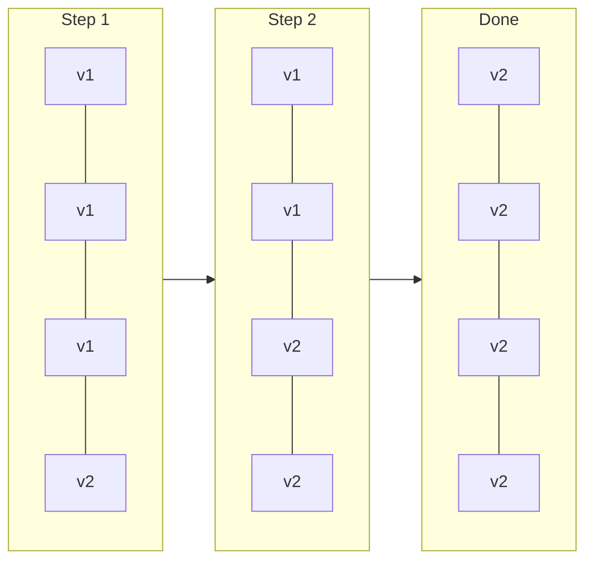
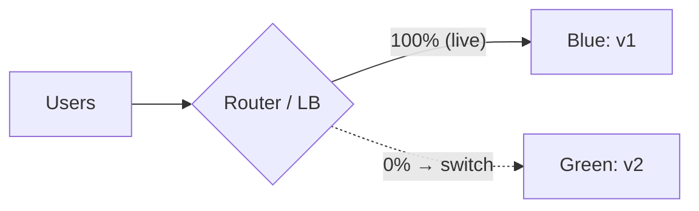
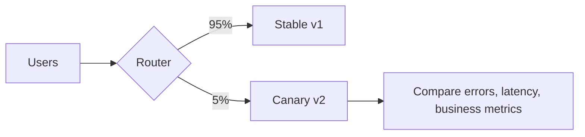

Most outages are caused by changes. A deployment strategy decides how a new version replaces the old one, and therefore how many users a bad release can hurt and how quickly you can undo it.

## Recreate (big bang)

Stop the old version, start the new one.
- **Pros:** simplest; no two versions running together.
- **Cons:** downtime; a bad release hits everyone at once.
- **Use for:** dev environments, batch jobs, or when two versions genuinely cannot coexist.

## Rolling deployment

Replace instances a few at a time: take one out of the load balancer, upgrade it, health-check it, put it back, repeat.

- **Pros:** no downtime; no extra capacity needed; the default in Kubernetes.
- **Cons:** v1 and v2 serve traffic **at the same time**, so they must be compatible; rollback is another slow rolling deploy; a bad release gradually reaches everyone unless health checks catch it.

## Blue-green deployment

Run two complete environments. **Blue** serves all traffic (v1). Deploy v2 to **green**, test it, then switch the router to green in one step. Blue stays ready.

- **Pros:** instant switch and **instant rollback** (switch back); you can test green with production config before it gets traffic.
- **Cons:** double the infrastructure during the release; database changes must work for both versions; in-flight sessions and long connections need draining; the switch moves everyone at once, so a subtle bug affects all users until noticed.

## Canary release

Send a **small percentage** of traffic to the new version, watch metrics, and gradually increase: 1% → 5% → 25% → 50% → 100%.

- **Pros:** limits the **blast radius**; real production traffic validates the release; can be **automated** (progressive delivery tools compare canary metrics against the baseline and roll back automatically).
- **Cons:** more complex routing and monitoring; needs enough traffic for statistically meaningful comparison; both versions run together (compatibility again).
- Canary by user segment too: employees first, then one region, then everyone.

## Related techniques

### Feature flags
Deploy code with the new behaviour **switched off**, then enable it for chosen users at runtime. Separates **deploying** from **releasing**: a bad feature is turned off in seconds without a redeploy. Requires discipline to remove old flags.

### Shadow (dark) traffic
Copy real requests to the new version without returning its responses to users. Compare results and performance with zero user impact. Be careful with side effects (writes, emails, payments).

### A/B testing
Route users to variants to measure **business outcomes** (conversion, engagement), not release safety. Uses the same traffic-splitting machinery as canaries.

## Comparison

| Strategy | Downtime | Rollback speed | Extra cost | Blast radius | Complexity |
|---|---|---|---|---|---|
| Recreate | Yes | Slow | None | Everyone | Lowest |
| Rolling | No | Slow (roll back again) | Little | Grows over the rollout | Low |
| Blue-green | No | Instant | 2× during release | Everyone at switch | Medium |
| Canary | No | Fast (shift traffic back) | Small | Small, controlled | Higher |

## Supporting practices

### Backward-compatible database changes: expand and contract
Because old and new versions run at the same time, schema changes are done in steps:
1. **Expand:** add the new column/table; old code ignores it.
2. Deploy code that writes to both old and new, and reads the old.
3. **Backfill** existing data.
4. Deploy code that reads the new.
5. **Contract:** remove the old column once nothing uses it.

Never rename or drop a column in the same release that stops using it.

### Trunk-based development
Developers merge small changes into the main branch frequently (at least daily), keeping it always releasable, with unfinished work hidden behind feature flags. Short-lived branches avoid painful merges and make continuous deployment possible. It pairs naturally with canaries and flags.

### Automate the safety net
- Health checks and readiness probes gate every step.
- Automatic rollback when error rate or latency crosses thresholds.
- Deploy during staffed hours; freeze during peak events.

> [!INTERVIEW] A safe release process
> "Main is always releasable (trunk-based, feature flags for unfinished work). CI builds one artifact, deploys to staging, then canaries in production at 1% for 15 minutes with automatic comparison of error rate and p99 against the baseline, then 10%, 50%, 100%. Schema changes use expand-and-contract so both versions can run together, and any feature can be switched off by flag."

## Key takeaways

- Rolling: no downtime, cheap, slow rollback. Blue-green: instant switch and rollback, double cost. Canary: smallest blast radius, needs good metrics.
- Feature flags separate deploying from releasing.
- Running two versions at once requires backward compatibility, especially in the database (expand and contract).
- Trunk-based development plus automated, progressive rollouts make frequent releases safe.
