A fast, scalable API is designed in, then **proved** by measurement. This lesson covers the performance techniques that matter most and the observability you need to know whether they are working.

## Making APIs fast

### Reduce work per request
- **Cache** at every sensible layer (CDN for public GETs, Redis for hot objects, in-process for config).
- **Index** for the queries endpoints actually run; avoid N+1 query patterns (load related data in one query or batch).
- **Return only what's needed:** sparse fieldsets, pagination, smaller payloads.
- **Precompute** expensive results (feeds, aggregates) instead of computing them per request.

### Reduce waiting
- **Parallelise** independent downstream calls instead of making them one after another.
- **Move non-essential work off the request path** with queues (emails, analytics, indexing).
- **Batch** small calls (one `MGET` instead of 50 GETs).
- **Connection pooling** and keep-alive for databases and downstream HTTP/gRPC.
- **Timeouts and deadlines** so one slow dependency doesn't hold everything.

### Reduce bytes
- **Compression** (gzip/Brotli) for JSON.
- **Binary formats** (Protocol Buffers) between services.
- **HTTP/2 or HTTP/3** to multiplex requests.

### Handle load gracefully
- **Horizontal scaling** of stateless API servers with autoscaling on CPU, latency or queue depth.
- **Rate limiting and load shedding** so overload produces fast 429s/503s instead of everything slowing down.
- **Bulkheads:** separate thread or connection pools per dependency.
- **Async request-reply** (`202 Accepted`) for heavy operations.

### Watch the tail
At scale, p99 matters more than average. Tail-latency reducers:
- **Hedged requests:** if a replica hasn't answered within the p95 time, send the same (idempotent) request to another replica and take whichever answers first.
- Avoid GC pauses and noisy neighbours; keep hot data in memory.
- Remember that fan-out amplifies the tail: if a page calls 100 services, even a 1% slow rate per service makes most page loads slow.

## Observability: the three pillars

### Metrics
Numeric time series, cheap to store and fast to query. Use them for dashboards and alerts.

Two well-known checklists:
- **RED** (for request-driven services): **R**ate (requests/s), **E**rrors (failed requests/s), **D**uration (latency percentiles).
- **USE** (for resources: CPU, disks, pools): **U**tilisation, **S**aturation (queueing), **E**rrors.
- Plus Google's **four golden signals:** latency, traffic, errors, saturation.

Record latency as **histograms** so you can compute p50/p95/p99. Averages hide problems.

### Logs
Detailed records of individual events.
- Use **structured logs** (JSON) with consistent fields: timestamp, level, service, request ID, user ID (if allowed), message.
- Centralise them (ELK/OpenSearch, Loki, cloud logging).
- Control volume: sample noisy debug logs; never log secrets or personal data you don't need.

### Traces
A **distributed trace** follows one request across every service it touches. Each hop is a **span** with timing; all spans share a **trace ID** passed along in headers (W3C `traceparent`).

```mermaid
gantt
  title Trace of GET /checkout (total 182 ms)
  dateFormat X
  axisFormat %L ms
  section API gateway
  gateway            :0, 182
  section Checkout svc
  checkout handler   :5, 175
  section Calls
  cart service       :10, 40
  pricing service    :10, 55
  inventory service  :60, 150
  section DB
  inventory query    :70, 145
```

The trace instantly shows the inventory query is the bottleneck. **OpenTelemetry** is the standard way to instrument metrics, logs and traces.

### Tie them together
Put the **trace ID in every log line** and link metrics exemplars to traces. Then an alert on p99 latency leads to an example slow trace, which leads to that request's logs.

## SLOs and alerting

- Define **SLIs** (e.g. "fraction of checkout requests under 300 ms and successful") and **SLOs** (e.g. "99.9% over 30 days").
- The **error budget** is what the SLO allows to fail (0.1%). Spend it on releases and experiments; when it's exhausted, prioritise reliability work.
- **Alert on symptoms users feel** (error rate, latency SLO burn) rather than every CPU spike. Use multi-window **burn-rate alerts** to catch both fast and slow budget consumption.
- Every alert should be actionable and link to a runbook.

## Load testing and capacity

- Load-test before launches with realistic traffic shapes (tools: k6, Gatling, JMeter, Locust).
- Find each service's breaking point and the first bottleneck.
- Test failure modes too: what happens to latency when a dependency slows down?

> [!INTERVIEW] Observability in a design
> "Each service exposes RED metrics with latency histograms, logs JSON with the trace ID, and is instrumented with OpenTelemetry. We have an SLO of 99.9% of feed requests under 200 ms, with burn-rate alerts. When an alert fires, the dashboard links to slow example traces."

## Key takeaways

- Performance: cache, index, parallelise, batch, go async, compress, pool connections, and shed load.
- Tail latency dominates at scale; hedging and fan-out awareness help.
- Metrics (RED/USE), structured logs and distributed traces, joined by trace IDs.
- Define SLOs, alert on burn rate and user-facing symptoms, and load-test before launch.
