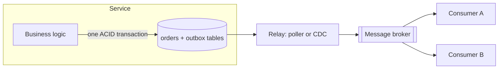

A service often has to do two things at once: **update its database** and **publish an event** so others can react. Doing both reliably is surprisingly hard. The transactional outbox pattern solves it.

## The dual-write problem

```java
orderRepository.save(order);                          // 1. database
kafka.send("orders", new OrderPlaced(order.id()));    // 2. broker
```

These are two separate systems, so there is no transaction covering both:
- **Crash after 1, before 2:** the order exists but nobody hears about it. No email, no inventory update, a stuck saga.
- **Publish first, then the DB write fails:** consumers act on an order that doesn't exist.
- **Publish succeeded but timed out**, so you retry: duplicate events.

Wrapping it in a try/catch doesn't help, because a crash can happen between any two lines.

> [!REAL] Writing in the register and sending an SMS
> The shopkeeper writes the sale in the register and then sends the customer an SMS. If his phone dies between the two, the sale is recorded but the SMS never goes, or the SMS goes but the sale is never recorded.

## The pattern

Write the event into an **outbox table in the same database**, inside the same local transaction as the business change. A separate relay then publishes outbox rows to the broker.



```sql
BEGIN;
INSERT INTO orders (id, user_id, status, total) VALUES (981, 42, 'PLACED', 4999);
INSERT INTO outbox (id, aggregate_id, type, payload, created_at)
VALUES (gen_random_uuid(), 981, 'OrderPlaced', '{"orderId":981,"userId":42}', now());
COMMIT;
```

Either both rows are committed or neither is. The event can no longer be lost or invented.

> [!REAL] Writing the SMS in the register too
> He writes the sale *and* "SMS to send" in the same register entry. An assistant goes through the register and sends any SMS not yet marked sent. Nothing is lost because both are one write.

## Relaying outbox rows

### Option 1: Polling publisher
A background job repeatedly selects unpublished rows, publishes them, then marks them published (or deletes them).

```sql
SELECT * FROM outbox WHERE published_at IS NULL ORDER BY created_at LIMIT 100 FOR UPDATE SKIP LOCKED;
-- publish each to the broker, then:
UPDATE outbox SET published_at = now() WHERE id IN (...);
```

- **Pros:** simple, works with any database.
- **Cons:** polling adds latency and load; must scale carefully (`SKIP LOCKED` lets several relays share work).

### Option 2: Change data capture (CDC)
A tool such as Debezium reads the database's transaction log (PostgreSQL WAL, MySQL binlog) and streams new outbox rows to Kafka.

- **Pros:** low latency, no polling load, preserves commit order.
- **Cons:** more infrastructure; requires log access and careful operations.

> [!REAL] Reading the CCTV instead of asking
> Instead of checking the register every few minutes, the assistant watches the live recording of every new entry. CDC tools like Debezium read the database's change log and publish events.

## Delivery guarantees

The relay may crash after publishing but before marking the row as published, so it publishes again on restart. The outbox gives **at-least-once** delivery, never "exactly once" by itself.

So consumers must be **idempotent**:
- Each event carries a unique ID.
- Consumers record processed event IDs (in the same transaction as their own change) and skip duplicates. This is sometimes called an **inbox** table.

```sql
-- consumer side, one transaction:
INSERT INTO processed_events (event_id) VALUES (:id);   -- fails on duplicate → skip
UPDATE inventory SET reserved = reserved + 1 WHERE sku = :sku;
```

## Ordering

- Events for the same entity should be published in commit order. Using the entity ID (`aggregate_id`) as the Kafka message key sends them to the same partition, preserving per-entity order.
- Global ordering across all entities is rarely needed and costly.

## Housekeeping

- Delete or archive published outbox rows regularly so the table stays small.
- Monitor **outbox lag** (oldest unpublished row's age). Growing lag means the relay is stuck or too slow.
- Keep payloads versioned so consumers can evolve.

## Related patterns

- **Listen to yourself:** publish the event first and have your own service consume it to update the database. Works, but the database lags behind the event.
- **Event sourcing:** the event log *is* the database, so there is nothing to keep in sync. Powerful but a much bigger architectural commitment.
- **CDC on business tables directly** (without an outbox): simpler, but leaks your internal schema to consumers. The outbox gives you an explicit, stable event contract.

> [!INTERVIEW] Name the problem, then the pattern
> "Saving the order and publishing `OrderPlaced` is a dual write, so a crash in between would lose the event. I'll insert the event into an outbox table in the same transaction, and Debezium streams outbox rows to Kafka keyed by order ID. Delivery is at-least-once, so consumers deduplicate by event ID."

## Key takeaways

- Updating a database and publishing a message are two writes with no shared transaction.
- The outbox puts the event in the same local transaction as the change.
- A poller or CDC relays outbox rows to the broker.
- The result is at-least-once delivery, so consumers must be idempotent.
