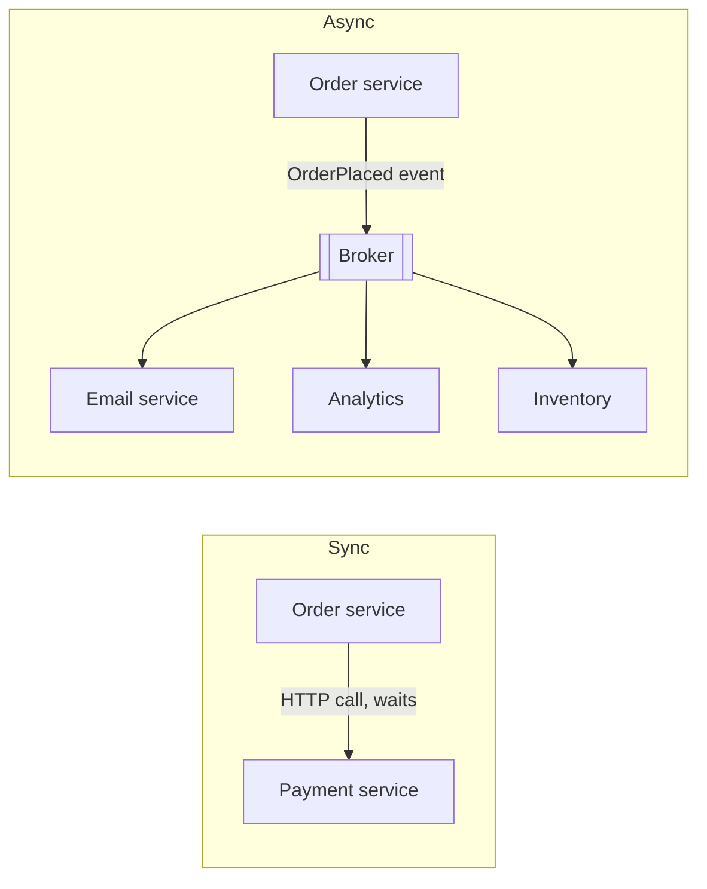

Services and clients have to talk to each other. The choice of **how** (request/response or events, synchronous or asynchronous, which protocol) shapes latency, coupling and failure behaviour more than almost any other decision.

## Synchronous vs asynchronous communication

### Synchronous (request/response)
The caller sends a request and waits for the answer.

- **Pros:** simple mental model; immediate result; easy error handling.
- **Cons:** **temporal coupling**: if the callee is slow or down, the caller is slow or fails too. Latency adds up along call chains, and availability multiplies down (see [High Availability](#/l/02-scalability/availability)).
- **Use for:** queries the user is waiting for, and operations that need an immediate answer ("is this card valid?").

### Asynchronous (messaging / events)
The caller publishes a message and moves on; a consumer processes it later.

- **Pros:** decoupled in time; absorbs spikes; the producer survives consumer downtime; easy to add new consumers.
- **Cons:** eventual consistency; harder debugging and tracing; you need idempotent consumers, retries and dead-letter handling.
- **Use for:** side effects (emails, notifications, indexing), workflows spanning services, high-volume ingestion.

## Communication patterns

| Pattern | Description | Example |
|---|---|---|
| **Request/response** | Ask and wait | REST/gRPC call |
| **Fire-and-forget** | Send, don't wait for a result | Logging, metrics |
| **Point-to-point queue** | Each message processed by one consumer | Job queue for image resizing |
| **Publish/subscribe** | Each message delivered to every subscriber group | `OrderPlaced` to email, analytics, inventory |
| **Request/reply over messaging** | Async request with a reply queue and correlation ID | Long-running jobs |
| **Streaming** | Continuous flow of messages over one connection | Live prices, logs, LLM token streaming |

More detail in [Message Queue Patterns](#/l/08-distributed/message-queues).

## Real-time client communication

How does the server tell the client something changed?

### Short polling
The client asks every N seconds: "anything new?"
- Simple, works everywhere; wasteful (most responses are empty) and adds up to N seconds of delay.

### Long polling
The client asks; the server **holds** the request open until there is data or a timeout, then the client immediately asks again.
- Near-real-time with plain HTTP; each update still costs a new request; holding many open requests needs an async server.

### Server-Sent Events (SSE)
One long-lived HTTP response through which the server streams events.
- Simple, automatic reconnection, works through most proxies; **one direction only** (server → client); text only.
- Great for notifications, live feeds, progress updates and streaming AI responses.

### WebSocket
A full-duplex, persistent connection upgraded from HTTP.
- Low-latency messages in both directions; ideal for chat, multiplayer, collaborative editing, trading UIs.
- Stateful connections complicate scaling: you need connection-aware routing, a way to deliver a message to whichever server holds the recipient's connection (pub/sub between servers), heartbeats, and reconnection with resume.

### Webhooks
Server-to-server push: when something happens, your server POSTs to a URL the other party registered.
- Used by payment providers, Git hosts, SaaS integrations.
- Needs signatures (HMAC) for authenticity, retries with backoff, idempotent receivers and a way to replay missed events.

| | Direction | Latency | Overhead | Best for |
|---|---|---|---|---|
| Short polling | Client pulls | Up to interval | High | Rare updates, simplicity |
| Long polling | Client pulls (held) | Low | Medium | Fallback for real-time |
| SSE | Server → client | Low | Low | Feeds, notifications, streaming text |
| WebSocket | Both ways | Lowest | Low per message, stateful | Chat, games, collaboration |
| Webhook | Server → server | Low | Low | Integrations between systems |

See also [Short Polling vs Long Polling vs Webhooks](#/l/09-tradeoffs/polling-vs-webhooks).

## Protocol choices between services

- **REST over HTTP/JSON:** universal, human-readable, cache-friendly; default for public APIs.
- **gRPC (HTTP/2 + Protocol Buffers):** compact, fast, strongly typed contracts, streaming; great between internal services.
- **GraphQL:** clients ask for exactly the fields they need; great for complex UIs aggregating many sources.
- **Message brokers** (Kafka, RabbitMQ, SQS): asynchronous communication.

Compared in detail in [REST vs GraphQL vs gRPC](#/l/07-api-design/rest-graphql-grpc).

## Making calls robust

Whatever the protocol:
- **Timeouts** on every call, shorter than the caller's own deadline. Propagate deadlines down the chain.
- **Retries** with exponential backoff and jitter, only for idempotent operations.
- **Idempotency keys** for operations with side effects.
- **Circuit breakers and bulkheads** so a failing dependency doesn't drag everything down.
- **Backpressure:** bounded queues and rate limits so a fast producer can't overwhelm a slow consumer.

> [!INTERVIEW] Choosing sync vs async
> "Placing an order calls payment authorisation synchronously because the user needs the result. Everything after that (confirmation email, inventory update, analytics, recommendations) is triggered by an `OrderPlaced` event, so a slow email provider can never slow down checkout."

## Key takeaways

- Synchronous calls are simple but couple availability and latency; async decouples at the cost of eventual consistency.
- Pick the real-time mechanism by direction and frequency: polling, long polling, SSE, WebSocket, webhooks.
- REST for public APIs, gRPC internally, GraphQL for flexible client queries, brokers for async.
- Timeouts, retries with jitter, idempotency and circuit breakers apply to every call.
