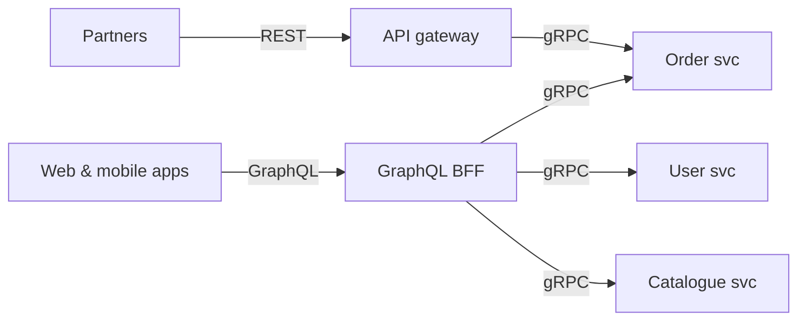

REST, GraphQL and gRPC are the three API styles you will be asked to compare. Each is the best choice somewhere, and real systems often use all three: REST for public APIs, GraphQL for rich client apps, gRPC between internal services.

## REST

Resources identified by URLs, manipulated with HTTP methods, usually exchanging JSON.

```http
GET /v1/users/42
GET /v1/users/42/orders?limit=10
```

**Strengths**
- Universal: every language, browser, tool and developer understands it.
- **HTTP caching works naturally** (GETs, ETags, CDNs).
- Simple to debug with curl and browser tools.
- Stateless and easy to put behind load balancers and gateways.

**Weaknesses**
- **Over-fetching:** endpoints return more fields than a screen needs.
- **Under-fetching:** a screen needs data from several endpoints → several round trips (painful on mobile).
- No built-in schema or type contract (OpenAPI adds one).
- JSON is verbose; no native streaming.

## GraphQL

A single endpoint where the client sends a **query describing exactly the data it wants**, following a typed schema.

```graphql
query {
  user(id: 42) {
    name
    orders(last: 3) { id total items { name } }
  }
}
```

**Strengths**
- **Exactly the data needed, in one round trip**, even across many backend services.
- **Strongly typed schema** with introspection: great tooling, autocomplete and generated types.
- Frontends evolve independently; adding fields doesn't break clients.
- **Subscriptions** for real-time updates.

**Weaknesses**
- **Caching is harder:** everything is a POST to one URL, so HTTP/CDN caching doesn't apply by default (persisted queries help).
- **N+1 problem in resolvers:** resolving `orders` for 50 users can trigger 50 queries. Solved with batching (DataLoader).
- **Expensive queries:** clients can request deeply nested data. You need depth limits, cost analysis and timeouts.
- More complex server, error handling (partial results with an `errors` array and HTTP 200), and monitoring per field.

## gRPC

Remote procedure calls over **HTTP/2** using **Protocol Buffers** for compact binary messages and a contract defined in `.proto` files.

```protobuf
service OrderService {
  rpc GetOrder (GetOrderRequest) returns (Order);
  rpc StreamOrderUpdates (OrderId) returns (stream OrderUpdate);
}
message GetOrderRequest { int64 id = 1; }
```

**Strengths**
- **Fast and compact:** binary encoding, HTTP/2 multiplexing, low overhead.
- **Strict contracts** and generated client/server code in many languages.
- **Streaming:** client, server and bidirectional streaming built in.
- Deadlines, cancellation and metadata are first-class.

**Weaknesses**
- **Limited browser support** (needs gRPC-Web and a proxy).
- Binary payloads are not human-readable; debugging needs tools.
- Less friendly for public third-party APIs.
- Requires HTTP/2 end to end; some proxies and load balancers need configuration to balance per request.

## Side by side

| | REST | GraphQL | gRPC |
|---|---|---|---|
| Transport | HTTP/1.1 or 2 | HTTP (usually POST) | HTTP/2 |
| Payload | JSON (usually) | JSON | Protocol Buffers (binary) |
| Contract | Optional (OpenAPI) | Required schema | Required `.proto` |
| Data shape | Server decides | Client decides | Server decides (per method) |
| Round trips for complex screens | Many | One | Depends on API design |
| HTTP/CDN caching | Excellent | Hard | Not applicable |
| Streaming | No (use SSE/WebSocket) | Subscriptions | Native, bidirectional |
| Browser support | Native | Native | Via gRPC-Web |
| Performance | Good | Good (server cost varies) | Best |
| Best for | Public APIs, simple CRUD, cacheable reads | Complex UIs, many clients, aggregating services | Internal microservice calls, low latency, streaming |

## How to choose

- **Public API for third parties?** REST. Everyone can use it and it caches well.
- **Mobile and web apps with complex screens pulling from many services?** GraphQL (often as a gateway or BFF over internal services).
- **High-volume service-to-service calls, polyglot microservices, streaming?** gRPC.
- **Real-time push to browsers?** None of them alone; add WebSockets or SSE (or GraphQL subscriptions).



> [!INTERVIEW] Avoid tribalism
> "We expose REST to partners because it's universal and cacheable. Our own apps use a GraphQL BFF so each screen gets its data in one round trip. Behind that, services talk gRPC for low latency and strict contracts, with deadlines propagated on every call."

## Key takeaways

- REST: universal, cacheable, simple; risks over- and under-fetching.
- GraphQL: client-shaped queries and a typed schema; watch caching, N+1 and query cost.
- gRPC: fast binary RPC with streaming and contracts; best internally.
- Use each where it fits; combining them is normal.
