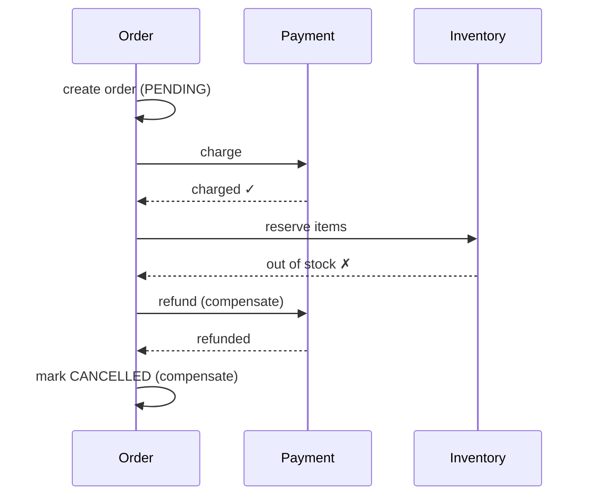
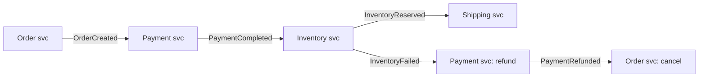
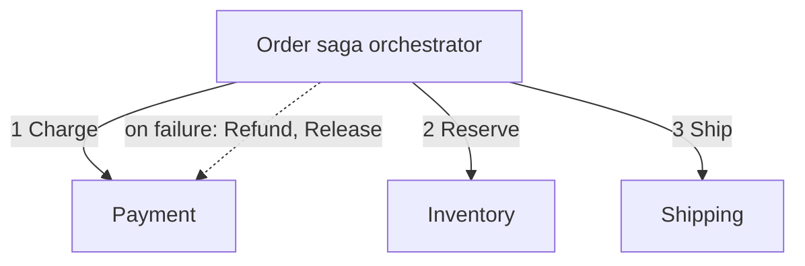

In a microservice architecture, one business action often touches several services, each with its own database. You cannot wrap them in a single ACID transaction. A **saga** replaces one big transaction with a sequence of local transactions, each followed by the next step, and **compensating actions** that undo earlier steps if a later one fails.

## The problem

Placing an order involves:
1. **Order service:** create the order.
2. **Payment service:** charge the customer.
3. **Inventory service:** reserve the items.
4. **Shipping service:** schedule delivery.

If inventory fails after payment succeeded, the customer must be refunded. Distributed two-phase commit (2PC) could lock all four databases until everyone agrees, but it is slow, blocks when the coordinator fails, and many systems (message brokers, third-party payment APIs) do not support it at all.

## How a saga works

Each step is a **local transaction** in one service. Each step that can be undone has a **compensating transaction**.

| Step | Action | Compensation |
|---|---|---|
| 1 | Create order (PENDING) | Mark order CANCELLED |
| 2 | Charge payment | Refund payment |
| 3 | Reserve inventory | Release inventory |
| 4 | Schedule shipping | (final step, no compensation needed) |

If step 3 fails, the saga runs compensations in reverse: refund payment (2), cancel order (1).

Compensation is a **semantic undo**, not a rollback. The charge really happened and is visible on the statement; the refund is a new, separate transaction. Some actions cannot be undone at all (an email was sent), so you send a correction instead, or move such steps to the end of the saga.

## Two ways to coordinate

### Choreography: services react to events
No central coordinator. Each service listens for events and publishes its own.

- **Pros:** loose coupling, no single coordinator, simple for short flows.
- **Cons:** the overall flow is implicit and spread across services, hard to understand and monitor; cyclic dependencies between services; adding a step means changing several services.

### Orchestration: a coordinator directs the steps
An **orchestrator** (a saga state machine) tells each service what to do and decides what happens next based on replies.

- **Pros:** the flow is explicit in one place; easy to monitor, test and change; services stay simple.
- **Cons:** the orchestrator is extra infrastructure and can become a "god service" if business logic leaks into it.
- **Tools:** workflow engines such as Temporal, Camunda, AWS Step Functions, or a hand-written state machine persisted in a database.

| | Choreography | Orchestration |
|---|---|---|
| Control | Distributed, event-driven | Central coordinator |
| Visibility of flow | Low | High |
| Coupling | Loose | Services coupled to orchestrator's commands |
| Best for | Simple flows, 2–4 steps | Complex flows, many steps, branching |

## Hard parts to get right

### Lack of isolation
Saga steps commit immediately, so other transactions can see intermediate states: an order that is "paid but not reserved". Countermeasures:
- **Semantic locks:** mark records with a pending state (`PENDING_PAYMENT`) so other operations treat them carefully.
- **Commutative updates** that work in any order.
- **Reorder steps:** do risky, likely-to-fail steps (e.g. reserve inventory) **before** hard-to-compensate ones (e.g. charge card). Pivot steps go in the middle; anything after the pivot should be retryable until it succeeds.

### Reliable messaging
A service must update its database **and** publish an event atomically, or the saga stalls or diverges. Use the [Transactional Outbox](#/l/07-api-design/outbox).

### Idempotency
Messages are delivered at least once, so every step and every compensation must be idempotent (e.g. "refund payment 981" twice must refund once).

### Failures during compensation
Compensations can fail too. They must be retried until they succeed, with alerting and a manual-intervention path for the rare cases that can't complete.

### Timeouts
What if a service never replies? The orchestrator needs timeouts per step that trigger retries or compensation.

## When to use sagas

- Business transactions spanning several services or external systems.
- Long-running processes (minutes to days): bookings, onboarding, loan approval.
- When eventual consistency of the overall process is acceptable.

Avoid them when one service with one database can do the job in a single local transaction. Often the best fix is to redraw service boundaries so data that must change together lives together.

> [!INTERVIEW] A crisp saga answer
> "Checkout is an orchestrated saga: reserve inventory, then authorise payment, then confirm the order, then capture payment. Reserving first means the likely failure happens before money moves. Each service writes its state change and its outgoing message in one local transaction through an outbox, every handler is idempotent, and failures trigger compensations: release the reservation, void the authorisation."

## Key takeaways

- A saga is a sequence of local transactions with compensating actions instead of a distributed lock.
- Compensation is a semantic undo, a new transaction, not a rollback.
- Choreography suits short flows; orchestration suits complex ones and is easier to observe.
- Handle missing isolation, reliable messaging (outbox), idempotency, timeouts and failed compensations.
