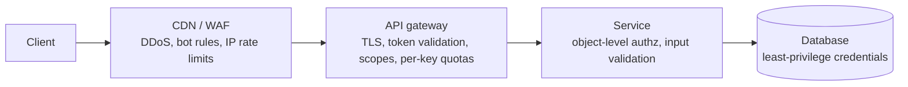

An API is a door into your system. Securing it means answering three questions on every request: **who is calling** (authentication), **what may they do** (authorisation), and **how much may they do** (rate limiting), while protecting data in transit and validating everything that comes in.

## Authentication: who are you?

### API keys
A long random secret identifying a client application.
- Simple; good for server-to-server and identifying a calling application.
- Weak alone: no user identity, often long-lived, leak easily. Send only in headers over TLS, store only hashed, allow rotation, scope per environment.

### Sessions (cookie-based)
After login, the server stores a session and gives the browser a session ID cookie.
- Easy to revoke (delete the session).
- Needs a shared session store when servers scale out.
- Protect cookies with `HttpOnly`, `Secure`, `SameSite`; defend against CSRF.

### Tokens (JWT)
A signed token carrying claims (`sub`, `exp`, `scope`). Services verify the signature locally without a database lookup.

```text
header.payload.signature
{"sub":"user_42","scope":"orders:read","exp":1767225600}
```

- **Pros:** stateless verification, scales well, works across services.
- **Cons:** hard to revoke before expiry. Use short-lived access tokens (5–15 minutes) plus refresh tokens that *can* be revoked. Never put secrets in the payload (it's only encoded, not encrypted). Pin the algorithm; never accept `alg: none`.

### OAuth 2.0 and OpenID Connect
- **OAuth 2.0** is for **delegated authorisation**: let an app act on a user's behalf with limited scopes, without seeing the user's password ("allow this app to read your calendar").
- **OpenID Connect** adds **authentication** on top: an ID token telling the app who the user is ("Sign in with Google").
- Common flows: **Authorization Code + PKCE** for web and mobile apps; **Client Credentials** for service-to-service.

### Mutual TLS (mTLS)
Both client and server present certificates. Strong identity for service-to-service traffic, often automated by a service mesh.

## Authorisation: what may you do?

- **RBAC (role-based):** permissions attached to roles (admin, editor, viewer). Simple and common.
- **ABAC (attribute-based):** rules over attributes ("managers may approve expenses under ₹50,000 in their own department").
- **ReBAC (relationship-based):** permissions from relationships ("can edit if owner of the folder that contains the doc"), as in Google Zanzibar-style systems.
- **Scopes** in OAuth tokens limit what a token can do.

> [!WARNING] The most common API vulnerability
> **Broken object-level authorisation (BOLA/IDOR):** the API checks that you're logged in but not that order `981` belongs to you, so changing the ID in the URL exposes other users' data. Check ownership on every object access, server-side.

Where to enforce:
- **Gateway:** coarse checks (valid token, required scope).
- **Service:** fine-grained checks (does this user own this resource?). Never rely on the gateway alone.

## Rate limiting and quotas

Protect the system from abuse, accidental overload and noisy neighbours.

- **Dimensions:** per user, per API key, per IP, per endpoint (stricter for login and expensive search), per tenant.
- **Response:** `429 Too Many Requests` with `Retry-After` and headers like `X-RateLimit-Remaining`.
- **Algorithms:** token bucket, leaky bucket, fixed window, sliding window. See [Rate Limiting Algorithms](#/l/08-distributed/rate-limiting).
- **Where:** at the edge or gateway for broad limits; inside services for business quotas; a shared store such as Redis for distributed counters.

## Protecting data and inputs

- **TLS everywhere**, including internal traffic where possible (mTLS).
- **Validate all input** against a schema: types, lengths, ranges, allowed values. Reject unknown fields to prevent mass assignment.
- **Parameterised queries** to prevent SQL injection; encode output to prevent XSS.
- **Limit payload sizes**, page sizes and query complexity (especially GraphQL depth and cost).
- **Don't leak internals** in error messages or stack traces.
- **Secrets** in a secrets manager, never in code or logs; rotate them.
- **CORS** configured narrowly for browser clients.
- **Webhook security:** sign payloads with HMAC and a timestamp; verify and reject old timestamps to stop replays.

## Auditing and monitoring

- Log authentication events, permission denials and sensitive actions with request IDs (but never log tokens, passwords or full card numbers).
- Alert on anomalies: spikes in 401/403, unusual geographies, a key suddenly calling new endpoints.

## Typical layered setup



> [!INTERVIEW] Security in one breath
> "Users sign in through OIDC; the app gets a 10-minute access JWT and a revocable refresh token. The gateway validates signature, expiry and scopes and applies per-user rate limits in Redis. Each service checks ownership of the specific resource. Service-to-service calls use mTLS through the mesh."

## Key takeaways

- Authentication: API keys, sessions, JWTs, OAuth/OIDC, mTLS, each with its trade-offs.
- Authorisation must check object ownership in the service, not only at the gateway.
- Rate-limit by user, key, IP and endpoint; respond with 429 and Retry-After.
- Validate inputs, encrypt in transit, guard secrets and audit sensitive actions.
