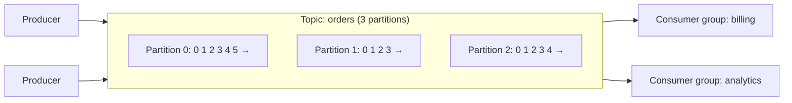

Apache Kafka is a distributed, durable, append-only **log**. Producers append events; consumers read them at their own pace and can re-read history. It handles millions of messages per second and is the backbone of event-driven architectures, data pipelines and stream processing.

## Core concepts



- **Event / record:** a key, a value, a timestamp and headers.
- **Topic:** a named stream of events, such as `orders` or `payments`.
- **Partition:** a topic is split into partitions. Each partition is an **ordered, append-only log** stored on disk. Partitions are the unit of parallelism and ordering.
- **Offset:** each record's position in its partition (0, 1, 2…). Consumers track the offset they've reached.
- **Broker:** a Kafka server storing partitions. A **cluster** has many brokers.
- **Producer:** writes records to topics.
- **Consumer:** reads records; consumers are organised into **consumer groups**.

## Partitioning and keys

The producer picks a partition for each record:
- **With a key:** `partition = hash(key) mod partitions`. All records with the same key (e.g. `order_id`) go to the same partition, so they stay **in order**.
- **Without a key:** spread across partitions (sticky batching) for throughput.

**Ordering is guaranteed only within a partition**, not across a topic. Choose the key by the ordering you need: events for one order, one user or one account.

Watch for **hot partitions**: a key with huge volume (a celebrity, a large tenant) overloads one partition. Use a more granular key or add a suffix to spread it.

## Consumer groups

- Each partition is consumed by **exactly one consumer in a group** at a time.
- Different groups read independently, each with its own offsets: billing and analytics both see every event.
- Parallelism within a group is capped by the partition count: 12 partitions → at most 12 active consumers; extra consumers sit idle.

```text
Topic with 6 partitions, group with 3 consumers:
  consumer A ← P0, P1
  consumer B ← P2, P3
  consumer C ← P4, P5
```

When consumers join or leave, partitions are reassigned. See [Kafka Consumer Rebalancing](#/l/08-distributed/kafka-rebalancing).

## Replication and durability

- Each partition has a **replication factor** (typically 3): one **leader** replica and followers on other brokers.
- Producers and consumers talk to the **leader**; followers copy from it.
- **ISR (in-sync replicas):** followers that are caught up. With `acks=all`, a write is acknowledged only when all ISRs have it.
- `min.insync.replicas=2` (with RF 3) means a write fails rather than being acknowledged by just one replica, protecting against data loss.
- If a leader broker dies, a new leader is elected from the ISR by the **controller** (KRaft quorum in modern Kafka; ZooKeeper in older versions).

## Why Kafka is fast

- **Sequential disk I/O:** appending to a log and reading sequentially is very fast, even on spinning disks.
- **OS page cache:** recent data is served from memory without Kafka managing its own cache.
- **Zero-copy:** data is sent from the page cache to the network socket without copying through application memory.
- **Batching and compression:** producers send batches; brokers store them compressed; consumers fetch in batches.
- **Partitioning:** load spreads across brokers and disks.

## Retention and compaction

Kafka keeps data after it's consumed:
- **Time/size retention:** delete segments older than, say, 7 days or beyond 1 TB.
- **Log compaction:** keep only the **latest record per key**. A compacted topic acts like a changelog table, e.g. the current profile of each user. A record with a null value (a tombstone) deletes the key.
- **Tiered storage:** older segments move to cheap object storage while staying readable.

Because data is retained, consumers can **replay**: rebuild a search index, backfill a new service, reprocess after a bug fix.

## The ecosystem

- **Kafka Connect:** move data in and out (CDC from databases via Debezium, sinks to S3, Elasticsearch, warehouses).
- **Kafka Streams / ksqlDB / Flink:** stream processing: filter, join, aggregate and window events in real time.
- **Schema Registry:** manages Avro/Protobuf/JSON schemas and enforces compatible evolution.

## Typical uses

- Event-driven microservices (`OrderPlaced` consumed by many services).
- Change data capture pipelines from databases.
- Activity tracking, clickstreams, logs and metrics aggregation.
- Stream processing: fraud detection, real-time analytics, trending topics.
- Buffer in front of slower systems and data lakes.

> [!INTERVIEW] Sizing a topic
> "We expect a 30K events/s peak. If one consumer handles ~3K/s, we need at least 10 consumers, so 10 partitions minimum; I'd pick 24 for headroom, since adding partitions later changes key-to-partition mapping. Replication factor 3, `min.insync.replicas=2`, producers with `acks=all` and idempotence on. Keyed by `order_id` for per-order ordering."

## Key takeaways

- Kafka is a partitioned, replicated, append-only log with retention and replay.
- Keys pick partitions; ordering holds only within a partition.
- Each partition is read by one consumer per group; partitions cap parallelism.
- Durability comes from replication, ISR, `acks=all` and `min.insync.replicas`.
- Speed comes from sequential I/O, page cache, zero-copy, batching and partitioning.
