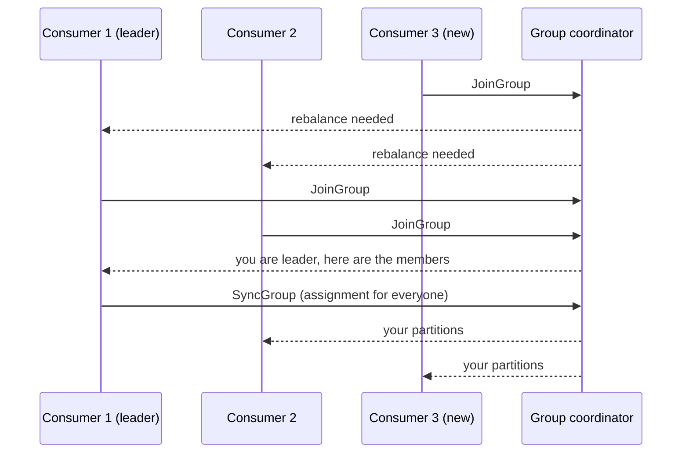

A **rebalance** is how a Kafka consumer group redistributes partitions among its members. It is necessary (members come and go) but disruptive: during a classic rebalance, consumption pauses. Understanding why rebalances happen and how to make them cheap is a common senior-level question.

## What triggers a rebalance

- A consumer **joins** the group (scale-out, deploy, restart).
- A consumer **leaves** cleanly (shutdown) or **dies** (missed heartbeats past `session.timeout.ms`).
- A consumer is **considered stuck** (no `poll()` within `max.poll.interval.ms`).
- The subscribed topics change (partitions added, or a regex subscription matches a new topic).

## How it works

One broker acts as the **group coordinator**. One consumer is chosen as the **group leader**, which computes the assignment.



## Eager vs cooperative rebalancing

### Eager (stop-the-world)
Every consumer **revokes all** its partitions, everyone rejoins, and partitions are reassigned from scratch.
- Simple, but the whole group stops consuming during the rebalance, even for partitions that end up with the same owner.
- With large groups or frequent rebalances (rolling deploys!), these pauses add up to significant lag.

### Cooperative (incremental)
Consumers keep their partitions and only the partitions that **actually need to move** are revoked, over one or two quick rounds.
- Most consumers keep working throughout.
- Enabled with `partition.assignment.strategy=CooperativeStickyAssignor` (and on by default in newer client and protocol versions; Kafka's newer consumer group protocol moves assignment to the broker and makes rebalances incremental by design).

## Assignment strategies

| Strategy | Behaviour |
|---|---|
| Range | Assigns contiguous ranges per topic; can be uneven across topics |
| RoundRobin | Spreads partitions evenly; ignores previous ownership |
| Sticky | Even spread **and** keeps as many previous assignments as possible |
| CooperativeSticky | Sticky + incremental (cooperative) rebalancing; the recommended default |

Stickiness matters because moving a partition loses any local state or cache the old consumer had built for it.

## Problems rebalances cause

- **Pauses and lag spikes** while partitions are unowned.
- **Duplicate processing:** records processed but not yet committed by the old owner are processed again by the new owner. Consumers must be idempotent.
- **Rebalance storms:** a slow consumer exceeds `max.poll.interval.ms`, gets evicted, rejoins, triggers another rebalance, and the cycle repeats.
- **Lost local state** for stateful processing (rebuilt from changelogs in Kafka Streams).

## Making rebalances rare and cheap

1. **Cooperative-sticky assignment** so only moved partitions pause.
2. **Static membership:** set `group.instance.id` per consumer instance (e.g. pod name). A consumer that restarts within `session.timeout.ms` gets its old partitions back **without** triggering a rebalance. Ideal for rolling deployments.
3. **Keep poll loops fast:** limit `max.poll.records`, set timeouts on external calls, or process asynchronously and pause partitions, so you never exceed `max.poll.interval.ms`.
4. **Tune failure detection:** a sensible `session.timeout.ms` (not so short that GC pauses cause evictions) and heartbeat interval ≈ one-third of it.
5. **Commit on revoke:** implement a `ConsumerRebalanceListener` that commits processed offsets in `onPartitionsRevoked`, minimising duplicates.
6. **Avoid flapping deployments:** scale gradually, and avoid autoscalers that add and remove consumers every minute.

```java
consumer.subscribe(List.of("orders"), new ConsumerRebalanceListener() {
    public void onPartitionsRevoked(Collection<TopicPartition> parts) {
        consumer.commitSync(currentOffsets(parts));   // save progress before losing them
    }
    public void onPartitionsAssigned(Collection<TopicPartition> parts) {
        // optionally restore local state / seek to stored offsets
    }
});
```

## Monitoring

- Rebalance rate and duration per group.
- Consumer lag per partition (spikes coincide with rebalances).
- Count of evictions due to `max.poll.interval.ms`.

> [!INTERVIEW] The senior answer
> "Every deploy used to trigger several eager rebalances, pausing the whole group. We moved to the cooperative-sticky assignor and static membership with the pod name as `group.instance.id`, so restarted pods reclaim their partitions without a rebalance. We also commit offsets in `onPartitionsRevoked` to cut duplicates, and handlers are idempotent for the rest."

## Key takeaways

- Rebalances happen when members join, leave, die or stall, or when subscriptions change.
- Eager rebalancing stops the whole group; cooperative rebalancing moves only what's necessary.
- Static membership avoids rebalances on quick restarts.
- Fast poll loops, sensible timeouts, commit-on-revoke and idempotent handlers keep rebalances harmless.
