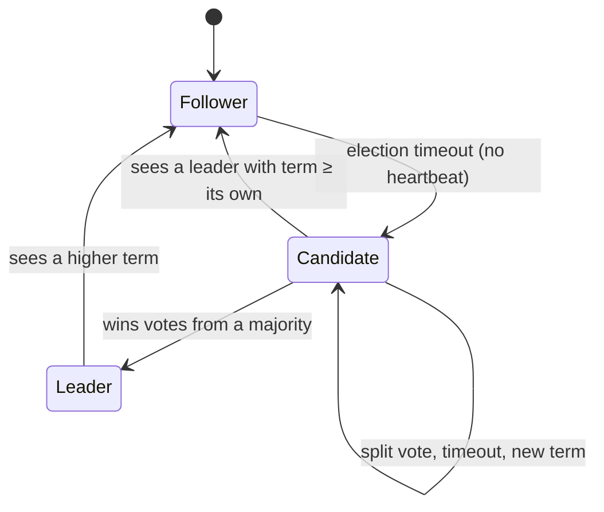
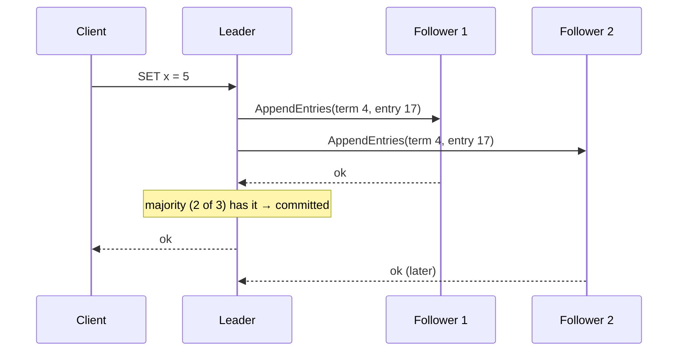

Many distributed systems need exactly one node to be in charge: one database primary accepting writes, one scheduler running cron jobs, one partition leader in Kafka. **Leader election** chooses that node, and **consensus** algorithms such as Raft make sure all nodes agree on who it is and on the order of changes, even when machines crash and networks misbehave.

## Why it's hard

- Nodes can crash, restart or be **slow** (indistinguishable from crashed, from the outside).
- Messages can be delayed, lost, duplicated or reordered.
- The network can **partition**, splitting the cluster into groups that can't talk to each other.

The danger is **split brain**: two nodes both believe they are the leader and both accept writes, and the data diverges.

> [!REAL] Who's the class monitor?
> If the monitor is absent, the class must choose one replacement, and two groups mustn't each elect their own. Over a laggy network, "absent" and "just slow to answer" look the same.

## The key idea: majorities (quorums)

In a cluster of N nodes, a decision needs agreement from a **majority**: more than N/2.

- Any two majorities overlap in at least one node, so two conflicting decisions can't both win.
- A cluster of **2f + 1** nodes tolerates **f** failures: 3 nodes survive 1 failure, 5 nodes survive 2.
- During a partition, only the side with a majority can make progress. The minority side stops, which is exactly what prevents split brain (a CP choice in CAP terms).

That's why consensus clusters have an odd number of nodes: 4 nodes tolerate only 1 failure, the same as 3.

> [!REAL] Majority vote in a committee
> With 5 members, any decision needs 3 votes. Two groups of 3 can't exist at once, so there can never be two winners.

## Raft in plain language

Raft was designed to be understandable. Each node is a **follower**, a **candidate** or the **leader**. Time is divided into numbered **terms**, each with at most one leader.



### 1. Leader election
- The leader sends regular **heartbeats** to followers.
- If a follower hears nothing for its **election timeout** (randomised, e.g. 150–300 ms), it assumes the leader is gone, increments the term, becomes a **candidate**, votes for itself and asks the others for votes.
- Each node votes for **at most one candidate per term**, and only for a candidate whose log is at least as up to date as its own.
- A candidate with votes from a majority becomes leader and starts sending heartbeats.
- **Randomised timeouts** make it unlikely that two candidates start at the same moment; if they split the vote, both time out and try again with a new term.

> [!REAL] Raising your hand after silence
> If the teacher hasn't spoken for a random few seconds, a student says "I'll lead, vote for me". The random wait means usually only one student asks first.

### 2. Log replication
- Clients send commands to the leader, which appends them to its **log** and sends them to followers.
- Once a **majority** has stored an entry, it is **committed**; the leader applies it to its state machine and replies to the client.
- Followers apply committed entries in the same order, so every node's state machine ends up identical. This is **replicated state machine** design.



### 3. Safety
- **Election restriction:** a node can only win if its log contains all committed entries, so a new leader never loses committed data.
- **Terms as fences:** any message with an older term is rejected. An old leader that was partitioned away discovers the higher term and steps down; its uncommitted entries are overwritten.

## Other approaches

- **Paxos / Multi-Paxos:** the original consensus algorithm; equivalent guarantees, notoriously hard to understand and implement. Used inside Google's Chubby and Spanner.
- **ZAB:** ZooKeeper's protocol, similar in spirit to Raft.
- **Bully and ring algorithms:** classic textbook elections without majorities; they don't handle partitions safely and aren't used for critical data.

## Leader election using a coordination service

Most applications don't implement Raft themselves. They use a store built on it (etcd, ZooKeeper, Consul) or a database:

- **Lease / lock with TTL:** a node creates a key such as `/leader/scheduler` with a lease (e.g. 10 seconds) and keeps renewing it. If it dies, the lease expires and another node takes the key.
- **ZooKeeper ephemeral sequential nodes:** each candidate creates a node; the lowest sequence number is the leader; each watches only its predecessor, avoiding a herd of wake-ups.
- **Kubernetes leases** do the same for controllers.

### Fencing tokens
A paused leader (long GC pause, VM freeze) may wake up after its lease expired, still believing it's the leader. Protect shared resources with a **fencing token**: a number that increases with each new lease (e.g. the Raft term or the etcd revision). The storage layer rejects writes carrying an older token.

```text
Leader A gets lease, token 33 → pauses
Lease expires, Leader B gets token 34 → writes with 34
A wakes up, writes with 33 → storage rejects (33 < 34)
```

> [!REAL] Numbered visitor passes
> Every new manager gets a higher pass number. If the old manager comes back after a long nap and tries to give orders, the staff see an older number and ignore him.

## Where you'll meet this

- etcd (Kubernetes' brain), Consul, ZooKeeper: Raft/ZAB-based configuration and coordination.
- Kafka's KRaft controller quorum (replacing ZooKeeper).
- CockroachDB, TiKV, YugabyteDB: one Raft group per data range.
- Database failover managers choosing a new primary.

> [!INTERVIEW] Keep it at the right altitude
> "Only one scheduler instance may run jobs, so instances compete for a lease in etcd with a 10-second TTL and renew it every 3 seconds. etcd uses Raft across three nodes, so it tolerates one failure and can't elect two leaders. Jobs write with the lease's revision as a fencing token so a paused former leader can't double-run work."

> [!REAL] Real systems
> Kubernetes stores its state in etcd (Raft). Kafka moved from ZooKeeper to its own Raft-based KRaft. Databases like CockroachDB use Raft for every range of data.

## Key takeaways

- Consensus relies on majorities: 2f + 1 nodes tolerate f failures; the minority side of a partition stops.
- Raft: heartbeats, randomised election timeouts, one vote per term, majority-committed log entries.
- Terms and fencing tokens stop stale leaders from doing damage.
- In applications, use etcd/ZooKeeper/Consul leases rather than writing consensus yourself.
