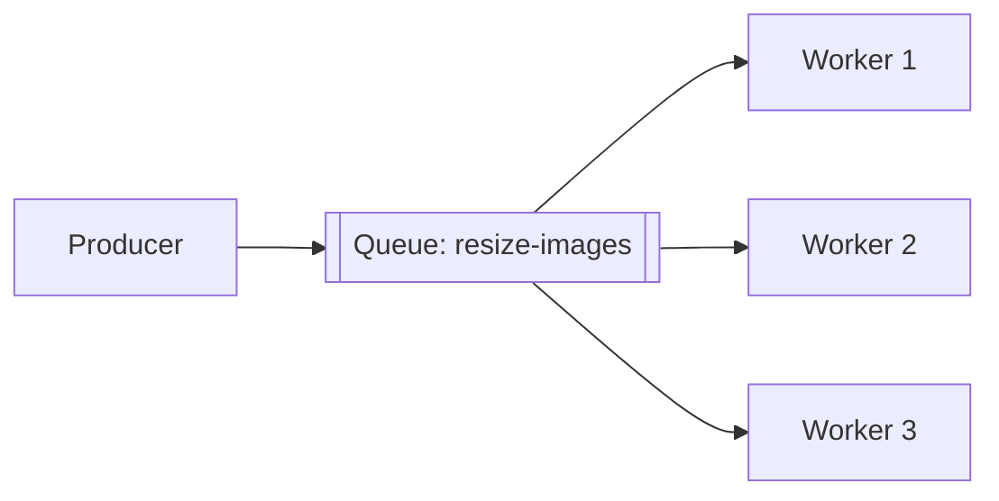
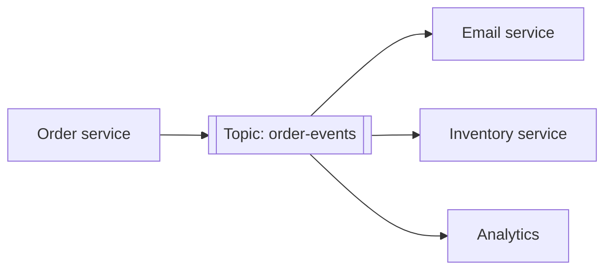
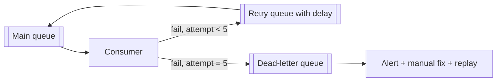

A message queue (or broker) sits between producers and consumers. Producers put messages in; consumers take them out and process them, at their own pace. Queues are how large systems decouple services, absorb spikes and do work asynchronously.

## Why use a queue

- **Decoupling:** the producer doesn't need to know who consumes, or whether they're up right now.
- **Load levelling:** a burst of 50,000 orders in a minute is buffered and processed at a steady rate.
- **Asynchronous work:** slow tasks leave the request path (emails, video encoding, reports).
- **Reliability:** messages persist until processed; failed processing is retried.
- **Fan-out:** one event reaches many independent consumers.
- **Independent scaling:** add consumers when the backlog grows.

## Core patterns

### Point-to-point (work queue / competing consumers)
Each message is delivered to **one** consumer from a pool. Add consumers to process faster.

Use for: background jobs, task distribution.

### Publish/subscribe
Each message goes to **every subscriber** (each subscriber group gets its own copy).

Use for: domain events that several services react to.

### Request/reply over messaging
The request message carries a `reply-to` queue and a **correlation ID**; the responder sends the result to that queue. Use for: long-running jobs where the requester checks back later.

### Priority queues
Higher-priority messages are processed first (e.g. paid users' exports). Beware starvation of low-priority work.

### Delayed / scheduled messages
Deliver after a delay: retry with backoff, "send a reminder in 24 hours", cancel unpaid orders after 15 minutes.

## Delivery semantics

| Guarantee | Meaning | How it fails |
|---|---|---|
| **At most once** | Delivered zero or one time | Messages can be lost |
| **At least once** | Delivered one or more times | Duplicates possible |
| **Exactly once** | Effect happens once | Only achievable within limits (see below) |

Most systems use **at-least-once** delivery plus **idempotent consumers**. The consumer acknowledges a message only **after** processing it; if it crashes first, the message is redelivered.

"Exactly once" end to end is really **at-least-once delivery + idempotent processing** (deduplicate by message ID, or make the operation naturally idempotent), or transactional processing within one system such as Kafka's transactions. See [Kafka Delivery Guarantees](#/l/08-distributed/kafka-delivery).

## Handling failure

### Acknowledgements and visibility timeouts
In queues like SQS, a received message becomes invisible to others for a **visibility timeout**. If not deleted (acknowledged) in time, it reappears for another consumer. Set the timeout longer than normal processing time; extend it for long jobs.

### Retries with backoff
Transient failures (a downstream timeout) deserve retries with exponential backoff, often via delay queues or retry topics (`orders.retry.1m`, `orders.retry.10m`).

### Dead-letter queue (DLQ)
After N failed attempts, move the message to a DLQ instead of retrying forever. A **poison message** (one that always fails, e.g. malformed data) would otherwise block or loop. Monitor the DLQ, fix the cause and **replay** messages.

## Ordering

- Global ordering across a whole queue limits you to one consumer at a time, which kills throughput.
- Usually you only need **per-key ordering** (all events for order 981 in sequence). Use partitioned logs (Kafka partitions by key) or FIFO queues with message group IDs (SQS FIFO).
- Retries can break ordering; design consumers to tolerate it (version numbers, ignore older events).

## Backpressure and monitoring

- Watch **queue depth / consumer lag** and **age of oldest message**. Growing lag means consumers can't keep up: scale them, or find the slow dependency.
- Bound queue sizes or retention; decide what happens when full (reject producers, drop low-priority messages).
- Autoscale consumers on lag.

## Queue vs log

| | Traditional queue (RabbitMQ, SQS) | Log (Kafka, Pulsar, Kinesis) |
|---|---|---|
| After consumption | Message deleted | Message retained (by time/size) |
| Replay | No | Yes, rewind offsets |
| Consumers | Compete for messages | Each group tracks its own offset |
| Ordering | Per queue / FIFO groups | Per partition |
| Routing | Rich (exchanges, routing keys) | By topic and key |
| Strength | Task distribution, complex routing, per-message acks | High-throughput event streams, replay, many consumer groups |

See [Kafka vs RabbitMQ](#/l/09-tradeoffs/kafka-vs-rabbitmq).

> [!INTERVIEW] Make the consumer idempotent
> "The email worker consumes `OrderPlaced` with at-least-once delivery. It records the event ID in a processed-events table in the same transaction that marks the email as queued, so a redelivered event is skipped. After five failures with backoff, the message goes to a DLQ that pages on-call."

## Key takeaways

- Queues decouple services, level load and enable async work and fan-out.
- Point-to-point distributes work; pub/sub broadcasts events.
- Use at-least-once delivery with idempotent consumers; "exactly once" is idempotency in disguise.
- Retries with backoff, DLQs for poison messages, per-key ordering and lag monitoring are essential.
