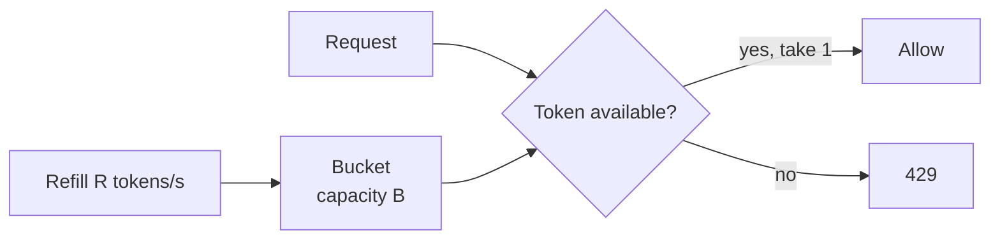

A rate limiter caps how many requests a client can make in a period of time. It protects services from abuse and overload, enforces fair use and pricing tiers, and controls cost. There are five classic algorithms; each makes a different trade-off between accuracy, burst handling and memory.

## 1. Token bucket

A bucket holds up to **B** tokens and is refilled at **R** tokens per second. Each request takes one token; if the bucket is empty, the request is rejected (or queued).



- **Allows bursts** up to B, then a steady rate R. That matches real usage (a page load fires 10 requests at once, then nothing).
- **Memory:** two numbers per client (tokens, last refill time). Refill lazily on each request: `tokens = min(B, tokens + (now − last) × R)`.
- **Used by:** most API gateways and cloud APIs. The usual default.

## 2. Leaky bucket

Requests enter a queue (the bucket) and are processed at a **constant rate**, like water leaking from a hole. If the queue is full, new requests are dropped.

- **Smooths** bursty input into a steady output; great for protecting a downstream system that needs an even pace (e.g. a payment provider's API).
- Bursts are delayed rather than served immediately, which adds latency; a burst of old requests can block newer ones.

## 3. Fixed window counter

Count requests per client in fixed windows (e.g. per calendar minute). Reject when the count exceeds the limit.

```text
key = "rl:user42:2026-11-02T10:15"   INCR, EXPIRE 60
```

- **Simple and cheap** (one counter per client per window).
- **Boundary problem:** a client can send the full limit at 10:15:59 and again at 10:16:00, which is double the rate across a two-second span.

## 4. Sliding window log

Store the timestamp of every request; count those in the last N seconds.

- **Exact**, with no boundary problem.
- **Memory-heavy:** one entry per request. In Redis, a sorted set per client (`ZADD`, `ZREMRANGEBYSCORE`, `ZCARD`).
- Good for low limits where accuracy matters (e.g. 5 login attempts per 15 minutes).

## 5. Sliding window counter

Approximate a sliding window using the current and previous fixed-window counts, weighted by how far into the current window you are:

```text
estimate = current_count + previous_count × (1 − elapsed_fraction_of_current_window)

limit 100/min, 15 s into this minute, previous = 80, current = 30
estimate = 30 + 80 × 0.75 = 90 → allowed
```

- **Smooths the boundary problem** with only two counters per client.
- Slightly approximate (assumes the previous window's requests were evenly spread), which is good enough in practice and widely used.

## Comparison

| Algorithm | Bursts | Accuracy | Memory per client | Best for |
|---|---|---|---|---|
| Token bucket | Allowed up to B | Good | 2 values | General API limits |
| Leaky bucket | Queued, smoothed | Good | Queue | Protecting a fixed-rate downstream |
| Fixed window | Up to 2× at boundaries | Low | 1 counter | Simple, coarse limits |
| Sliding log | Exact | Exact | One entry per request | Low, strict limits |
| Sliding counter | Smoothed | Approximate | 2 counters | High-volume, fair limits |

## Distributed rate limiting

With many API servers, counters must be shared or carefully partitioned.

### Central store (Redis)
All servers update counters in Redis. To avoid race conditions between "read count" and "increment", make it atomic: `INCR` with `EXPIRE`, or a **Lua script** that implements the whole token-bucket check in one step.

```lua
-- KEYS[1] = bucket key; ARGV = capacity, refill_per_sec, now_ms, cost
local b = redis.call('HMGET', KEYS[1], 'tokens', 'ts')
local cap, rate, now, cost = tonumber(ARGV[1]), tonumber(ARGV[2]), tonumber(ARGV[3]), tonumber(ARGV[4])
local tokens = tonumber(b[1]) or cap
local ts = tonumber(b[2]) or now
tokens = math.min(cap, tokens + (now - ts) / 1000 * rate)
local allowed = tokens >= cost
if allowed then tokens = tokens - cost end
redis.call('HSET', KEYS[1], 'tokens', tokens, 'ts', now)
redis.call('PEXPIRE', KEYS[1], math.ceil(cap / rate * 1000) * 2)
return allowed and 1 or 0
```

- Adds a network hop per request (~0.5–1 ms); shard Redis by client key for scale.
- Decide what happens if Redis is down: **fail open** (allow; protects availability) or **fail closed** (deny; protects the backend). Most public APIs fail open with a local fallback limit.

### Local limits with periodic sync
Each server enforces `limit ÷ number_of_servers` locally, or keeps local counters and syncs to the central store every few hundred milliseconds. Much faster, slightly inaccurate. Good for very high throughput.

### Sticky routing
Route each client to the same limiter node (consistent hashing on API key), so its counters live in one place.

## Designing the limiter

- **What to key on:** user ID, API key, IP (for anonymous traffic), endpoint, tenant. Often several layers at once (per IP at the edge, per user at the gateway, per tenant in the service).
- **Different limits per endpoint and plan:** login 5/min, search 30/min, free tier 100/hour, paid tier 10K/hour.
- **Communicate:** return `429 Too Many Requests`, `Retry-After`, and headers such as `RateLimit-Limit`, `RateLimit-Remaining`, `RateLimit-Reset`.
- **Soft vs hard limits:** log or alert before enforcing; allow short bursts.
- **Where:** CDN/WAF for floods, API gateway for per-client limits, inside services for business rules.

See the full case study in [Design a Distributed Rate Limiter](#/l/10-hld-case-studies/rate-limiter).

> [!INTERVIEW] Pick and justify
> "I'd use a token bucket per API key, capacity 20 and refill 10 per second, so normal page loads can burst but sustained abuse is capped. State lives in Redis, updated atomically by a Lua script, sharded by key. If Redis is unavailable we fail open with a conservative in-memory limit per server."

## Key takeaways

- Token bucket allows bursts with a steady average: the usual default.
- Leaky bucket smooths output for fragile downstreams.
- Fixed windows are cheap but leak at boundaries; sliding logs are exact but costly; sliding counters are a good compromise.
- Distributed limiters need atomic updates (Lua/INCR), sharding, and a fail-open or fail-closed decision.
