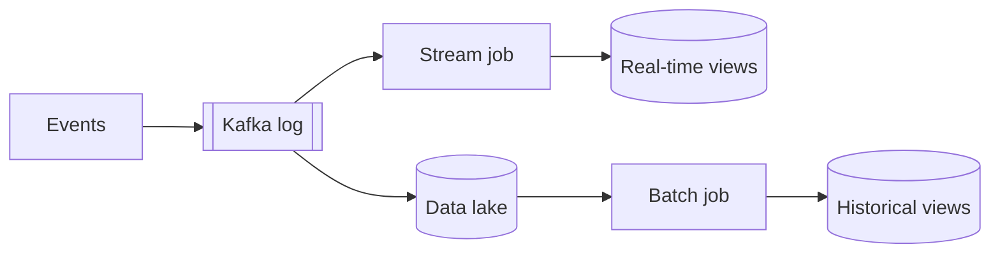

**The short version:** batch processing handles large, bounded chunks of data on a schedule, which makes it efficient and simple. Stream processing handles events continuously as they arrive, giving low latency at the cost of more complexity.

## Side by side

| | Batch | Stream |
|---|---|---|
| Input | Bounded dataset (yesterday's logs) | Unbounded flow of events |
| Latency | Minutes to hours | Milliseconds to seconds |
| Throughput efficiency | Very high | High |
| Complexity | Lower: rerun the job | Higher: state, windows, late events, exactly-once |
| Correctness model | Sees all data before computing | Must handle out-of-order and late data |
| Failure recovery | Re-run the job | Checkpoints, replay from offsets |
| Tools | Spark, Hadoop MapReduce, SQL warehouses, Airflow | Kafka Streams, Flink, Spark Structured Streaming, Kinesis |

## Choose batch for

- Daily/hourly reports, billing runs, payroll.
- Training ML models, rebuilding recommendation indexes.
- Large backfills and data migrations.
- Anything where results an hour later are fine and simplicity or cost matters.

> [!REAL] Monthly salary processing
> Salaries, monthly bank statements and nightly reports are batch: process everything at once on a schedule.

## Choose stream for

- Fraud detection during a transaction.
- Real-time dashboards, monitoring and alerting.
- Trending topics, live leaderboards.
- Updating search indexes, caches and feeds within seconds.
- IoT and sensor reactions.

> [!REAL] Card fraud alerts
> "Was that card swipe in Delhi and then Dubai within 10 minutes?" must be answered in seconds, not tomorrow morning. That's streaming.

## Stream-processing concepts you should know

- **Windows:** group an infinite stream into finite chunks.
  - *Tumbling:* fixed, non-overlapping (every 1 minute).
  - *Sliding/hopping:* fixed size, overlapping (last 5 minutes, every 1 minute).
  - *Session:* activity separated by gaps of inactivity.
- **Event time vs processing time:** when the event happened vs when you processed it. Mobile events can arrive minutes late.
- **Watermarks:** the processor's estimate that "all events up to time T have probably arrived", which decides when to close a window. Allowed lateness handles stragglers.
- **State:** counts and joins need state, kept locally and checkpointed (Flink) or backed by changelog topics (Kafka Streams).
- **Exactly-once:** via checkpoints and transactional sinks.

> [!REAL] Late-arriving letters
> A letter posted on the 31st may arrive on the 2nd. Event time vs processing time and watermarks decide which month that letter counts towards.

## Architectures that combine them

### Lambda architecture
Run a **batch layer** (accurate, complete, slow) and a **speed layer** (fast, approximate) side by side, and merge their results at query time.
- Pro: accurate history plus fresh data.
- Con: two codebases for the same logic, which drift apart.

### Kappa architecture
**Only streaming.** Keep the raw events in a durable log (Kafka with long retention); to recompute history, replay the log through a new version of the stream job.
- Pro: one codebase.
- Con: replaying large histories can be slow and costly; requires mature streaming infrastructure.

Many companies use a pragmatic mix: streaming for freshness, periodic batch jobs for reconciliation and heavy analytics.

> [!INTERVIEW] Match latency to need
> "Card transactions are scored for fraud in a Flink job within 100 ms, using a 10-minute sliding window of the card's activity. Merchant settlement and monthly statements run as nightly batch jobs over the warehouse, because they need complete, reconciled data rather than speed."

## Key takeaways

- Batch: bounded data, scheduled, simple, efficient, slow.
- Stream: unbounded data, continuous, fast, more complex.
- Learn windows, event time, watermarks and state for streaming questions.
- Lambda runs both; Kappa streams everything and replays for history.
