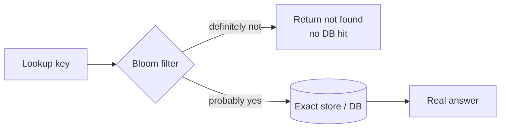

**The short version:** a hash table answers "is X in the set?" exactly, but stores every element. A Bloom filter answers "**definitely not** in the set" or "**probably** in the set" using a tiny fraction of the memory. It can have false positives, but never false negatives.

## How a Bloom filter works

A Bloom filter is a bit array of size **m**, all zeros, plus **k** independent hash functions.

- **Add X:** compute the k hashes of X and set those k bits to 1.
- **Check Y:** compute the k hashes of Y. If **any** bit is 0, Y was **definitely never added**. If all are 1, Y was **probably** added (the bits might have been set by other elements).

```text
m = 16 bits, k = 3
add "alice" → bits 2, 7, 11 set
add "bob"   → bits 4, 7, 14 set

check "carol" → bits 2, 9, 14 → bit 9 is 0 → definitely not present
check "dave"  → bits 4, 11, 2 → all 1 → "probably present" (false positive!)
```

> [!REAL] The bouncer's quick memory
> The bouncer can't remember every guest, but he remembers some features. If a face doesn't match any he's seen, he's *sure* the person isn't on the list. If it does match, he checks the full list. "Definitely not" or "maybe", never a false "no".

### Tuning
For n elements and a target false-positive rate p:
- bits needed: `m ≈ −n · ln(p) / (ln 2)²`
- best number of hashes: `k ≈ (m/n) · ln 2`

Rule of thumb: **~10 bits per element gives ~1% false positives**; ~15 bits gives ~0.1%. A billion URLs at 1% ≈ 1.2 GB, compared with tens of GB to store the URLs themselves.

### Limits
- **No deletions** in a standard Bloom filter (clearing a bit could remove other elements). **Counting Bloom filters** use small counters instead of bits to allow deletes; **cuckoo filters** also support deletion with good space efficiency.
- You can't list the elements or retrieve values.
- The false-positive rate rises as you add more elements than planned.

## Side by side

| | Hash table / hash set | Bloom filter |
|---|---|---|
| Answer | Exact yes/no (and can store values) | "No" for sure, or "probably yes" |
| False positives | None | Yes, tunable |
| False negatives | None | None |
| Memory | Stores every key (plus overhead) | ~10 bits per element for 1% FP |
| Deletion | Yes | No (counting variants: yes) |
| Retrieve values / iterate | Yes | No |
| Lookup cost | O(1) average | O(k) |

## Where Bloom filters shine

- **Avoiding expensive lookups for things that don't exist:**
  - LSM-tree databases (Cassandra, RocksDB, HBase) keep a Bloom filter per SSTable so reads skip files that can't contain the key. See [How Databases Store Data on Disk](#/l/03-databases/storage-engines).
  - Caches use one to block **cache penetration** (requests for non-existent IDs). See [Stampedes, Penetration & Hot Keys](#/l/04-caching/challenges).
- **"Have we seen this before?" at huge scale:** a web crawler checking whether a URL was already visited; detecting already-recommended articles; checking weak/breached passwords client-side.
- **Distributed joins:** send a compact filter of keys to another node so it only ships matching rows.
- **CDNs and "one-hit wonders":** cache an object only on its second request, using a Bloom filter to remember first requests and avoid filling the cache with items requested once.

> [!REAL] "Username already taken?"
> When you type a new username, a Bloom filter can instantly say "definitely available" for most names without hitting the database. Cassandra and similar databases use Bloom filters to skip files that can't contain a key.

## When to use a hash table instead

- You need exact answers (usernames taken, payment already processed, idempotency keys).
- You need to store values, delete items or iterate.
- The set is small enough that memory doesn't matter.

A common combination: Bloom filter first (cheap, in memory), then confirm "probably yes" answers against the exact store.



> [!INTERVIEW] Web crawler example
> "Checking 'have we crawled this URL?' across 10 billion URLs exactly would need hundreds of GB. A Bloom filter at 1% false positives needs about 12 GB and fits in memory. A false positive just means we occasionally skip a page we hadn't actually crawled, which is acceptable here."

## Key takeaways

- Bloom filters trade exactness for huge memory savings: false positives possible, false negatives impossible.
- ~10 bits per element ≈ 1% false-positive rate; standard filters can't delete.
- Use them to skip expensive lookups for absent items and for "seen before?" checks at scale.
- Use hash tables when you need exact answers, values, deletion or iteration.
