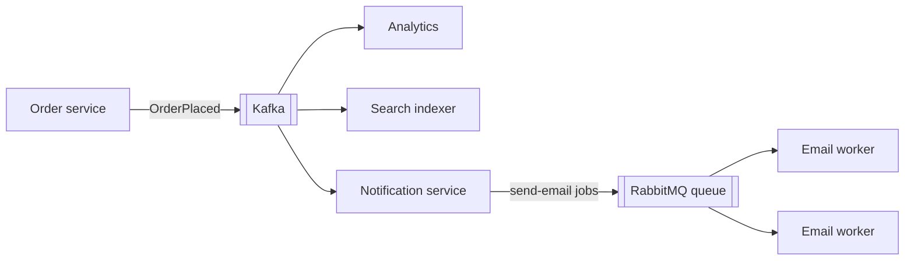

**The short version:** Kafka is a distributed, durable **log** built for high-throughput event streams, replay and many independent consumers. RabbitMQ is a **message broker** built for flexible routing and per-message work distribution. Both can do the other's job in a pinch, but each shines in its own lane.

## Side by side

| | Kafka | RabbitMQ |
|---|---|---|
| Model | Partitioned append-only log | Queues fed by exchanges |
| After consumption | Messages retained (time/size/compaction) | Message removed once acknowledged |
| Replay | Yes: reset offsets | No (except RabbitMQ Streams) |
| Consumers | Pull; each group tracks its own offset | Push (prefetch); competing consumers on a queue |
| Ordering | Per partition | Per queue (single consumer); weaker with many consumers |
| Routing | Topic + key → partition | Rich: direct, topic (wildcards), fanout, headers exchanges |
| Throughput | Very high (millions/s per cluster) | High (tens of thousands/s per node, more with clusters) |
| Latency | Low, batching-friendly | Very low per message |
| Per-message features | Basic | Priorities, TTLs, delayed messages (plugin), dead-lettering, per-message ack/requeue |
| Scaling consumers | Up to the partition count per group | Add consumers to a queue freely |
| Protocols | Kafka protocol | AMQP 0-9-1, MQTT, STOMP |
| Ecosystem | Connect, Streams, ksqlDB, Schema Registry | Plugins, management UI, shovel/federation |

## Choose Kafka when

- **Event streaming at high volume:** clickstreams, logs, metrics, IoT, CDC.
- **Many independent consumers** need the same events (analytics, search, billing), each at its own pace.
- You need **replay**: rebuild a read model, backfill a new service, reprocess after a bug.
- **Stream processing** with joins, windows and state (Kafka Streams, Flink).
- Event sourcing or a durable "source of truth" event log.

## Choose RabbitMQ when

- **Task/work queues:** distribute jobs among workers with per-message acknowledgement, retries and requeueing.
- **Complex routing:** route by pattern (`orders.*.india`), headers or fan out to specific queues.
- **Per-message priorities, TTLs, delays** and dead-letter exchanges out of the box.
- **Request/reply (RPC) over messaging.**
- Lower volume, latency-sensitive messaging where retention and replay aren't needed.
- Integration with protocols such as MQTT or STOMP.

## Common mistakes

- Using Kafka as a job queue with long, uneven tasks: a slow message blocks its partition, and parallelism is capped by partitions. (Kafka's newer "share groups"/queue semantics narrow this gap.)
- Using RabbitMQ as a long-term event store: queues grow huge, and there's no replay for new consumers.
- Picking Kafka for 100 messages a minute because it's popular; the operational cost isn't justified.

## Using both

Many architectures use **Kafka for domain events and data pipelines** and **RabbitMQ (or SQS) for task queues** inside individual services.

> [!INTERVIEW] Justify with the access pattern
> "Order events go to Kafka because several services consume them independently and we want to replay history into new services. Inside the notification service, individual email and SMS sends are jobs in RabbitMQ: per-message acks, retries with a delay exchange and a dead-letter queue are exactly what that needs."

## Key takeaways

- Kafka: retained, replayable, partitioned log for high-throughput streams and many consumer groups.
- RabbitMQ: flexible routing and per-message work distribution with rich queue features.
- Pick by access pattern: event streaming and replay vs task queues and routing.
- Using both in one architecture is common and sensible.
