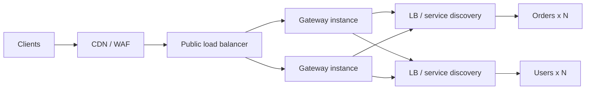

**The short version:** a load balancer spreads traffic across instances of a service. An API gateway is the front door to many services and handles API concerns such as authentication, rate limiting and routing. Large systems use both, usually gateway behind or alongside load balancers.

## Side by side

| | Load balancer | API gateway |
|---|---|---|
| Main job | Distribute traffic, remove unhealthy instances | Manage APIs: route, secure, shape and observe requests |
| Layer | L4 or L7 | L7 (HTTP/gRPC) |
| Routing | Across identical instances (some path/host rules at L7) | Across many different services by path, method, version, header |
| Authentication | Rarely | Yes: tokens, API keys, OAuth/OIDC |
| Rate limiting & quotas | Basic, if any | Per client, plan, endpoint |
| Request transformation | Minimal | Header/body rewriting, protocol translation (REST ↔ gRPC), aggregation |
| API management | No | Keys, usage plans, developer portal, analytics |
| Performance overhead | Very low | Higher (more logic per request) |
| Examples | AWS NLB/ALB, HAProxy, NGINX | Kong, Apigee, AWS API Gateway, Envoy-based gateways, Spring Cloud Gateway |

## What an API gateway adds

- **Single entry point** that hides the internal service layout from clients.
- **Authentication and coarse authorisation** (validate JWT, check scopes) before traffic reaches services.
- **Rate limiting, quotas and usage plans** per API key or tenant.
- **Routing and versioning:** `/v1/orders → order-service`, `/v2/orders → order-service-v2`, canary splits.
- **Request/response transformation** and protocol bridging.
- **Aggregation:** one client call fans out to several services (BFF-style).
- **Observability:** consistent access logs, metrics and trace headers for every API.
- **Caching** of responses for cacheable endpoints.

## Typical placement

- A **load balancer in front of the gateway** spreads traffic across gateway instances (the gateway itself must scale and be redundant).
- **Behind the gateway**, each service's instances are balanced by internal load balancers, client-side balancing or a service mesh.

## Pitfalls

- **Gateway as a bottleneck or SPOF:** run several instances, autoscale, keep its logic light.
- **Business logic creep:** the gateway should not decide order pricing. Keep domain logic in services.
- **Only-gateway authorisation:** services must still check object-level permissions.
- **Extra latency:** every plugin adds work; measure it.

## When you don't need a gateway

A single service or a monolith with a handful of endpoints can do fine with a load balancer plus middleware in the application. Add a gateway when you have many services, external API consumers, or cross-cutting concerns repeated in every service.

> [!INTERVIEW] One-liner
> "The load balancer answers 'which instance?'; the gateway answers 'which service, is this caller allowed, and how much can they do?'. We use both: a cloud L7 balancer in front of a horizontally scaled gateway, which routes to services balanced via service discovery."

## Key takeaways

- Load balancers distribute traffic among instances; gateways manage APIs across services.
- Gateways centralise auth, rate limiting, routing, transformation and API analytics.
- Use a load balancer in front of the gateway and inside the service layer.
- Keep gateways thin and redundant; don't put business logic in them.
