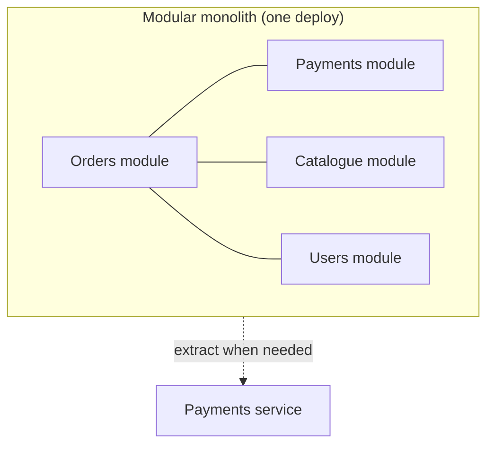

**The short version:** a monolith is one deployable application. It's simple to build, test and run, but harder to scale organisationally as it grows. Microservices split the system into independently deployable services, which helps large teams move independently at the cost of distributed-systems complexity.

## Side by side

| | Monolith | Microservices |
|---|---|---|
| Deployment | One unit | Many independent units |
| Development speed (small team) | Fast | Slower: more plumbing |
| Development speed (many teams) | Slows: coordination, merge conflicts, shared releases | Teams ship independently |
| Scaling | Scale the whole app | Scale each service separately |
| Data | One shared database, easy transactions | Database per service; sagas and events for consistency |
| Calls between parts | In-process function calls | Network calls: latency, failures, retries |
| Testing | Simpler end-to-end | Contract tests, harder integration |
| Operations | One thing to monitor | Service discovery, tracing, many pipelines |
| Failure isolation | One bug can crash everything | Failures can be contained (with bulkheads/circuit breakers) |
| Technology choice | One stack | Per service (use sparingly) |

## Why microservices exist

They are mainly a solution to an **organisational** problem: letting many teams work and release independently without stepping on each other (Conway's Law: systems mirror the communication structure of the organisations that build them). Technical benefits such as independent scaling and fault isolation are real but secondary for most companies.

## The costs people underestimate

- **Network unreliability:** every call can be slow or fail; you need timeouts, retries, circuit breakers.
- **Distributed data:** no joins across services; no ACID transactions across them; sagas, outboxes and eventual consistency instead.
- **Observability:** distributed tracing becomes mandatory.
- **Operational overhead:** CI/CD per service, versioned APIs, service discovery, security between services.
- **The distributed monolith trap:** services that must be deployed together, share a database or call each other synchronously in long chains have all the costs and none of the benefits.

## The modular monolith: often the best start

A single deployable application with **strong internal module boundaries**: each module owns its data (separate schemas), exposes an internal API and hides its internals. You get monolith simplicity now, and the option to extract a module into a service later when there's a real reason.

## When to move to microservices

- Several teams are blocked by each other's releases.
- Parts of the system have very different scaling or reliability needs (e.g. a search or media pipeline vs an admin backend).
- A component needs different technology or isolation (compliance, PCI scope for payments).
- You have the platform maturity: automated deploys, monitoring, tracing, on-call.

Extract services **along domain boundaries** (bounded contexts), one at a time, typically with the **strangler fig** pattern, and give each its own data.

> [!INTERVIEW] Avoid dogma
> "For a new product with one team I'd build a modular monolith with clear module boundaries and separate schemas. We'd extract a service only when a module needs independent scaling, a separate team, or isolation. Payments might come first for PCI scope. Going microservices on day one would mostly buy us network failures and operational load."

## Key takeaways

- Monoliths are simpler and faster for small teams; microservices help many teams ship independently.
- Microservices bring network failures, distributed data and operational cost.
- A modular monolith keeps options open.
- Split along domain boundaries, one service at a time, when there's a concrete reason.
