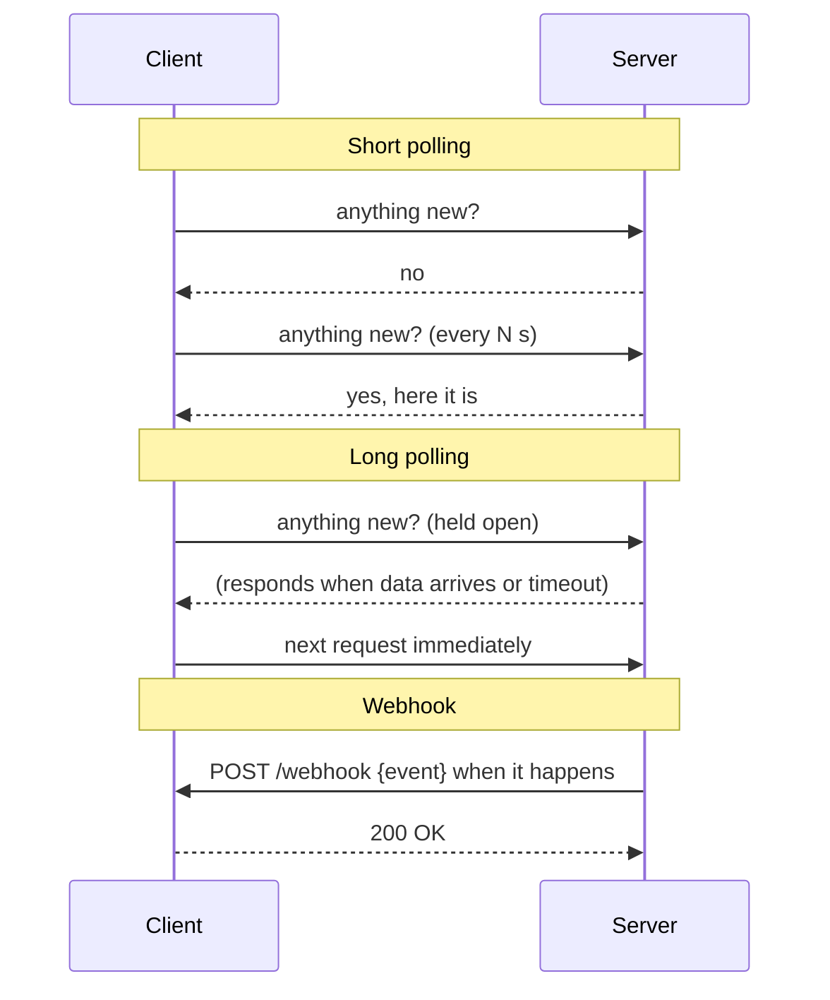

**The short version:** short polling asks "anything new?" on a timer, which is simple and wasteful. Long polling holds the question open until there's an answer, which is near-real-time over plain HTTP. Webhooks have the other side call you when something happens: efficient and real-time, but you need a reachable, secure endpoint and must handle retries.

## How each works

> [!REAL] Checking for a parcel vs a doorbell
> Polling is opening the door every 10 minutes to see if the parcel has arrived. A webhook is the doorbell: the courier tells you when it's there.

## Side by side

| | Short polling | Long polling | Webhooks |
|---|---|---|---|
| Who initiates | Client, on a timer | Client, held by server | Server (provider) calls you |
| Latency | Up to the interval | Near real-time | Near real-time |
| Wasted requests | Many empty responses | Few | None |
| Server resources | Many short requests | Many open connections | One request per event |
| Receiver must be reachable | No | No | Yes: a public HTTPS endpoint |
| Reliability concerns | Simple: just ask again | Reconnect handling | Retries, ordering, duplicates, signature checks |
| Typical use | Simple dashboards, rare updates, behind firewalls | Browser notifications fallback, chat fallback | Payment provider events, Git pushes, SaaS integrations |

## Choose short polling when

- Updates are infrequent and a delay of the polling interval is fine.
- Simplicity matters most, or the client can't receive inbound calls.
- You're polling a job's status for a short time (`GET /exports/77` every 2 s).

Use backoff (poll less often when nothing changes) and conditional requests (`ETag`/`If-None-Match`) to cut waste.

## Choose long polling when

- You need near-real-time updates in a browser, but WebSockets/SSE aren't available.
- Volume is moderate; the server can handle many idle open requests (async I/O).

## Choose webhooks when

- Integrating **between servers**: payment confirmations, shipment updates, repository events.
- Events are relatively rare and polling for them would waste a lot.

### Building a robust webhook receiver
- **Verify signatures** (HMAC of the body with a shared secret, plus a timestamp to block replays).
- **Respond fast** (`200` within a second or two), then process asynchronously via a queue.
- **Be idempotent:** providers retry, so dedupe by event ID.
- **Don't assume order:** check event timestamps or fetch the current state from the provider's API.
- **Reconcile:** periodically poll the provider's API for anything you missed (webhooks can be lost).

> [!REAL] Signing for the parcel
> Check the courier's ID (verify the signature), sign quickly (return 200 fast and process later), and don't panic if the same parcel is delivered twice (handle duplicates idempotently).

### Sending webhooks well (if you're the provider)
- Retries with exponential backoff for hours or days; a dashboard showing delivery attempts; a way for customers to replay events; signatures; event IDs; versioned payloads.

## Beyond these three

For browser real-time updates, **SSE** or **WebSockets** usually beat long polling. For server-to-server streams of many events, consider a shared message broker or event streaming instead of webhooks. See [Protocols & Communication Patterns](#/l/07-api-design/protocols).

> [!INTERVIEW] Combine push with a safety net
> "We receive payment status via the provider's webhooks: signature verified, acknowledged immediately, processed from a queue idempotently by event ID. Because webhooks can be delayed or lost, a reconciliation job polls the provider for any payment still pending after 10 minutes."

## Key takeaways

- Short polling: simple, wasteful, delayed by the interval.
- Long polling: near-real-time over HTTP, at the cost of open connections.
- Webhooks: efficient server-to-server push; verify, ack fast, process idempotently, reconcile.
- Use SSE/WebSockets for browser real-time; brokers for high-volume event streams.
